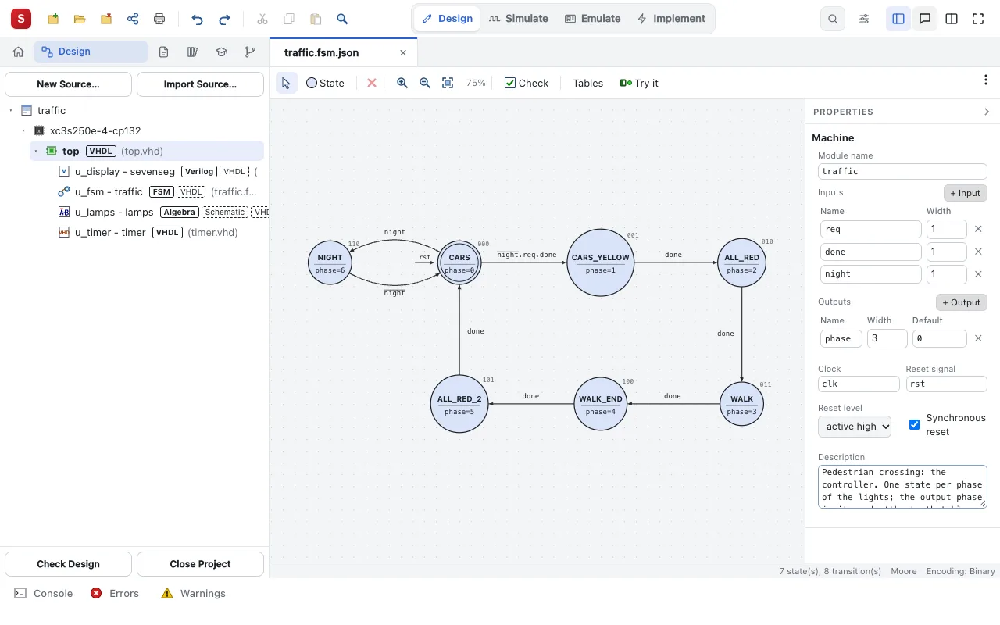
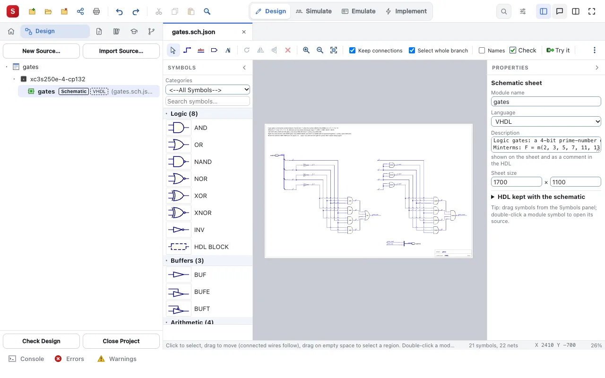
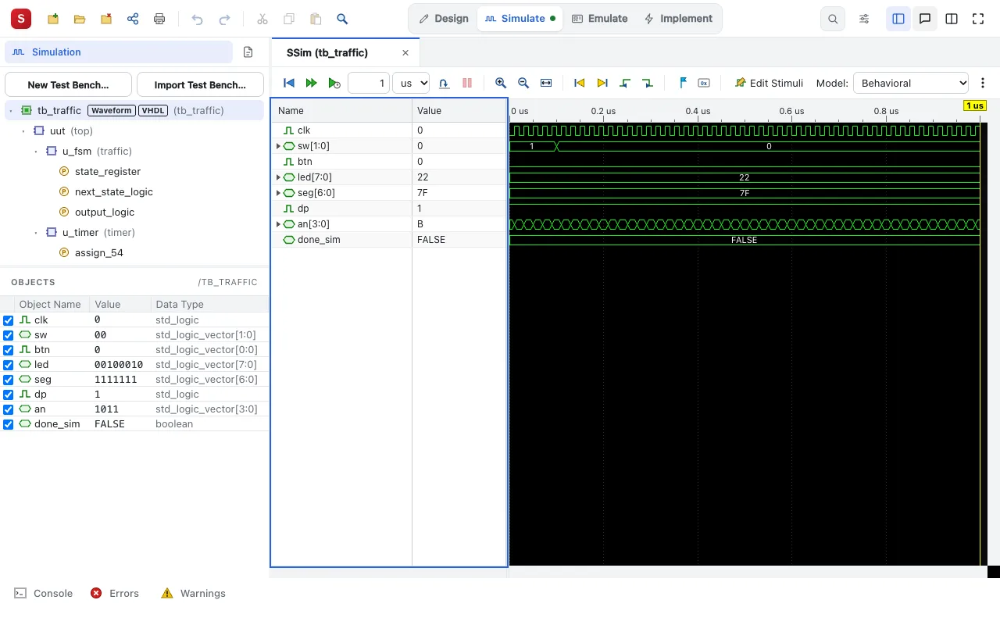
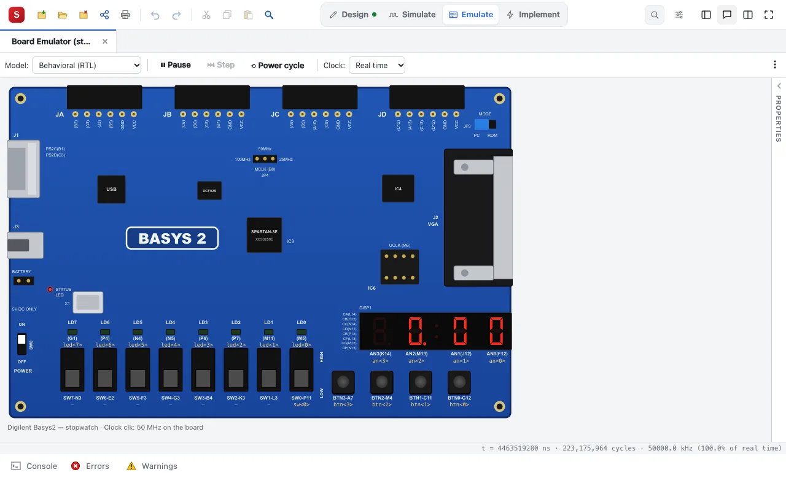
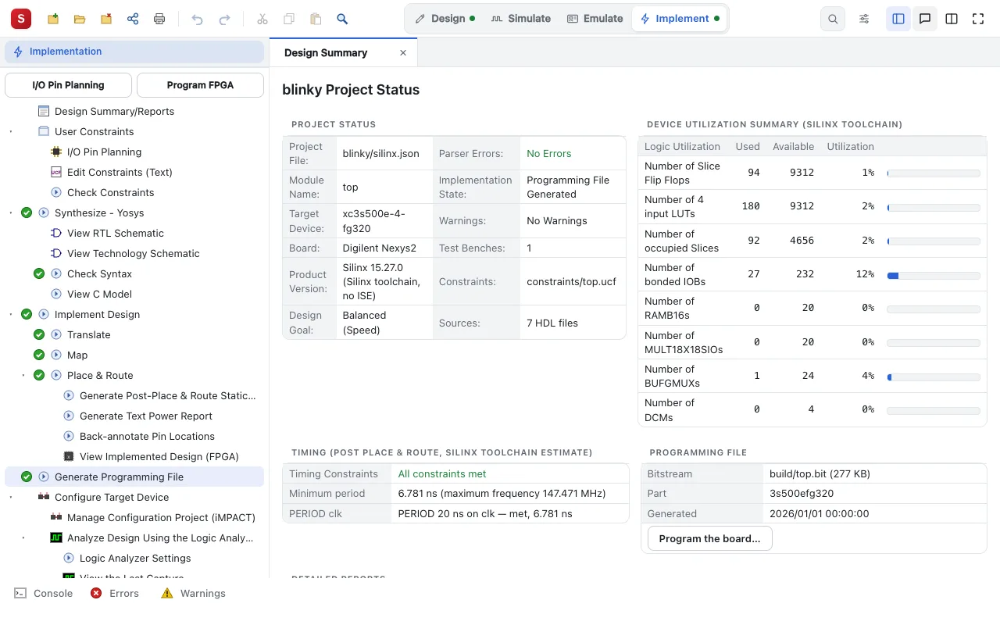
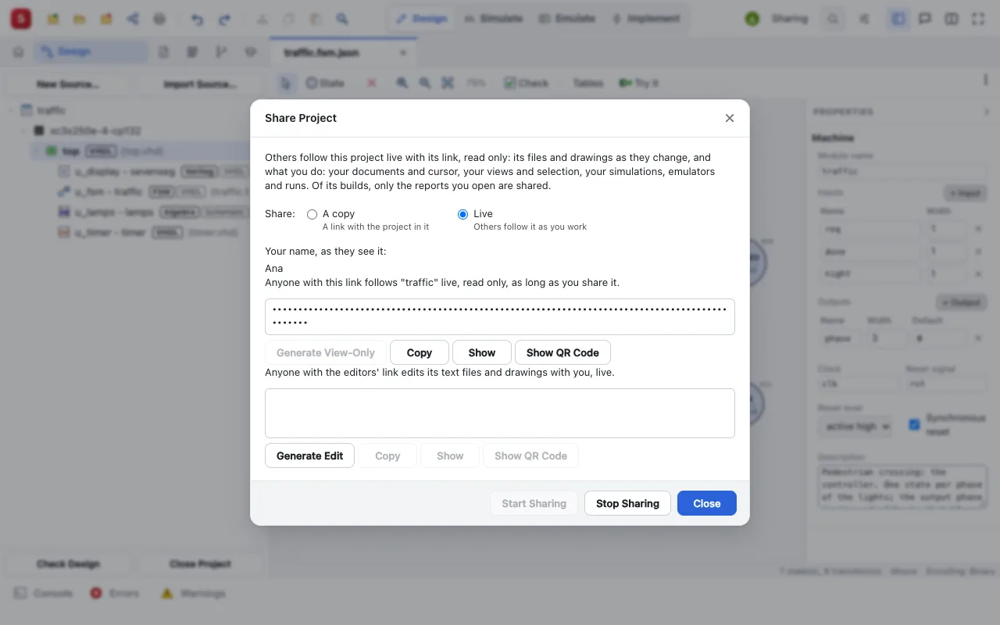
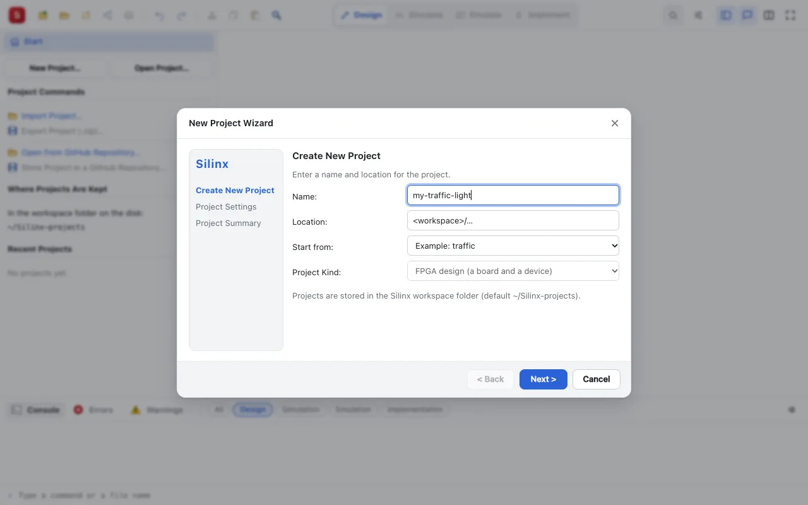
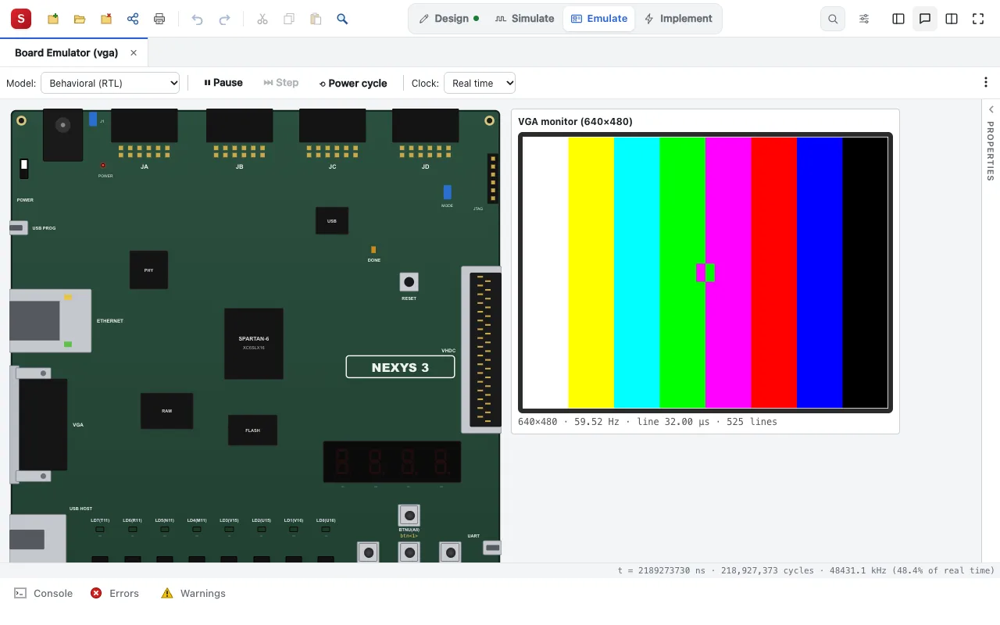
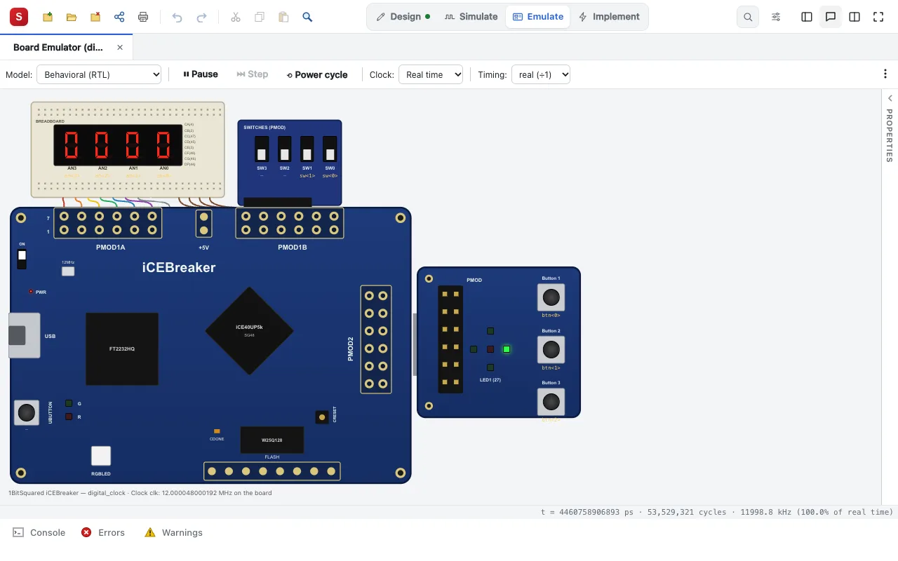
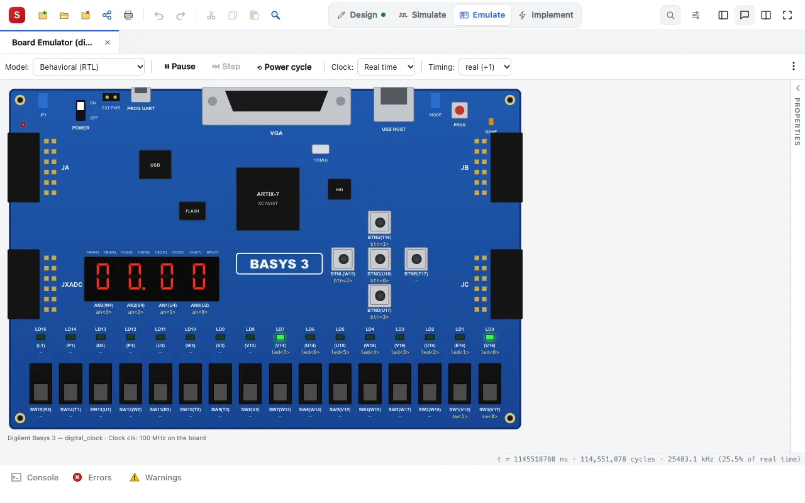

# Silinx

**An FPGA design environment for teaching digital systems, in the browser.** Write VHDL or Verilog, or draw
schematics, state machines, ASM charts, truth tables and breadboard circuits; simulate them; try them on an emulated
board; and build them for a real one, with Silinx's own open toolchain. Nothing to install.

**[▶ Try it in the browser](https://pmnmalo.github.io/Silinx/)** · [Install it](docs/user/en/getting-started.md) ·
[User's guide](docs/user/en/README.md) · [Português](README.pt.md)

## What it does

<table>
<tr>
<td width="50%">
<b>Design your way.</b> VHDL and Verilog with live errors explained for beginners, schematics, state diagrams, ASM
charts, Boolean algebra and Karnaugh maps, Petri nets, even C. Every drawing generates its HDL.</td>
<td width="50%">
<b>Simulate.</b> Silinx's own simulator runs VHDL and Verilog in the browser: test benches made by a wizard or drawn
on the waveforms, any instance's signals added, cursors and markers. Try it steps a drawing as you click.</td>
</tr>
<tr>
<td>
<b>Try it on an emulated board.</b> The design runs on a picture of the board: press its buttons, flip its switches,
watch its LEDs, displays and VGA screen.</td>
<td>
<b>Build for a real board.</b> Synthesis, place and route and the bitstream with Silinx's open toolchain, and the
board programmed over USB, from the browser.</td>
</tr>
<tr>
<td>
<b>Collaboration.</b> Share a project live: others follow it read only, or edit it with you, peer to peer or through
<a href="docs/user/en/live-relay.md">a free relay of your own</a>. A design in a link for the slides, a project on
GitHub, a group's copies merged back.</td>
<td>
<b>Classroom ready.</b> Examples from the first gates to a microprocessor, guided labs checked step by step, exercises
graded automatically, GitHub Classroom assignments.</td>
</tr>
</table>

## Boards

The Silinx toolchain builds for the **Basys2**, **Nexys2**, **Nexys3**, **Atlys**, **iCEBreaker**, **ULX3S**, **Tang Nano 9K**
and **GateMate evaluation** boards (and the 7-series' Basys 3 and Nexys A7, an experimental family) with nothing else installed; Xilinx
ISE 14.7 and AMD Vivado, which you install yourself, add the other boards (Vivado: the Arty S7 and Zybo Z7 too). A design and simulation project needs no board
at all. [Boards and toolchains](docs/user/en/boards.md)

| Basys2 (Spartan-3E) | Nexys3 (Spartan-6) |
|---|---|
|  |  |
| **iCEBreaker (iCE40)** | **Basys 3 (7-series)** |
|  |  |

## Try it

- **In the browser:** open **https://pmnmalo.github.io/Silinx/**, click *New Project…* and start from an example.
  Your projects stay in your browser. Nothing to install, and it works on a tablet too (on a phone: to read,
  simulate and emulate).
- **Synthesis and bitstreams need no Xilinx tool** for the **Basys2-100 / 250, Nexys2-500 / 1200, Nexys3, Atlys,
  iCEBreaker, ULX3S, Tang Nano 9K and GateMate evaluation board** (and the Basys 3 and Nexys A7, an experimental family): the
  *Silinx toolchain (no ISE)*, the default mode, synthesizes (Yosys), places and routes (nextpnr) and writes the bitstream, in the
  browser or locally.
- **On your computer:** download `silinx-<version>.zip` from the
  [latest release](https://github.com/pmnmalo/Silinx/releases/latest), unzip it and start it with Node.js: your
  projects as folders, offline, with Xilinx ISE 14.7 or AMD Vivado for the other boards.

Step by step: [Getting started](docs/user/en/getting-started.md) · [Começar a usar o Silinx](docs/user/pt/getting-started.md)

## Documentation

- **[The user's guide](docs/user/en/README.md)** (also [on the site](https://pmnmalo.github.io/Silinx/docs/)): [what Silinx is](docs/user/en/what-is-silinx.md),
  [getting started](docs/user/en/getting-started.md), [designing](docs/user/en/designing.md),
  [circuits](docs/user/en/circuits.md), [simulating](docs/user/en/simulating.md),
  [the Board Emulator](docs/user/en/emulator.md), [boards and toolchains](docs/user/en/boards.md),
  [teaching](docs/user/en/teaching.md), [AI assistants](docs/user/en/ai-mcp.md), [questions](docs/user/en/faq.md).
- **Reference**: [every feature](docs/user/en/features.md), [the toolchains](docs/user/en/toolchains.md),
  [the changes of each version](CHANGELOG.md).
- **Changing Silinx**: [CONTRIBUTING.md](CONTRIBUTING.md), [developing Silinx](docs/DEVELOPMENT.md),
  [the architecture](docs/ARCHITECTURE.md), [the toolchain](docs/TOOLCHAIN.md), [the history](docs/HISTORY.md),
  [every developer's document](docs/README.md#for-those-who-change-silinx).
  Security: [SECURITY.md](SECURITY.md).

Using Silinx in a course, a school or on your own? Tell us on
[GitHub Discussions](https://github.com/pmnmalo/Silinx/discussions/151).

## About

Silinx is an independent open-source project. It is not affiliated with, endorsed by or supported by AMD/Xilinx.
Xilinx, ISE, ISim, iMPACT, Spartan and Virtex are trademarks of AMD. ISE and Vivado, where you use them, are
installed by you. Silinx was made to teach digital systems after AMD/Xilinx discontinued ISE; who started it and why:
[the history of Silinx](docs/HISTORY.md).

*About the name:* Silinx = **SI** + **linx**. SI stands for *Super Intelligence*: the tool was generated by an AI.
*linx* stands for the programmable links of an FPGA, the interconnect that wires its logic blocks together.

## Licence

Silinx is Copyright 2026 Pedro Maló and is free software, licensed under the
[GNU Affero General Public License v3.0](LICENSE) (AGPL-3.0-only), with an additional permission
to combine it with elkjs (EPL-2.0) — see [NOTICE](NOTICE). Modified versions, including ones offered
to users over a network, must make their source code available under the same licence. Your
designs, and the HDL Silinx generates for them, are yours: the licence does not cover them.

Silinx includes open-source components under their own licences: CodeMirror (MIT), Express and
its dependencies (MIT, ISC, BSD-3-Clause), Yosys (YoWASP, ISC), a port of adepttool (MIT) and elkjs
(EPL-2.0 or GPL-3.0-or-later). Their licence texts are in
[THIRD-PARTY-NOTICES.md](THIRD-PARTY-NOTICES.md), generated with `node scripts/third-party.mjs`
(run it again after changing the dependencies; the tests check it is up to date).
