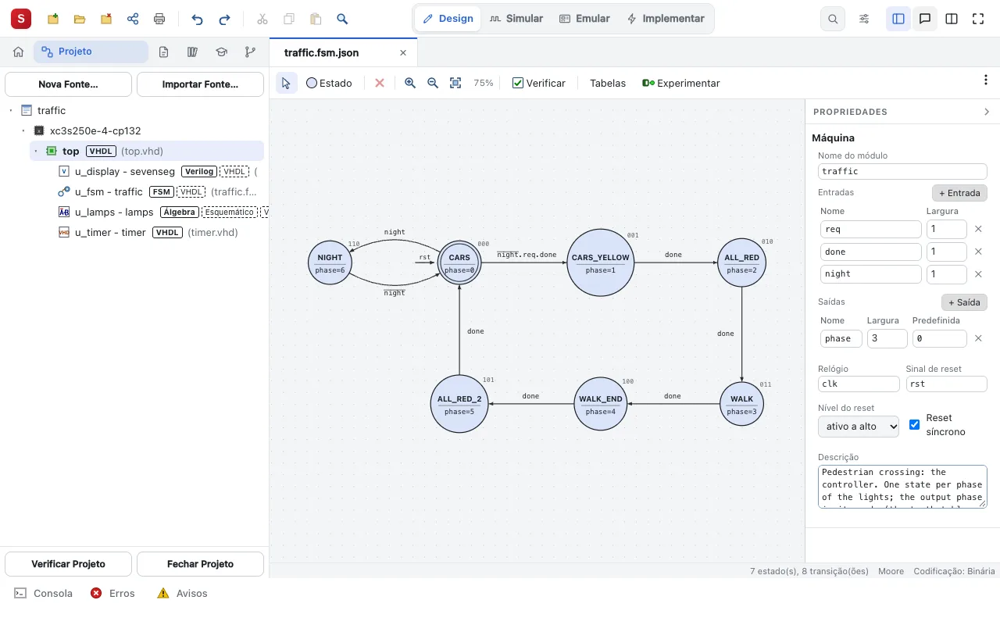
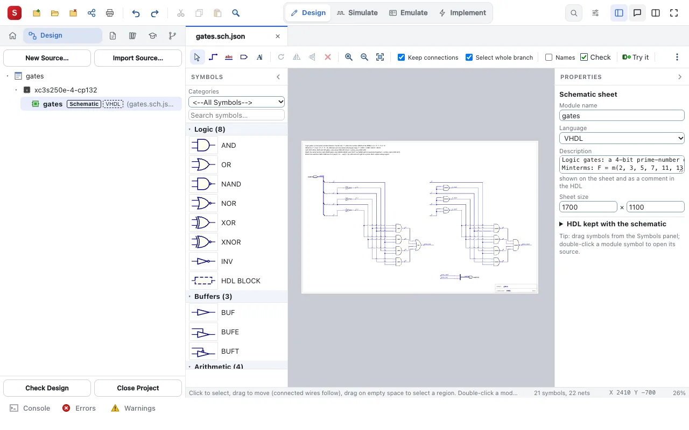
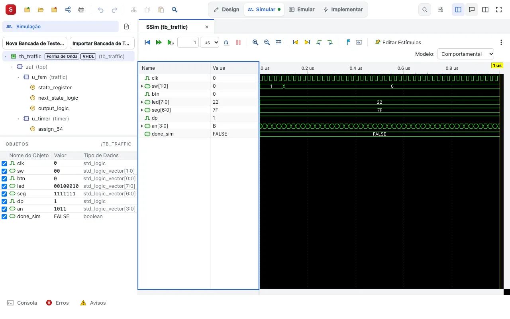
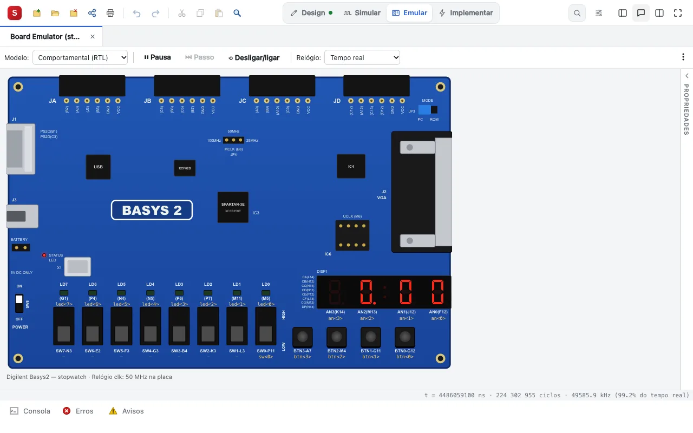
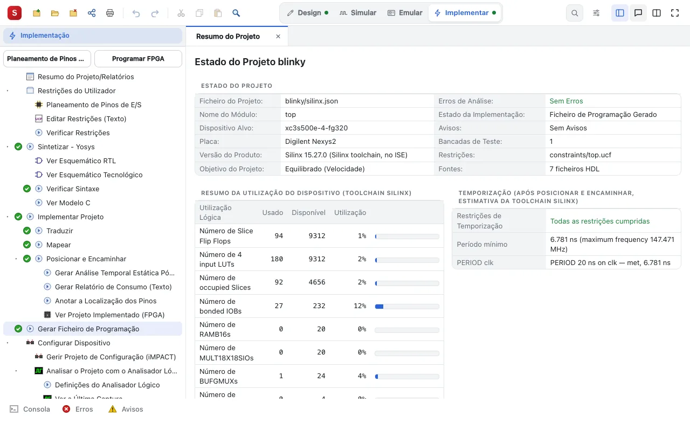
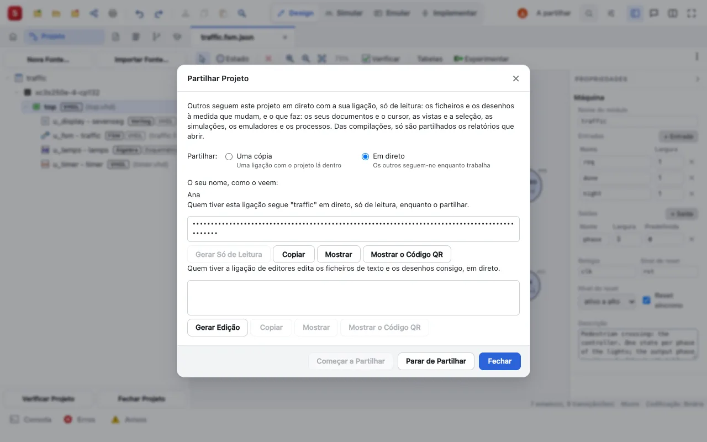
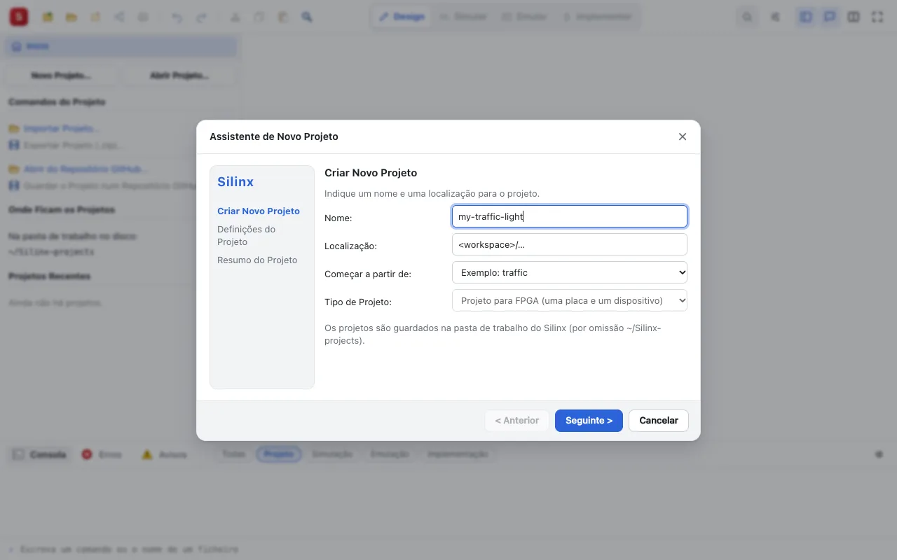
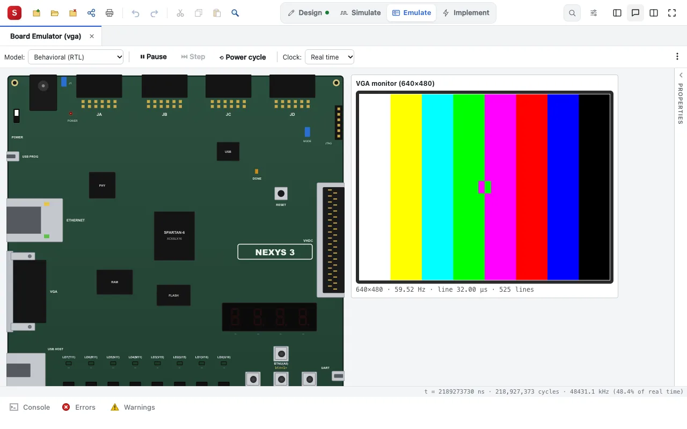
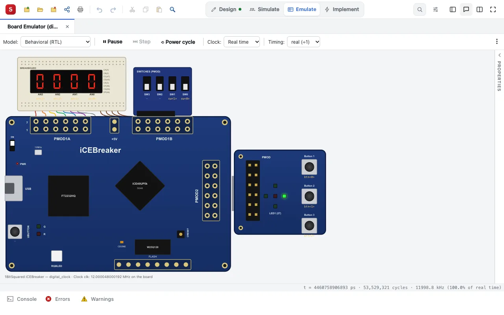
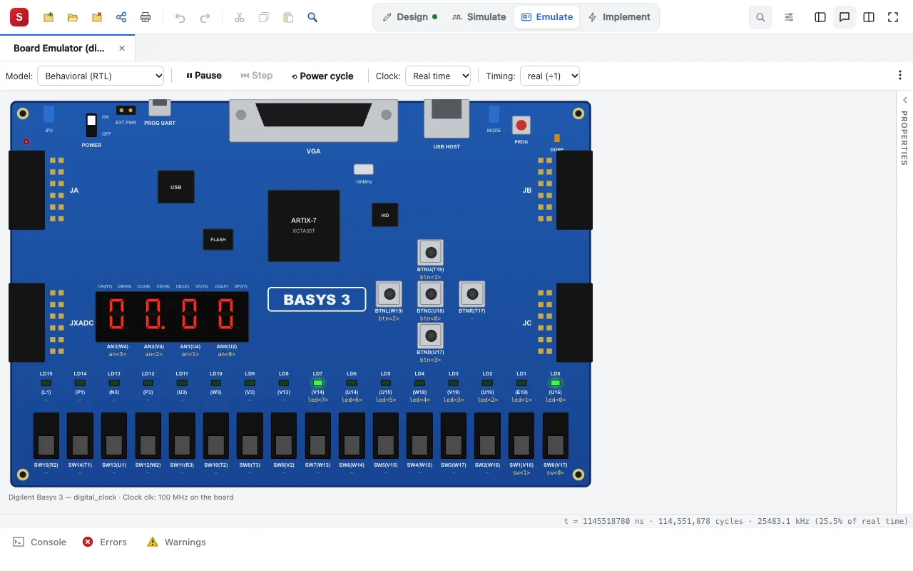

# Silinx

**Um ambiente de projeto para FPGA para ensinar sistemas digitais, no browser.** Escreva VHDL ou Verilog, ou desenhe
esquemáticos, máquinas de estados, fluxogramas ASM, tabelas de verdade e circuitos numa breadboard; simule-os;
experimente-os numa placa emulada; e implemente-os para uma placa real, com as ferramentas abertas do próprio Silinx.
Nada a instalar.

**[▶ Experimente no browser](https://pmnmalo.github.io/Silinx/)** · [Instalar](docs/user/pt/getting-started.md) ·
[Guia do utilizador](docs/user/pt/README.md) · [English](README.md)

## O que faz

<table>
<tr>
<td width="50%">
<b>Projete à sua maneira.</b> VHDL e Verilog com erros explicados para principiantes, esquemáticos, diagramas de
estados, fluxogramas ASM, álgebra de Boole e mapas de Karnaugh, redes de Petri, até C. Cada desenho gera o seu HDL.</td>
<td width="50%">
<b>Simule.</b> O simulador do próprio Silinx corre VHDL e Verilog no browser: bancadas de teste feitas por um assistente
ou desenhadas nas formas de onda, os sinais de qualquer instância, cursores e marcadores. O Experimentar avança um
desenho a cada clique.</td>
</tr>
<tr>
<td>
<b>Experimente numa placa emulada.</b> O projeto corre numa imagem da placa: carregue nos botões, mude os
interruptores, veja os LEDs, os mostradores e o ecrã VGA.</td>
<td>
<b>Implemente para uma placa real.</b> A síntese, o posicionamento e encaminhamento e o bitstream com as ferramentas
abertas do Silinx, e a placa programada por USB, a partir do browser.</td>
</tr>
<tr>
<td>
<b>Colaboração.</b> Partilhe um projeto ao vivo: os outros acompanham-no só a ver, ou editam-no consigo, diretamente ou
por <a href="docs/user/pt/live-relay.md">um relay gratuito seu</a>. Um projeto num link para os slides, um projeto no GitHub, as cópias
de um grupo juntadas de volta.</td>
<td>
<b>Pronto para a sala de aula.</b> Exemplos das primeiras portas lógicas a um microprocessador, laboratórios guiados
verificados passo a passo, exercícios avaliados automaticamente, trabalhos do GitHub Classroom.</td>
</tr>
</table>

## Placas

As ferramentas do Silinx implementam para as placas **Basys2**, **Nexys2**, **Nexys3**, **Atlys**, **iCEBreaker**,
**ULX3S**, **Tang Nano 9K** e **GateMate de avaliação** (e para a Basys 3 e a Nexys A7 da Série 7, uma família experimental) sem mais nada instalado; o
Xilinx ISE 14.7 e o AMD Vivado, que instala por si, acrescentam as outras placas (o Vivado também a Arty S7 e a Zybo Z7). Um projeto de desenho e simulação
não precisa de placa nenhuma. [Placas e ferramentas](docs/user/pt/boards.md)

| Basys2 (Spartan-3E) | Nexys3 (Spartan-6) |
|---|---|
|  |  |
| **iCEBreaker (iCE40)** | **Basys 3 (Série 7)** |
|  |  |

## Experimentar

- **No browser:** abra **https://pmnmalo.github.io/Silinx/**, clique em *Novo Projeto…* e comece a partir de um
  exemplo. Os projetos ficam no seu browser. Nada a instalar, e funciona também num tablet.
- **A síntese e o bitstream não precisam de nenhuma ferramenta da Xilinx** para a **Basys2-100 / 250,
  Nexys2-500 / 1200, Nexys3, Atlys, iCEBreaker, ULX3S, Tang Nano 9K e GateMate de avaliação**: as ferramentas do Silinx, o modo por omissão,
  sintetizam (Yosys), posicionam e encaminham (nextpnr) e escrevem o bitstream, no browser ou no seu computador.
- **No seu computador:** descarregue o `silinx-<versão>.zip` da
  [última versão](https://github.com/pmnmalo/Silinx/releases/latest), descompacte-o e arranque-o com o Node.js: os
  projetos em pastas, sem Internet, com o Xilinx ISE 14.7 ou o AMD Vivado para as outras placas.

Passo a passo: [Começar a usar o Silinx](docs/user/pt/getting-started.md)

## Documentação

- **[O guia do utilizador](docs/user/pt/README.md)** (também [no site](https://pmnmalo.github.io/Silinx/docs/pt/index.html)): [o que é o Silinx](docs/user/pt/what-is-silinx.md),
  [começar](docs/user/pt/getting-started.md), [projetar](docs/user/pt/designing.md),
  [simular](docs/user/pt/simulating.md), [o Emulador da Placa](docs/user/pt/emulator.md),
  [placas e ferramentas](docs/user/pt/boards.md), [ensinar](docs/user/pt/teaching.md),
  [assistentes de IA](docs/user/pt/ai-mcp.md), [perguntas](docs/user/pt/faq.md).
- **Para consulta** (em inglês): [todas as funcionalidades](docs/user/en/features.md),
  [as ferramentas de implementação](docs/user/en/toolchains.md), [as alterações de cada versão](CHANGELOG.md).
- **Alterar o Silinx** (em inglês): [CONTRIBUTING.md](CONTRIBUTING.md), [desenvolver o Silinx](docs/DEVELOPMENT.md),
  [a arquitetura](docs/ARCHITECTURE.md).

Usa o Silinx numa cadeira, numa escola ou sozinho? Diga-nos nas
[GitHub Discussions](https://github.com/pmnmalo/Silinx/discussions/151).

## Sobre

O Silinx é um projeto de código aberto independente. Não tem qualquer ligação à AMD/Xilinx, nem é aprovado ou
suportado por ela. Xilinx, ISE, ISim, iMPACT, Spartan e Virtex são marcas da AMD. O ISE e o Vivado, quando os usa,
são instalados por si. O Silinx foi feito para ensinar sistemas digitais depois de a AMD/Xilinx ter descontinuado o ISE;
quem o começou e porquê: [a história do Silinx](docs/HISTORY.md) (em inglês).

## Licença

O Silinx é Copyright 2026 Pedro Maló e é software livre, com a licença
[GNU Affero General Public License v3.0](LICENSE) (AGPL-3.0-only), com uma permissão adicional para o combinar com o
elkjs (EPL-2.0): veja o [NOTICE](NOTICE). Os seus projetos, e o HDL que o Silinx gera para eles, são seus: a licença
não os abrange. Os componentes de código aberto que o Silinx inclui e as suas licenças estão em
[THIRD-PARTY-NOTICES.md](THIRD-PARTY-NOTICES.md).
