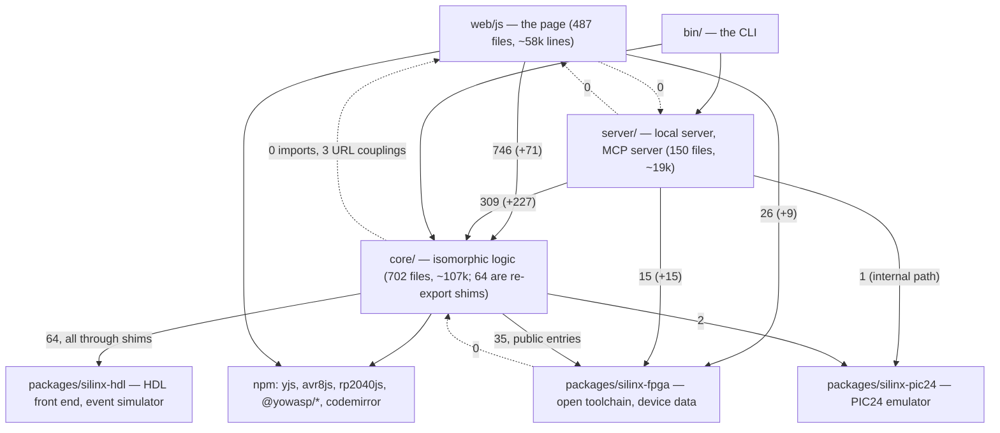
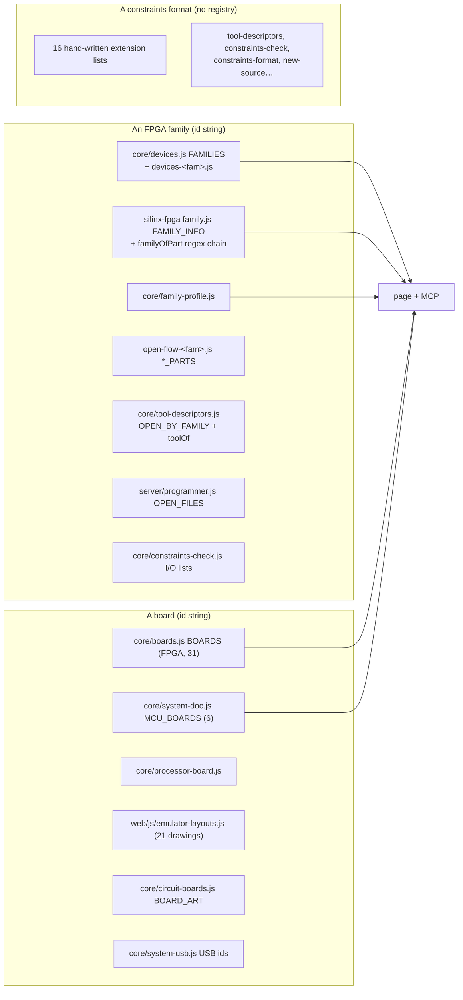
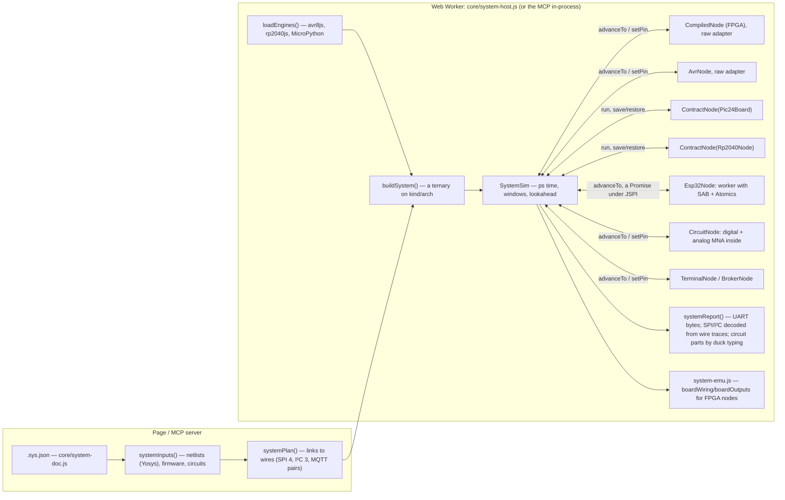
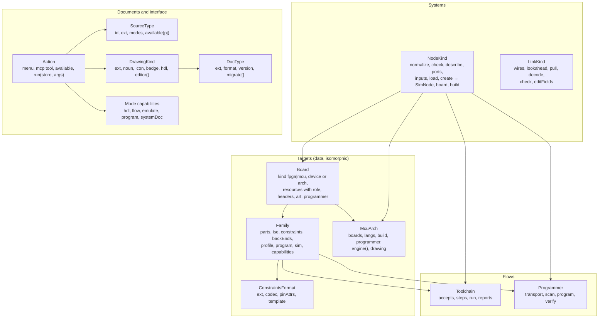

# Architecture and data-model audit (November 2026)

Audit of Silinx's system architecture, data models, models of use (experiment, simulate, emulate, program),
interface representation, scalability and performance, as they are on `main` at commit `c7e65829e`
(2026-11-27). The code was read; the documents were checked against it, not trusted. No code was changed.
The recommendations are proposals: none of them is an issue yet, and the maintainer decides which become one.

Ratings: **sound** (keep it), **needs work** (it works, but drift or a gap will cost later), **risk** (it can
lose data, it already contradicts itself, or it makes the next family or node kind expensive).

Contents:

- [Sumário executivo (Português)](#sumário-executivo)
- [Executive summary](#executive-summary)
- [1. Method](#1-method)
- [2. The current architecture](#2-the-current-architecture)
- [3. Architecture: layers and modules](#3-architecture-layers-and-modules)
- [4. Devices, boards and families](#4-devices-boards-and-families)
- [5. Data models](#5-data-models)
- [6. The models of use: experiment, simulate, emulate, program](#6-the-models-of-use-experiment-simulate-emulate-program)
- [7. The interface and its parity with the MCP server](#7-the-interface-and-its-parity-with-the-mcp-server)
- [8. Scalability: what an addition costs today](#8-scalability-what-an-addition-costs-today)
- [9. Performance](#9-performance)
- [10. Probable defects found on the way](#10-probable-defects-found-on-the-way)
- [11. Target architecture](#11-target-architecture)
- [12. Roadmap](#12-roadmap)
- [Appendix: how the measurements were taken](#appendix-how-the-measurements-were-taken)

---

## Sumário executivo

**Veredicto.** O Silinx tem bases sólidas: as camadas (`core/` isomórfico, `server/`, `web/js/`, os pacotes) estão
limpas e protegidas por testes; o pacote do toolchain tem um registo de back-ends a sério; os processos de cada
toolchain são dados (descritores) partilhados pela interface e pelo servidor MCP; o escalonador dos Sistemas é bem
desenhado (tempo global em ps, janelas conservadoras, quantum adaptativo, lookahead por protocolo); as restrições têm
um só modelo com um codec por formato; e a regra de tamanho (#405) é cumprida. **Mas o crescimento rápido deixou o
conhecimento de cada "tipo" de coisa espalhado em cadeias de `if`/ternários sobre strings**, e é aí que está o custo
de escalar.

**Os três problemas estruturais principais:**

1. **Não há um registo único por conceito.** Uma família FPGA está descrita em três registos principais
   (`core/devices.js` FAMILIES, `packages/silinx-fpga/src/family.js` FAMILY_INFO, `core/family-profile.js`) e uns seis
   satélites, com os mesmos factos repetidos e nenhum teste que os compare. Os formatos de restrições não têm registo: a
   lista `ucf|pcf|lpf|cst|ccf|xdc|qsf` está escrita à mão em 16 sítios (e um já divergiu: o Import Source não aceita
   `.xdc`). As placas têm duas formas sem relação (FPGA `BOARDS` e `MCU_BOARDS`) e cinco tabelas paralelas por id.
   **Acrescentar uma família custa hoje cerca de 70 ficheiros (não testes)**; o GateMate tocou 98.
2. **O contrato de nó dos Sistemas existe mas não é usado em produção.** `core/system-contract.js` define
   `run/save/restore/lookahead/fidelity`, mas `buildSystem` constrói os nós com um ternário sobre `kind`/`arch` e
   adaptadores crus: só 2 de 8 tipos de nó podem guardar/repor estado, e as notas de fidelidade nunca são lidas. Não há
   registo de tipos de nó: **223 condições por tipo/arquitetura em 64 ficheiros**. Um MCU novo custa 15–20 ficheiros;
   um tipo de ligação novo (CAN, 1-Wire) cerca de 10. O escalonador só conhece `wire` e `uart`.
3. **Os documentos persistidos não têm um envelope nem uma cadeia de migração comuns.** O `silinx.json` tem
   `version: 1` mas nenhum leitor o usa; o que um projeto *é* (Circuito / Placa / Sistema) está codificado de três
   maneiras (`kind`, `profile`, e `profile` + uma placa MCU). Só o esquema tem cadeia de migração (v1→v7). O índice das
   versões (`.silinx/versions`), se estragado, é lido como vazio e **o histórico perde-se em silêncio**; as gravações
   não estão sob o lock entre processos (servidor web e servidor MCP).

**Desempenho (medido barato, uma coisa de cada vez):** o arranque da página carrega de forma estática 982 módulos
(11 MiB de fonte) no servidor local; empacotado e minificado, a parte inicial são 4,9 MB (1,65 MB gzip), dois terços
do total. **O toolchain inteiro (bitgen, o placer do Gowin…) e o emulador do PIC24 entram no arranque** por imports
estáticos (p.ex. `core/family-profile.js` importa o índice do `silinx-fpga`): é a continuação natural do #5093. O
simulador por eventos corre os testbenches dos exemplos a ~1 ms simulado por segundo (~50–75 k ciclos/s a 50 MHz); o
motor compilado ~1000× mais. Num Sistema com dois FPGAs compilados e UART nos dois sentidos, o escalonador custa
10–60 % com as ligações paradas e 3–6× com o quantum fino em ligações ativas. Os grafos de encaminhamento ocupam
85–176 MiB de RSS ao carregar; o Yosys WASM tem 69 MB.

**Alvo proposto:** um registo por conceito (família, formato de restrições, placa, arquitetura MCU, tipo de nó, tipo
de ligação, toolchain, programador, tipo de documento, tipo de desenho, tipo de fonte, capacidades por modo), onde cada
descritor traz as suas capacidades, e as tabelas de hoje passam a ser *vistas* sobre eles (mantendo os nomes
exportados). O contrato de nó passa a ser obrigatório, com capacidades tipadas (`observe`, `control`, `pullOf`) em vez
de duck typing. Com isto, uma família nova passa de ~70 para ~8–12 ficheiros e um MCU novo de ~25 para ~5–6.

**Roteiro** (secção 12): começa por **testes-guarda** (ratchets como o `family-conditions`, consistência entre
registos, listas de extensões, fecho de imports do arranque), depois **correções pequenas** (os defeitos prováveis da
secção 10), depois **movimentos sem mudança de comportamento** para os registos, um conceito de cada vez, seguindo as
regras de divisão do CLAUDE.md. Cada passo é um PR pequeno; nada exige um big bang.

---

## Executive summary

**Verdict.** Silinx stands on sound foundations: clean, test-enforced layers; a real back-end registry in the
toolchain package; process trees as data (tool descriptors) shared by the page and the MCP server; a well-designed
System scheduler; one constraints model with a codec per format; and the #405 size rule respected everywhere. **Fast
growth has, however, spread the knowledge of each "kind" of thing (family, format, board, MCU architecture, node kind,
link kind, drawing kind, mode) over if/ternary chains keyed by strings.** That is where scaling costs.

The three structural problems, in order of cost:

| # | Problem | Evidence (headline) | Rating |
|---|---|---|---|
| 1 | No single registry per concept | a family in 3 registries + ~6 satellites; the constraints extension list written 16 times (`.xdc` already missing from Import Source); two board shapes and 5 parallel board tables; a new family touches ~70 non-test files | risk |
| 2 | The System's node contract exists but production bypasses it | `buildSystem` builds raw adapters (only 2 of 8 kinds can save/restore); 223 per-kind/arch conditions in 64 files; the scheduler knows `wire` and `uart` only | risk |
| 3 | Persisted documents have no common envelope or migration chain | `silinx.json`'s `version` is decorative; the project's mode in three encodings; only the schematic migrates; a damaged versions index silently loses the history | risk |

Performance is adequate for teaching use but start-up is heavier than it needs to be: the eager bundle is 4.9 MB
minified (1.65 MB gzip, 66 % of the whole), and it includes the whole open toolchain and the PIC24 emulator through
a handful of static imports.

The proposed target is **one registry per concept, whose descriptors carry their capabilities**, with today's tables
kept as views under their old names, and **the node contract made mandatory** with typed capabilities. The roadmap
(section 12) starts with guard tests, then small fixes, then move-only refactors, one concept at a time.

---

## 1. Method

- Scope: `core/` (702 JS files, ~107 k lines), `server/` (150, ~19 k), `web/js/` (487, ~58 k),
  `packages/silinx-fpga` (155 source files), `packages/silinx-hdl` (64), `packages/silinx-pic24` (35), `bin/`.
- Five read-only surveys, one per area (layers; devices and boards; data models; models of use; interface and MCP
  parity), each verified against the code with file and line references. The import graph was parsed from every
  source file (1603 files, 6691 import statements, literal dynamic imports included). Condition counts come from
  regular expressions and are approximate (they include some comment lines); they are given to show orders of
  magnitude, not exact figures.
- Measurements on the developer's Mac with Node 22, one at a time, with no full test suite and no ISE, Vivado or
  Vitis job (the appendix has the commands). Place and route was not re-measured: #5826 did it.
- Line references are to `c7e65829e`; they will move as `main` moves.

---

## 2. The current architecture

### 2.1 Layers and how dependencies flow

Edge labels are import statements (static, plus dynamic in brackets). The forbidden directions all have 0 and are
enforced by `test/layering.test.js:48-69`, `test/toolchain-boundary.test.js` and `test/hdl-boundary.test.js`.



### 2.2 Where the knowledge of a device lives



### 2.3 How a System co-simulation is wired



### 2.4 The project's documents

```mermaid
classDiagram
  direction LR
  class Project["silinx.json (version 1, never migrated)"] {
    kind? profile? board? device
    top simTop files[] excluded[]
    constraints impl synthTool ps? capture
  }
  class SystemDoc["name.sys.json (format silinx-system, version 2)"] {
    nodes[] links[]
  }
  class Node { id kind board module firmware circuit pins? ps? interfaces[] }
  class Link { id kind a b }
  class Drawing["sch / fsm / asm / tt / pn / circ / regs .json (four envelope styles)"] { version generatedFile }
  class Symbol["module.sym.json (always rewritten as v1)"]
  class HDL["generated .vhd / .v"]
  class Constraints[".ucf .xdc .pcf .lpf .cst .ccf .qsf"]
  class Versions[".silinx/versions/index.json + texts/sha256"]
  Project "1" --> "0..1" SystemDoc : top of a System project
  Project ..> SystemDoc : implicit one-node System (Circuit, Board)
  SystemDoc *-- Node
  SystemDoc *-- Link
  Node --> Constraints
  Project --> Drawing : files[]
  Drawing --> HDL : generatedFile (hash check: #5872, in progress)
  HDL ..> Symbol
  Project --> Versions
```

### 2.5 Scorecard

| Area | Finding | Rating |
|---|---|---|
| Layers | directions clean and enforced by tests | sound |
| Layers | `core/` isomorphic in its imports; three URL couplings and ~20 `SILINX_*` globals | needs work |
| Layers | `silinx-hdl` has no API: 64 shim files in `core/`, 47 of them unused | needs work |
| Layers | `web/js/app.js`: a 173-file import cycle around it; 994 lines; the mutable state `S` | risk |
| Layers | `core/` flat: 660 files in one folder | needs work |
| Layers | MCP server: one registry, 113 tools over shared core | sound |
| Layers | `api.js` / `api-local.js`: one interface by convention (39 / 16 methods only on one side) | needs work |
| Devices | a family in 3 registries + ~6 satellites, no cross-check | risk |
| Devices | constraints formats: no registry, 16 extension lists | risk |
| Devices | web/js free of family-name conditions (ratchet) | sound |
| Devices | core/server family conditions, predicates and regexes not ratcheted | needs work |
| Devices | boards in two shapes; a resource's role guessed from labels in ≥5 modules | needs work |
| Devices | MCU architecture chains in ~15 files | risk |
| Data | `silinx.json`: decorative version, mode in three encodings, 7 serialisers | needs work |
| Data | `.sys.json`: best format discipline; profile vs node kinds unchecked on add; no write precondition | needs work |
| Data | drawings: four envelope styles, one migration chain | needs work |
| Data | constraints: one model, codecs per format | sound |
| Data | versions: damaged index → silent loss; no cross-process lock | risk |
| Data | drawing → HDL sync by ~20 call sites (#5872 in progress) | risk until #5872 lands |
| Data | browser vs server stores: one interface, no conformance test | needs work |
| Use | open-flow back-end registry, one `runFlow` in a Worker and a process | sound |
| Use | vendor toolchain choice: ~12 guards in `startImplementation` | needs work |
| Use | node contract unused in production; fidelity notes unread | risk |
| Use | scheduler design | sound (docs drift) |
| Use | links: the scheduler knows `wire` and `uart`; `LINK_TYPES` ahead of the code | needs work |
| Use | no node-kind registry: 223 conditions in 64 files | risk |
| Use | programmers: one `switch (tool)` on the server; the browser's JTAG port interface | needs work / sound |
| UI | tool descriptors: per-family process trees as data | sound |
| UI | drawing kinds: 7 parallel ternary chains, 44 extension regexes in 10 subsets | needs work |
| UI | modes: `MODES`/`PROFILES` carry no capabilities (84 `designOnly()` calls) | needs work |
| UI | parity: menu bar enforced; context menus and process trees by convention | needs work |
| UI | i18n: 1022 patterns scanned linearly, no cache | needs work |
| UI | two interfaces, mostly CSS | sound |
| Perf | start-up loads the toolchain and the PIC24 emulator | needs work |
| Perf | simulation, co-simulation, memory | sound for the examples |

---

## 3. Architecture: layers and modules

### 3.1 Layer directions are clean and enforced — sound

0 imports web→server, server→web, core→server, core→web, packages→IDE (section 2.1).
`test/layering.test.js:48-69` forbids them; `test/toolchain-boundary.test.js` keeps the IDE on `silinx-fpga`'s public
entries (`index.js`, `parts.js`, `node.js`); the toolchain receives the HDL front end through a hook, `io.frontEnd`
(`packages/silinx-fpga/src/open-flow-core.js:17,94`, supplied by `core/flow-ide.js:52-72`). Server modules moved to
core leave re-exports, also checked (`test/layering.test.js:72-85`).

*Recommendation:* keep it; add to the same test a ban on `node:` imports in `core/` and on `'/js/'` URL strings in
`core/`.

### 3.2 core/ is isomorphic in its imports, with soft spots — needs work

- No `node:` import, `require`, `Buffer` or `window` in `core/`. But `core/system-sim-esp32.js:29` sniffs its host and
  defaults to `new Worker('/js/esp32-worker.js')` (`:34`): a run-time dependency on a `web/js` file the layering test
  cannot see. `core/system-sim-rp2040.js:36,47` bakes the server's `/vendor/` URLs into core.
- ~20 `SILINX_*` globals carry host settings (`core/system-sim-avr.js:22,54`, `core/build-channel.js:11,22`,
  `core/esp32-engine.js:153` sets `globalThis.Module`); 12 core files hold module-level mutable state with setters
  (`core/circuit-parts.js:152-154`, bound to an `AsyncLocalStorage` on the server, `server/parts-scope.js:4-8`).

*Recommendation:* the hosts inject the worker and asset locations (as Node already does through `setEsp32Spawner`,
`setRp2040Source`); gather the `SILINX_*` switches in one *core/host-config.js* (a move).

### 3.3 silinx-hdl has no defined API — needs work

The IDE reaches the HDL package only through 64 one-line re-exports in `core/` (`core/compile.js:1-2`, all of
`core/vhdl/` and `core/verilog/`); 0 direct imports. The package has no `exports` and no `src/index.js`. 47 of the
shims have no importer in the application. `silinx-fpga`, by contrast, has `exports` and a test that the IDE uses only
them.

*Recommendation:* give `silinx-hdl` an `src/index.js` and `exports` for what the 17 used shims expose, extend the
entry-only rule to it (and to `silinx-pic24`, which `server/xc16-compile.js:24` reaches through its internal
`src/hex.js`), delete the 47 unused shims.

### 3.4 Import cycles; app.js is a god module — risk (web/js), sound (core, packages)

| Area | Cycles (SCC > 1) | Files in cycles | Biggest |
|---|---|---|---|
| core/ | 13 | 72 | 17 `schdoc*` files (#405 split pattern) |
| web/js | 11 | 225 | **173 files, 25.8 k lines** (65 with static imports only), around `app.js` |
| server/ | 4 | 23 | 9: `projects`, `toolchain`, `ise`, `programmer`, `vivado`, `quartus`… closed by dynamic imports |
| silinx-fpga | 4 | 25 | 14 `fpga/pack*` |

The core and package cycles are the #405 split pattern, allowed and guarded by `test/core-imports-alone.test.js`.
The web/js cycle is of another kind: `web/js/app.js` (994 lines, 6 under the limit) has 117 importers, 79 imports and
18 direct two-way cycles; it exports the mutable page state `S` (`app.js:71`, also `window.Silinx` at `:134`) and a
service locator `app` of 44 functions (`app.js:985`). 106 of the names other modules import from it are `S`; then the
document-tab API (`findDoc` 35, `openDoc` 28, `activateDoc` 24, `closeDoc` 22). State changes are followed by explicit
redraw calls (`renderHierarchy` 18, `renderProcesses` 27, `markStale` 13): correctness depends on each writer
remembering the right redraws.

*Recommendation:* finish #4767's slices (modules import the slice, not `app.js`, for `S`); move the document-tab API
to *web/js/doc-tabs.js* with `app.js` re-exporting it; a ratchet test on the size of web/js's largest static cycle;
treat `app.js` as closed to new code. Later, a small `invalidate('hierarchy' | 'processes' | 'stale')` scheduler
instead of direct redraw calls. On the server, cut the `toolchain.js → projects.js` back-edge (`server/toolchain.js:180`).

### 3.5 core/ is flat — needs work

660 of `core/`'s 702 files sit in one folder, namespaced by prefixes (`c-` 74, `circuit-` 70, `system-` 39,
`collab-` 30…). ~9 modules used only by tests live there (`core/system-sim-remote.js`, `core/stk500-sim.js`,
`core/test-designs.js`…).

*Recommendation:* no mass move. One closed prefix group per pull request (`circuit-` → *core/circuit/*, `system-` →
*core/system/*, `c-`/`cpp-`/`hls-` → *core/hls/*, `collab-` → *core/collab/*), old paths re-exporting; test-only modules
to *test/helpers/*.

### 3.6 The MCP server — sound

One registry, `TOOLS` (`server/mcp.js:76`), concatenated from 39 per-area arrays: 113 tools, each `{ name, title,
description, inputSchema, annotations, run }`; shared argument checks, aliases and the design-only refusal around
`tools/call`. Of the 198 core modules the MCP files import, 189 are also imported by `web/js`: the logic is shared.
The `tools/list` payload is ~139 KB, which every MCP client pays in context; `test/mcp-tools-size.test.js` (#4752)
already keeps it under a budget of 136 KiB.

*Recommendation:* move the remaining duplicated orchestration into core store operations (section 7.5).

### 3.7 Two back ends behind one implicit API — needs work

`web/js/api.js` (REST client) and `web/js/api-local.js` (the browser edition, swapped in by
`scripts/build-standalone.mjs:156`) differ: 39 methods only in `api.js`, 16 only in `api-local.js`; callers test
`typeof api.x === 'function'` or `api.standalone` (88 uses). No test compares them.

*Recommendation:* a test that asserts the two method sets are equal modulo an explicit list (with a reason each), as
`core/mcp-parity.js` does; later a `capabilities` object instead of `api.standalone` checks.

### 3.8 The size rule (#405) — sound

`test/code-size.test.js`: 0 files over 1000 lines, empty exception lists. At the edge: `synth-open.js` 997,
`app.js` 994, `elaborate.js` 979. Not covered: `bin/`, the relay package (harmless today).

---

## 4. Devices, boards and families

### 4.1 A family in three registries and six satellites — risk

| Registry | Where | Holds |
|---|---|---|
| `FAMILIES` (19) | `core/devices.js:132-268` + the `devices-<family>.js` files | name, ISE family, speeds, I/O standards, bitgen, the `.experimental` mark |
| `FAMILY_INFO` (20) + `familyOfPart` (19 regexes) | `packages/silinx-fpga/src/family.js:5-64` | name *again*, ISE name *again*, the `.experimental` mark *again*, constraints format, back end, open parts |
| `FAMILY_PROFILES` (8) | `core/family-profile.js:10-77` | clock manager, block RAM, multiplier, open flow parts *(a third parts regex)*, programming |
| `*_PARTS` | `open-flow-{ice40,ecp5,gowin,gatemate,mistral}.js` | the parts each back end takes |
| `OPEN_BY_FAMILY` + `toolOf` | `core/tool-descriptors.js:426-436` | the back end of a device: a 4-level nested ternary |
| `OPEN_FILES` + `openFamilyOf` | `server/programmer.js:379-391` | programming per file type; returns the pseudo-family `'intel'` |
| `ECP5_IO`, `GOWIN_IO` | `core/constraints-check.js:19-24` | I/O standards that **differ** from the device data's (29 against 8 for the ECP5) |

The duplicated facts agree today, but no test asserts it. Two different functions are both called `openFamilyOf`
(`family.js` and `server/programmer.js:387`).

### 4.2 Dispatch on a family's name — sound in web/js, needs work elsewhere

`web/js` has 0 comparisons with a family's name, enforced by `test/family-conditions.test.js` (#2310): the model to
follow. `core/` has 22 literal comparisons and `server/` 14 (worst: `core/blockram.js`, `server/programmer.js`,
`core/ila.js`), unratcheted. About 120 predicate calls (`vivadoDevice`, `quartusDevice`, `openOnlyDevice`…) and some
regexes get past the ratchet, e.g. `web/js/new-source.js:40` and `server/mcp-wizards.js:130`, the same XADC family
regex written twice.

### 4.3 Constraints formats: no registry — risk

The format data is spread over `family.js:105-108`, `core/tool-descriptors.js:172-178`,
`core/constraints-format.js:9-31`, `core/constraints-check.js:12-45`, `core/new-source-text.js:10`,
`core/constraints-wizard.js:31`, `packages/silinx-fpga/src/board-constraints.js` and `web/js/new-source.js:43-68`. The
extension list `ucf|pcf|lpf|cst|ccf|xdc|qsf` is written by hand in at least 16 places (`core/collab-doc.js:53`,
`core/flow-files.js:12`, `core/import-gate.js:59`, `core/import-source.js:9,12`, `core/ident.js:23`,
`core/project-kind.js:65,111`, `server/mcp-constraints.js:51`, `web/js/design.js:477`, `web/js/tasks.js:99`,
`web/js/project.js:221`, `web/js/processes.js:474`, `web/js/new-source.js:62`, …). It has already drifted
(section 10).

### 4.4 Boards: two models and five parallel tables — needs work

- FPGA `BOARDS` (31, `core/boards.js`) and `MCU_BOARDS` (6, `core/system-doc.js:67-82`) have unrelated shapes: an MCU
  board has `pins` as strings, `uarts/spis/i2cs`, no `resources`, no `programmer`, no provenance.
- Keyed by board id elsewhere: `BOARD_LAYOUTS` (21 drawings; 10 FPGA boards have none), `BOARD_ART` and the header
  pinouts in `core/circuit-boards.js`, USB ids in `core/system-usb.js`, `NODE_ID`/`BOARD_TYPES` in
  `core/processor-board.js`.
- A resource's role (LED, switch, 7-segment, clock) is never a field: at least five modules derive it from the English
  `group` label or the resource's name (`core/emulate.js:27-35`, `web/js/emulator-board.js:118,159`,
  `core/emulate-headers.js`, `ucf.js`'s `ALIASES`, `core/board-generics.js`).
- The Basys2's JA header pinout is copied by hand in `core/circuit-boards.js:90`.
- The board resolvers (#5092, `resolveBoard`, `projectBoardOf`) are sound and used at 28 sites; 23 direct
  `BOARDS.find` lookups skip them (low risk while only `nexys2` has variant overrides).

### 4.5 MCU architectures — risk

`arch === 'avr' | 'pic24' | 'rp2040' | 'esp32'` chains appear in ~15 files (`core/system-build.js:181-185`,
`core/system-run.js:74-82`, `core/system-plan.js:86-110`, `core/system-emu.js:56-63`, `core/processor-board.js:83-86`,
`web/js/system-side.js:77-90`…), AVR being the implicit `else`. Nothing checks the chains are exhaustive: the
`rp2040` branch is missing from `core/system-emu.js` (section 10).

### 4.6 Schemas and validation — needs work (low)

The device and board data are ES module literals, with no schema or version; that is acceptable because they ship
with the code. But projects store board ids and parts, and only `LEGACY_BOARD_IDS` (`core/devices.js:565`) guards a
rename. The per-board invariant tests are solid (`test/devices.test.js:136-169`, `test/boards.test.js`); missing are
cross-registry tests. Tests also list families and formats by hand (deliberate independent oracles), so each family
edits ~15 tests: Intel's follow-up commit `4b17f4ea5` changed 17 test files.

---

## 5. Data models

### 5.1 silinx.json — needs work

- **The version is decorative.** `PROJECT_VERSION = 1` (`core/doc-format.js:9`) is written, and `newerProject()`
  warns on a greater one, but no reader branches on it. Legacy shapes are handled at their use sites:
  `topSourceType` dropped (`core/project-json.js:10`), `kind` → profile on every read
  (`core/project-profile.js:29-32`), the `impl` default (`core/project-defaults.js:9-10`), `files ||= []`
  (`server/projects.js:217`).
- **What a project is, in three encodings.** `kind: 'design'` (Circuit), `profile: 'embedded' | 'system'`
  (#5440), and, for a processor Board project, a System profile plus an MCU board id (`core/project-mode.js:32`,
  `core/processor-board.js:4-7`). The mode (#5753) is never written; it is derived.
- **Writers.** The server path is sound: one serialiser, `writeProjectUnlocked` (`server/projects.js:291`), atomic,
  with ETag/If-Match and a three-way merge on conflict (#4726). But `renameProject` (`server/projects.js:582`) and six
  payload builders (`server/project-zip.js:86`, `server/mcp-grade.js:76`, `web/js/api-local.js:578`,
  `core/design-link.js:136`, `core/collab-keep.js:19`, `core/grade-package.js:38`) stringify the description on their
  own. The browser stores have no revision check: the page's description wins.
- **Readers.** The browser folder store parses with a plain `JSON.parse` (`web/js/project-store.js:368`): no BOM
  handling (the #4755 fix does not reach it), no object check.
- `PROJECT_FILE` is defined three times (`server/projects.js:51`, `core/fold-name.js:7`, `core/git-rest.js:33`).
- Doc drift: `docs/PROJECT.md:57` says new projects default to Area; the code writes Speed/1.

*Recommendation:* a `migrateProject(pj)` chain in `core/project-json.js`, run by every reader (server and both browser
stores), whose first step only gathers today's scattered rules; then a `silinx.json` v2 with one written field for the
mode. One serialiser for every serialisation; a `validateProject` used by both editions.

### 5.2 The System document — needs work (the best discipline of all)

`format: 'silinx-system', version: 2`, version 1 refused on purpose (#5488), one serialiser `writeSystem`
(`core/system-doc.js:153-171`) used by all eight writing modules. Gaps:

- `PROFILES[].nodes` (`core/project-profile.js:13-16`) has no `broker`, yet `core/system-edit.js:51,70` can add one;
  `profileRefusal` is called only when the profile changes (`core/profile-change.js:21`), never when a node is added.
- `.sys.json` writes have no precondition: the System editor and the MCP's `edit_system` overwrite each other
  (`server/projects.js:672-714`).
- An FPGA node's pins can live in `node.pins` and in its constraints file (`core/system-doc.js:116-119`).
- `normalNode` keeps only known fields per kind: a field a later minor addition writes is dropped on the next save.
- `core/system-doc.js:5` and `docs/SYSTEMS.md:554` say "version 1".

### 5.3 Drawings — needs work

Four envelope styles: `version` (schematic, ASM, truth table), `version` + `kind` (FSM, Petri net, symbol),
`format` + `version` (circuit, register map, System, stimulus). Only the schematic has a migration chain (v1→v7,
`core/schdoc.js:68-110`, `core/schdoc-upgrade.js`). The truth table overwrites its version on read
(`core/logic.js:585`); a `.sym.json` is rewritten as v1 with unknown fields dropped (`core/symbol-layout.js:24-60`).
The newer-format guard (`core/doc-format.js:12-15`, open read-only, refuse a downgrade) covers 7 extensions, not
`.sym.json`, `.sys.json` or `.stim.json`.

*Recommendation:* a *core/doc-envelope.js* registry `{ type, ext, version, migrate[] }` from which `doc-format.js` is
built; the schematic's chain is its first entry; `format` written on the next save, never by a mass rewrite.

### 5.4 Constraints — sound

One model (`packages/silinx-fpga/src/constraints.js:1-29`), one reader/writer per format, the file text as the source
of truth and non-portable statements kept verbatim where the format allows. Only `core/constraints-format.js:13-31`
re-dispatches the format. *Recommendation:* each codec carries its name mapping; a round-trip test per codec over the
examples' constraints.

### 5.5 Versions (`.silinx/versions`) — risk

Content-addressed texts plus an `index.json` (`core/versions.js`, `server/versions.js`, IndexedDB in the browser),
with a sensible pruning policy. But:

- `index = checked(read) || emptyIndex()` (`core/versions.js:86`): one bad entry makes the whole index read as empty;
  the next automatic save writes a fresh index from id 1 and the old texts are orphaned. **The history is lost
  silently.**
- Saves are serialised per process only (`core/versions.js:82-84`), not under the project's cross-process lock that
  already exists (`server/projects.js:213-240`): the web server and the MCP server can race on the index.
- Named versions are never dropped, so the 64 MiB cap is soft; three history stores (versions, given-copy snapshots,
  merge backups) have three formats and limits.

*Recommendation:* set a damaged index aside (`index.json.damaged-<time>`) and say so, drop bad entries one by one;
take the project lock around `save`; sweep unreferenced texts.

### 5.6 Drawing → HDL → symbol sync — risk until #5872 lands

On `main` today, a drawing's HDL is kept in sync by about 20 call sites calling `syncDrawing`; a drawing changed
outside them leaves stale HDL, and a hand edit of generated HDL is overwritten silently. #5872 (open) addresses this
with a hash line in the generated file and a check at fixed points; its first part is PR #5886, with two stacked
branches to follow. *Recommendation:* make the check pull-based (one `ensureInSync` at open, on watcher changes, before
every flow) so the scattered call sites can shrink to it, keeping the hash in the generated file (no second writer of
`silinx.json`).

### 5.7 One fact, several homes — needs work

| Concept | Stored in | Can contradict |
|---|---|---|
| Project mode | `kind`, `profile`, `board` (MCU) + profile | yes |
| Allowed node kinds | `PROFILES[].nodes`, `NODE_KINDS` | yes (`broker`) |
| Board | `silinx.json.board` and the MCU node of a processor Board project | yes |
| Device | `silinx.json.device` and the board's device | yes (resolved at use) |
| Default device | `core/project-defaults.js:14`, `web/js/wizards.js:36` | could drift |
| Pins | constraints file, `node.pins` | yes |
| Trust | `silinx.json`, `.git/silinx-trust.json`, `~/.silinx/trusted-projects.json` | reconciled on read |

*Recommendation:* a source-of-truth table in `docs/PROJECT.md`, and a `checkProject()` consistency check reported as
warnings on open and by the MCP's `project_info`.

### 5.8 Browser and server storage — needs work

`browserStore` (localStorage), `folderStore` (File System Access API, the server's layout) and the server share one
interface by convention, with differences (parser, serialiser, no revision check). *Recommendation:* one conformance
suite run against the three stores (the in-memory FSA fake already exists, `test/fixtures/fs-access-fake.js`).

### 5.9 Schemas

There is no JSON Schema file in the repository. *Recommendation:* schemas for `silinx.json`, `.sys.json` and each
drawing, a test validating every example and fixture against them, and `docs/PROJECT.md`'s field table generated from
them.

---

## 6. The models of use: experiment, simulate, emulate, program

### 6.1 Toolchains

- **The open flow — sound.** `packages/silinx-fpga/src/open-flow-backends.js:165-168` (`registerBackend`,
  `backendOf`) with one module per back end; one driver, `runFlow` (`open-flow-core.js:69`), run in a browser Worker
  (`web/js/open-flow-worker.js`) and in a server child process (`server/open-flow-run.js`). Per-family capabilities as
  data in `core/family-profile.js`.
- **Vendor flows — needs work.** `startImplementation` (`server/impl-routes.js:173-245`) picks Quartus, Vivado, the
  Silinx toolchain or ISE through ~12 guards mixing the request, `synthTool`, the configuration's mode and device
  predicates; each vendor module has its own `runX`, step normaliser and report collector, with no shared interface.
- **MCU builds — needs work.** `mcuEntry` (`core/system-plan.js:86-110`) branches on language, runtime and arch
  (arduino-cli as the fallback, XC16, MicroPython, CircuitPython); the programmer names are a fixed map (`:22`).

### 6.2 Simulators and emulators: at least five time-advance APIs

| Engine | Entry | API |
|---|---|---|
| HDL event-driven | `packages/silinx-hdl/src/simulator.js:97` | `setSignal`, `run(until)`, ps |
| Compiled cycle engine | `core/compiled-sim.js:193,302` | cycles of a JS function, two-state |
| Board Emulator | `core/emulate-compiled.js:18`, `core/emulate-remote.js:106` | `advance(cycles, {budget})`, a Simulator-like subset |
| System adapter | `core/system-sim.js:5-17` | `advanceTo(t)`, `setPin`, `nextEventTime` |
| Node contract | `core/system-contract.js:6-18` | `run(t1, inputEvents)`, `save`, `restore`, `lookahead`, `fidelity` |
| PIC24 | `packages/silinx-pic24/src/node.js:15` | the contract |
| AVR, RP2040, ESP32 | the `system-sim-<arch>.js` modules | adapters; the ESP32's `advanceTo` may return a Promise (JSPI) |
| Circuit (digital + analog MNA) | `core/circuit-sim.js:26`, `core/analog-mna.js:20` | own `run`, `set`, `nextWake`; adapter `CircuitNode` |
| ngspice | `server/ngspice.js`, `core/circuit-spice.js` | batch, server only; not a System node |

### 6.3 The node contract is bypassed in production — risk

Contract factories exist for every engine (`compiledContract`, `eventContract`, `avrContract`, `circuitContract`,
`terminalContract`) but **only tests use them**. `buildSystem` (`core/system-build.js:168-195`) adds raw adapters; only
the PIC24 and the RP2040 go through `ContractNode`. So only 2 of 8 node kinds can save and restore, and nothing calls
`save`/`restore` anyway: grading or rewinding a System run, the contract's stated purpose
(`core/system-contract.js:11-12`), is not wired. The `fidelity` notes are never read; the circuit's says it "omits
analog" (`core/system-sim-circuit.js:140`) although the circuit simulation solves analog parts
(`core/circuit-sim.js:80`). `core/system-sim-remote.js` is dead in production (one test imports it) but
`docs/ARCHITECTURE.md:72` still points to it. An unknown kind falls back to `TerminalNode` (`:193-196`): a `design`
node reaching `buildSystem` would silently become an idle terminal.

### 6.4 Board emulation — sound for FPGA boards, needs work for unification

A design is joined to its board as data: `boardWiring` (`core/emulate.js:65`) maps each port bit to a board resource
from the constraints; `boardOutputs` (`:158`) turns waves into LED brightness and 7-segment patterns with persistence
of vision; LCD, VGA and UART are decoded on the compiled side. But the FPGA Board Emulator and the System Emulator are
two stacks with two time APIs (`RemoteBoard.advance(cycles)` against `SystemSim.run(ps)`), although the docs say "an
FPGA project is a System of one" (`docs/SYSTEMS.md:110-113`); the System Emulator's inputs are set per kind
(`core/system-emu.js:142-151`, `core/system-controls.js:14-43`). The documented emulator rates
(`docs/SYSTEMS.md:701-709`: compiled 2.2× real time, avr8js 9×, rp2040js ~0.8×) come from a Node prototype and have
not been measured in a browser Worker.

### 6.5 Programming — needs work, with one sound abstraction

The server's programmer is one module with a `switch (tool)` per operation over openFPGALoader, xc3sprog, djtgcfg,
iMPACT and adepttool (`server/programmer.js:147-180,363-370`). In the browser, `FtdiJtag` takes the Adept's `Djtg`
methods (`core/ftdi-jtag.js:1-12`), so one JTAG chain driver runs over the Adept, the FT2232H and the FT231X: a real
port interface. MCU programmers (STK500 over Web Serial, the raw REPL, the CircuitPython drive copy, PICkit) are
dispatched by `s.kind`/`s.programmer` checks (`server/system-program.js:62-63`).

### 6.6 System co-simulation

- **The scheduler — sound.** One global time in ps; conservative windows ending at the quantum, the next delivery, a
  node's next event or its lookahead (`core/system-sim.js:215`); an adaptive quantum (1/16 of a UART bit while a link
  is active, 100 µs idle); links with a protocol lookahead (`core/system-links.js`) are exact. Deterministic; `runAsync`
  for the ESP32 under JSPI. Docs drift: `docs/SYSTEMS.md:664` says the MCUs run first (the code runs nodes in document
  order); the docs say a tenth of a UART bit (the code a sixteenth); "no SharedArrayBuffer" is untrue once an ESP32
  node is present.
- **Links — needs work.** The scheduler knows two link kinds, `wire` and `uart` (`core/system-sim.js:107`). SPI and
  I²C are split into pin wires by the plan (`core/system-build.js:103-131`) and decoded after the run from the traces
  (`core/system-run.js:178-205`). `LINK_TYPES` (`core/system-links.js:17-23`) lists onewire, CAN, AXI, analog, Wi-Fi
  and BLE, none implemented and none marked as planned.
- **Analog/digital boundary — sound as designed.** The boundary lives inside a circuit node (`core/circuit-analog.js`:
  digital drivers as sources through their output resistance, thresholds with hysteresis, capacitors integrated
  between digital events). No System link carries a voltage; ngspice is a batch tool. Keeping analog inside circuit
  nodes is right for teaching; an `analog` port carrying volts with a sample-rate lookahead is the extension point.
- **No node-kind registry — risk.** About 223 per-kind or per-arch condition sites in 64 files: 115 in 22 `core/system*`
  files, 65 in 16 `web/js` files, 18 in 11 `server` files (worst: `core/system-edit.js`, `core/system-build.js`,
  `core/system-check.js`, `web/js/system-side.js`). `systemReport` finds circuit features by duck typing over 11
  properties (`core/system-run.js:130-152`); the AVR's pull-up reaches into a circuit node by `avr?.pulled?.()`
  (`core/system-build.js:197-201`).
- The MCP reuses the same core functions (`server/mcp-system-sim.js:9-26`): parity holds.

---

## 7. The interface and its parity with the MCP server

### 7.1 Per-device behaviour: data-driven — sound

The process trees, steps, reports, constraints format and programmer come from pure-data tool descriptors
(`core/tool-descriptors.js`: `ISE`, `SILINX`, `SILINX_ICE40`, …, `QUARTUS`), used by the page and the MCP. The Board
Emulator picks its drawing from `BOARD_LAYOUTS`. Weak spots: `toolOf` is a nested ternary with no matrix test
(`:433-436`); the mode predicates `vivadoMode`, `quartusMode`, `openMode` live in the page (`web/js/processes.js:57-63`)
and the MCP re-derives the choice its own way (`server/mcp-hdl.js:36`).

### 7.2 Per-drawing-kind behaviour: hand-written branches — needs work

`web/js/drawings.js:535-549` holds seven parallel ternary chains over the same kinds; `web/js/design.js:162-185`
repeats a loop once per kind; 44 hand-written drawing-extension regexes across web/core/server come in 10 different
subsets, e.g. Find in Project skips circuits and register maps (`core/find.js:64`), perhaps on purpose — nothing says.
`core/file-kinds.js` is already "one place for the rules" for HDL, C and constraints, but not for drawings.

### 7.3 Per-mode behaviour — needs work

`MODES` (`core/project-mode.js:15-25`) and `PROFILES` carry no capabilities, so the page branches by predicate:
`designOnly()` 84 calls, `systemsOn()` 12, `systemProject()` 9. System mode bypasses the tool descriptors
(`web/js/processes.js:87`). The Circuit project's source rule is written twice in opposite shapes: a whitelist in the
page (`web/js/new-source.js:60`) and a blacklist in the MCP (`server/mcp-design-only.js:15`) — section 10 has the
resulting drift. There is no *core/source-types.js*: New Source's types are two tables with different ids
(`web/js/new-source.js:24-57`, `server/mcp-new-source.js:31-50`).

### 7.4 Per-node-kind behaviour — needs work

The System views test `kind === 'fpga' | 'mcu' | …` 59 times in 12 `web/js/system-*` files (Properties fields per
kind in `system-side.js`, process lists per kind in `system-processes.js:63-86`).

### 7.5 UI↔MCP parity — needs work

- **Enforced for the menu bar:** `core/mcp-parity.js` maps 92 menu actions to tools or reasons;
  `test/mcp-parity.test.js` checks the tools exist and `test/ui/mcp-parity.test.js` walks the menus in both
  interfaces.
- **By convention elsewhere:** ~197 context-menu items in 28 files, ~58 process items, editor toolbars.
- **Shared rules, duplicated orchestration.** The best pattern is a core operation over a store, run with
  `server/projects.js` on the server and `pageStore()` in the page (`web/js/page-store.js:11`): `renameModule`,
  `duplicateSource`, `syncDrawing`, `adoptDrawing`. Elsewhere the read-check-write-message sequence is written twice:
  Set as Top (`web/js/design.js:543-558` / `server/mcp-projects.js:176-202`), a node's top (`web/js/system-top-ui.js`
  / `server/mcp-system-top.js`), renaming a file (three copies of one loop). `run_process` uses ISE's process names for
  every family while the page shows each tool's own tree, with no test mapping one to the other.

### 7.6 Page architecture — needs work

See section 3.4 (the state `S`, the redraw calls, `app.js`). Editors are mounted through `mountX(ctx)` sections per
#405, consistently. Editors, viewers and heavy tools are lazy (178 dynamic imports in 68 files), but start-up still
pulls far too much (section 9.1). Several hubs of `scripts/related-tests.mjs` (`drawings.js`, `processes.js`,
`design.js`) hold domain logic, so domain changes in them are the least tested at pull-request time.

### 7.7 i18n — needs work (cost), sound coverage

Portuguese is applied to the DOM by a `MutationObserver` (`web/js/i18n.js:594-610`): 3,138 exact strings and 1,022
regex patterns, tried in order, the first match winning. An exact hit costs 0.1 µs; a pattern hit or a miss scans the
list (23–40 µs) on every redraw, with no cache. Later modules' patterns are put first, so a broad one can shadow a
specific one. The tables (548 KB of source across 34 files) are all loaded at start-up.

*Recommendation:* a per-language `Map` cache in `t()`; a test for shadowed patterns; load a language's tables only
when it is chosen.

### 7.8 The two interfaces — sound

The difference is CSS (~650 `data-ui`/`data-layout` selectors) plus ~30 JavaScript checks; every UI test runs in both.

---

## 8. Scalability: what an addition costs today

| Addition | Files to change today (not tests) | Tests to change | After the target (section 11) |
|---|---|---|---|
| An FPGA family on an open back end | ~70 (GateMate's main commit: 72 of 98; ~10 only to add `ccf` to an extension list) | 25–40, of which ~15 only list families or formats | ~8–12 |
| An FPGA board on an existing family | 3 (plain) to 6 (faithful drawing) | ~4 | 2–3 |
| An MCU architecture (ESP32-like) | ~25 shared files + the engine's | ~20 | ~5–6 + the engine |
| A System link type (CAN, 1-Wire) | ~10, each an `if (kind === …)` edit | a few | 1 descriptor + the MCU peripheral models |
| A drawing kind | ~44 regexes may need it, in 10 subsets; 7 ternary chains | many | 1 table row + the editor |
| A source type | two tables (page, MCP) and two mode rules | 2 | 1 row |
| A constraints format | the codec + 16 extension lists + 6 dispatch sites | ~10 | the codec + 1 descriptor |

Git history confirms the cost: Intel (#5376) took 12 commits over 145 files, four of them follow-ups fixing 26 files
(mostly tests listing families by hand); ESP32 (#5495) touched 94 files, RP2040 (#5494) 66.

**Coupling hot spots**, in order: `core/system-edit.js`, `core/system-build.js`, `core/system-check.js`,
`core/system-run.js`, `core/system-emu.js` (node and link kinds); `web/js/system-side.js`, `web/js/drawings.js`,
`web/js/design.js`, `web/js/processes.js`, `web/js/new-source.js` (kinds and modes in the page);
`server/impl-routes.js` and `server/programmer.js` (toolchains and programmers); `core/tool-descriptors.js`'s `toolOf`;
and the 16 constraints extension lists.

---

## 9. Performance

Measured cheaply, one thing at a time, on the developer's Mac with Node 22.

### 9.1 Start-up and page load — needs work

| Measure | Result |
|---|---|
| Local server, unbundled ES modules: static import closure of `web/js/app.js` | **982 modules, 11.0 MiB of source** (core 498 files / 5.2 MiB, packages 234 / 2.4 MiB, web/js 183 / 1.7 MiB, CodeMirror 1.0 MiB, yjs + lib0 0.5 MiB) |
| The same, with every literal dynamic import followed | 1,581 modules, 16.7 MiB |
| esbuild bundle of `app.js`, minified, code-split: the eager part (entry + statically imported chunks) | **4,851 KiB minified, 1,652 KiB gzip** (106 of 339 chunks) |
| The whole bundle | 7,343 KiB minified, 2,555 KiB gzip |
| Eager share by origin | core 2,281 KiB, packages 1,079 KiB (silinx-fpga 567, silinx-hdl 496), web/js 957 KiB, CodeMirror 380 KiB |
| Largest eager inputs | CodeMirror's view 183 KiB, `i18n-circuit.js` 71, yjs 65, `core/boards.js` 63, `i18n-general.js` 61, `i18n.js` 53, `core/hints.js` 49 |
| Server: import `server/server.js` / `server/mcp.js` | 222 ms, 34 MiB heap / 207 ms, 41 MiB heap |

The chains that pull heavy code into start-up:

- `app.js → c-source.js → core/c-report.js → core/family-profile.js → packages/silinx-fpga/src/index.js` → the
  whole toolchain (bitgen, the Gowin packer and placer, `synth-open.js`…): `family-profile.js` imports its step lists
  from the package's barrel `index.js` instead of a data module.
- `app.js → processes.js → system-simulate-ui.js → core/system-stimulus.js → core/system-emu.js →
  core/system-emu-explorer.js → packages/silinx-pic24/src/index.js` (the PIC24 emulator).
- `app.js → processes.js → system-processes.js → system-open.js → core/system-run.js → core/system-sim-esp32.js`.
- `app.js → core/unisim.js → silinx-hdl`'s primitive library; `app.js → i18n.js → i18n-circuit.js` (every
  language's tables).

This is #5093's subject (the page's boot), which is open. *Recommendation:* import step lists and device data from
data modules, never from `silinx-fpga/src/index.js`; lazy-load the System simulators, the PIC24 emulator and the
i18n tables of the language not in use; add a test that bounds the static closure of `app.js` (a ratchet on its
module count and bytes).

The standalone build could not be measured here: the worktree's `node_modules` lacks `rp2040js` (a dependency added
since it was installed), and nothing was installed for this audit.

### 9.2 Simulation and emulation throughput — sound for the examples

Event-driven simulator, the examples' self-checking test benches (compile, elaborate and run; wall time):

| Example | Simulated | Wall | Simulated ms / s | Heap |
|---|---|---|---|---|
| gates | 0.025 ms | 0.03 s | 0.9 | +4 MiB |
| traffic | 0.025 ms | 0.07 s | 0.3 | +2 MiB |
| blinky | 0.5 ms | 0.44 s | 1.1 | +19 MiB |
| stopwatch | 0.075 ms | 0.16 s | 0.5 | +5 MiB |
| clock | 0.184 ms | 0.16 s | 1.2 | +4 MiB |
| uart | 0.325 ms | 0.21 s | 1.5 | +18 MiB |
| pong | 0.032 ms | 0.08 s | 0.4 | +8 MiB |

Roughly 50–75 k clock cycles per second at 50 MHz, compilation included: fine for test benches, the reason the
compiled engine runs the Board Emulator. The documented emulator rates (section 6.4) are not browser measurements.

### 9.3 A System's co-simulation — sound, with a known cost at fine quanta

`scripts/bench-system-sim.mjs --ms 10`: two FPGA nodes of the `uart` example (50 and 40 MHz), a UART both ways at
115,200 baud, compiled engine.

| Run | Simulated ms per second |
|---|---|
| the two nodes alone, no scheduler, links idle | 1,049 |
| links idle, adaptive, wide quantum 100 µs | 959 |
| links idle, adaptive, wide quantum 542 ns | 405 |
| links busy, adaptive, fine quantum bit/4 | 362 |
| links busy, adaptive, bit/16 | 300 |
| links busy, adaptive, bit/64 | 164 |
| links busy, fixed latency 542 ns | 199 |
| node b on the event-driven engine (wide 100 µs) | 3.5 |

The scheduler costs 10–60 % with idle links and 3–6× with fine windows on busy links; an event-driven node is ~280×
slower than a compiled one, which is why Systems run FPGA nodes compiled. The benchmark's `--b avr` option still says
the AVR node "comes with #4698", although the AVR node shipped: the benchmark has no MCU node (section 10).

### 9.4 Memory

| Item | Size |
|---|---|
| Routing graphs shipped (`packages/silinx-fpga/devices`, 7 gzipped files) | 12 MiB; the bit database 8.5 MiB |
| Loading a graph (`loadDeviceCache`) | XC3S100E 74 ms, RSS +85 MiB; XC3S500E 85 ms, +118 MiB; XC6SLX45 124 ms, +176 MiB |
| Yosys WASM (`@yowasp/yosys`) | 69 MB core module (76 MiB with its files) |
| nextpnr-himbaechel-gatemate WASM | 2.7 MB |

### 9.5 Place and route

Measured by #5826: on the XC3S250E, placement 90–120 s and router 1 236 s on the slowest corpus design; router 2 is
50× faster but +4 to +43 % on the period. The recommendation there (keep router 1 and fix it in the fork) stands.

---

## 10. Probable defects found on the way

Each needs checking in the app and, if confirmed, an issue with a regression test. They are listed, not filed.

| # | Defect | Evidence |
|---|---|---|
| 1 | Import Source refuses `.xdc` files | `core/import-source.js:9` `IMPORT_SOURCE_ACCEPT` lists every constraints extension but `.xdc`; `CONSTRAINTS` three lines below has it |
| 2 | A Pico / Pico W node gets no board in the System Emulator | `core/system-emu.js:56-63` has avr, pic24 and esp32 branches and no `rp2040`; the Pico has no drawing |
| 3 | `new_source` accepts a register map in a Circuit project that the page's New Source does not offer | whitelist `web/js/new-source.js:60` against blacklist `server/mcp-design-only.js:15` |
| 4 | The page's New Source may let a drawing into a CPU node that the MCP refuses | `cpuDrawingRefusal` (`core/drawing-code.js`) is called by the MCP (`server/mcp-util.js:129`), not from `web/js` |
| 5 | A damaged versions index loses the whole history silently | `core/versions.js:86` |
| 6 | A `silinx.json` with a BOM opens in the server edition and fails in the browser folder edition | `web/js/project-store.js:368` |
| 7 | A System with a broker node cannot change profile; adding a node never checks the profile | `core/project-profile.js:13-16`, `core/profile-change.js:21` |
| 8 | The System editor and `edit_system` overwrite each other's `.sys.json` | no If-Match on file writes, `server/projects.js:672-714` |
| 9 | Find in Project never searches circuits or register maps (perhaps on purpose) | `core/find.js:64` |
| 10 | The co-simulation benchmark has no MCU node | `scripts/bench-system-sim.mjs` (`--b avr`) |
| 11 | Documentation drift | `docs/PROJECT.md:57` (default optimisation); `docs/SYSTEMS.md:554` and `core/system-doc.js:5` ("version 1"); `docs/SYSTEMS.md:664` (node order), the UART quantum (1/10 against 1/16), "no SharedArrayBuffer"; `docs/SYSTEMS.md:98-103` (every engine "meets it through its factory"); `docs/ARCHITECTURE.md` (`silinx-pic24` "possible"; `system-sim-remote.js`); the circuit's stale fidelity note |

---

## 11. Target architecture

### 11.1 Principles

1. **One registry per concept, descriptors carrying their capabilities.** The code asks a descriptor ("does this
   family have an XADC?", "which programmer does this node use?") instead of comparing a name. The model already
   exists in three places: the toolchain's back ends (`registerBackend`), the tool descriptors, and
   `test/family-conditions.test.js`'s ratchet.
2. **Today's tables become views.** `FAMILIES`, `FAMILY_INFO`, `FAMILY_PROFILES`, `BOARDS`, `MCU_BOARDS`, `LINK_KINDS`,
   `NODE_KINDS`… keep their export names, computed from the descriptors, so importers do not change (CLAUDE.md's
   splitting rules).
3. **Isomorphic data, lazy code.** A descriptor is plain data in `core/` or the package; anything heavy (an engine, a
   drawing, a toolchain) is a lazy `() => import(…)` hook, so start-up loads descriptors, not engines.
4. **Every persisted document through one envelope and one migration chain per type.**
5. **Every user action as one core operation over a store**, the page and the MCP differing only in presentation.

### 11.2 The registries



Placement: families and formats in `packages/silinx-fpga/src/targets/` (core already depends on the package; the
package must not depend on core); boards, MCU architectures, node and link kinds, document, drawing and source types in
`core/` (e.g. *core/targets/*, *core/system/kinds/*).

A family descriptor, for example:

```js
// packages/silinx-fpga/src/targets/families/gatemate.js
export default {
  id: 'gatemate', vendor: 'cologne-chip', name: 'GateMate',
  partPattern: /^ccgm1a\d+$/,                      // replaces a familyOfPart line
  parts, packages, speeds, ioStandards,            // today devices-gatemate.js
  ise: null,                                       // { xiseFamily, bitgen } for an ISE family
  constraints: 'ccf', bitstream: '.bit',
  backEnds: [{ tool: 'silinx', engine: 'nextpnr-himbaechel-gatemate', parts, steps }],
  profile: { clock: null, blockRam: { … }, multiplier: null },   // today family-profile.js
  program: { target: 'sram', file: '.bit', usb: 'ft231x' },
  capabilities: { xadc: false },
};
```

### 11.3 The node contract

Keep `core/system-contract.js`'s time advance and make the rest typed and mandatory:

```ts
interface SimNode {                          // what the scheduler drives
  readonly ports: PortSpec[];                // typed: pin, transaction, analog, message; volts
  readonly lookahead?: Ps;
  readonly fidelity: Fidelity[];             // said by check_system and the Simulate view
  readonly async?: boolean;                  // run() returns a Promise (JSPI)
  run(t1: Ps, inputs: PinEvent[]): { outputs: PinEvent[]; t: Ps } | Promise<…>;
  value(pin: string): Level | number;
  messages(): Message[];
  save(): unknown; restore(s: unknown): void;   // required; ContractNode's replay as the default
  observe?(): Record<string, unknown>;       // lamps, LCDs, servos… (replaces 11 duck-typed filters)
  control?(id: string, value: unknown): void;  // switches, pots (replaces setBoardInput's chains)
  pullOf?(pin: string): boolean;             // replaces avr?.pulled?.()
}

interface NodeKind<Doc> {                    // one per kind or MCU architecture, registered once
  id: string;                                // 'fpga', 'mcu:avr', 'mcu:pic24', 'circuit', 'terminal', 'broker'
  matches(n: Doc): boolean;
  normalize(n: Doc): Doc; editFields: string[]; check(n: Doc, ctx): Problem[]; describe(n: Doc): string;
  ports(n: Doc, ctx): PortSpec[];
  inputs(n: Doc, ctx): Promise<unknown>;     // netlist, firmware, circuit
  load?(nodes: Doc[]): Promise<void>;        // avr8js, rp2040js, MicroPython
  create(n: Doc, input: unknown, plan): SimNode;   // replaces buildSystem's ternary; unknown kind = an error
  board?(n: Doc, ctx): EmuBoard;             // the System Emulator's board
  build?: { tool: string; sources(files, id): string[]; image(n): string | null };
  programmer?: string;                       // an id of the Programmer registry
  ui?: { icon, fields, processes };          // the System views' per-kind tables
}

interface LinkKind {
  id: string;                                // 'uart', 'gpio', 'spi', 'i2c', 'mqtt', later 'onewire', 'can'
  wires(link, a, b): Wire[]; lookahead(link): Ps; pull?: 1 | 0 | null;
  decode?(sim, wires): Traffic[]; check(a, b): Problem | null; editFields: string[];
}
```

The single-FPGA Board Emulator can then run as a one-node System on the same scheduler (as the docs already
describe), so Pmods, a terminal or a circuit attach the same way, and `save`/`restore` serve grading and rewind.

### 11.4 Guard tests that keep it so

Ratchets in the style of `test/family-conditions.test.js` and `test/code-size.test.js`, whose allowed lists only
shrink: family names, MCU architectures and node kinds outside their descriptors; hand-written extension regexes
outside their registry; cross-registry consistency; the static closure of the page's start-up; the size of web/js's
largest import cycle (as `test/mcp-tools-size.test.js` already does for the MCP's `tools/list`); the parity of context menus and process trees; `api.js` against
`api-local.js`.

---

## 12. Roadmap

Each item is one small pull request with its own issue and tests, following CLAUDE.md: guard tests first, fixes next,
then moves that change no behaviour (old names re-exported, outputs compared with `main`'s on the examples and the
corpus). The waves can overlap; items within a wave are independent unless noted.

### Wave 0 — guards (tests only, no behaviour change)

| # | Item | Size |
|---|---|---|
| 0.1 | Extend `family-conditions` to core/ and server/ (today's counts allowed), with predicates and regexes counted | S |
| 0.2 | `arch-conditions` and `node-kind-conditions` ratchets | S |
| 0.3 | Every hand-written constraints extension list equals the format set (fails on defect 1: fix it first) | S |
| 0.4 | Cross-registry consistency: FAMILIES ↔ FAMILY_INFO; open parts ↔ `*_PARTS`; every board has a drawing or is listed; every MCU architecture has an engine, a drawing and a programmer (fails on defect 2) | S |
| 0.5 | *test/targets-expected.mjs*: the tests' independent lists of families, formats and boards in one place | S |
| 0.6 | Start-up closure budget for `web/js/app.js`; web/js largest-cycle ratchet | S |
| 0.7 | `api.js` / `api-local.js` method-set parity; `node:` and `/js/` bans in core | S |

### Wave 1 — fixes (the defects of section 10)

| # | Item | Size |
|---|---|---|
| 1.1 | Import Source takes `.xdc` (defect 1) | XS |
| 1.2 | Versions: a damaged index set aside, entries checked one by one, the project lock around `save`, unreferenced texts swept (defect 5) | M |
| 1.3 | The browser folder store parses with `parseDescription` (defect 6); one serialiser for `silinx.json`; one `PROJECT_FILE` | S |
| 1.4 | `broker` in the profiles; `profileRefusal` when a node is added (defect 7) | S |
| 1.5 | An `ifMatch` precondition on file writes, used for `.sys.json` by the System editor (defect 8) | M |
| 1.6 | New Source's Circuit rule and CPU-node refusal shared by page and MCP (defects 3, 4; after checking them in the app) | S |
| 1.7 | The Pico in the System Emulator, or an explicit "no board" (defect 2) | S–M |
| 1.8 | The documentation drift of defect 11; the stale circuit fidelity note; delete or label `system-sim-remote.js`; the benchmark's MCU node | S |

### Wave 2 — performance (small, measurable)

| # | Item | Size |
|---|---|---|
| 2.1 | `core/family-profile.js` (and any page-reachable core) imports data modules, not `silinx-fpga/src/index.js` | S |
| 2.2 | Lazy-load the System simulators, the PIC24 emulator and `core/system-run.js` from start-up (part of #5093) | M |
| 2.3 | i18n: a `Map` cache in `t()`; the other language's tables loaded on demand; a shadowing test | S |
| 2.4 | Measure the emulators' rates in a browser Worker (the #4696 benchmark) and the standalone bundle once `node_modules` is current | S |

### Wave 3 — registries for targets (moves)

| # | Item | Depends on |
|---|---|---|
| 3.1 | Constraints formats registry; the 16 extension lists derived from it | 0.3 |
| 3.2 | Family descriptors; `FAMILIES`, `FAMILY_INFO`, `FAMILY_PROFILES`, `familyOfPart` as views (three PRs: ISE, open, Intel families) | 0.1, 0.4 |
| 3.3 | Back-end choice as data: `toolOf` reads `family.backEnds`; a core `toolFor()` replaces the page's `vivadoMode`/`openMode`; a matrix test; the server's `openFamilyOf` renamed | 3.2 |
| 3.4 | Board descriptors one file per board; a `role` field beside `group` (checked equal to today's derivation), then its five consumers; connector pinouts in `headers` | 0.4 |
| 3.5 | MCU architecture registry: `system-build.js`, then `system-emu.js`, `system-plan.js`, `processor-board.js`, the page's panels | 0.2 |
| 3.6 | Drawings registered by descriptor (`BOARD_LAYOUTS` derived) | 3.4 |

### Wave 4 — the System's kinds (moves, then the contract)

| # | Item | Depends on |
|---|---|---|
| 4.1 | `buildSystem` uses the contract factories for every node (plus `esp32Contract`, `brokerContract`); reports unchanged on the example Systems | — |
| 4.2 | `NodeKind` with `create` and `load`; an unknown kind is an error | 4.1, 3.5 |
| 4.3 | Typed capabilities: `observe`, `control`, `pullOf` replace duck typing and `pulled` | 4.2 |
| 4.4 | `LinkKind` registry; `LINK_KINDS` derived; planned protocols marked | 4.2 |
| 4.5 | Document side per kind (`normalize`, `check`, `describe`, `editFields`); `check_system` says the fidelity notes | 4.2 |
| 4.6 | Emulation and implementation per kind; `Programmer` and `Toolchain` registries (`startImplementation`, `server/programmer.js`) | 4.2 |
| 4.7 | The page's System views read `NodeKind.ui` | 4.5 |
| 4.8 | Optional: the Board Emulator as a one-node System; `save`/`restore` for grading and rewind | 4.3 |

### Wave 5 — documents (moves, then versions)

| # | Item | Depends on |
|---|---|---|
| 5.1 | *core/doc-envelope.js* registry with `migrate[]`; `doc-format.js` built from it; the schematic's chain registered; `.sym`, `.sys`, `.stim` included | — |
| 5.2 | `migrateProject()` gathering today's legacy rules; then `silinx.json` v2 with one field for the mode | 5.1 |
| 5.3 | JSON Schema files and a test validating every example and fixture; PROJECT.md's field table generated | 5.2 |
| 5.4 | A store conformance suite (server, folder, browser); a revision check in the browser stores | 1.3 |
| 5.5 | #5872 completed as a pull-based check at fixed points; the ~20 call sites shrink to it | #5886 |
| 5.6 | `checkProject()` consistency warnings (top, board/device, duplicated board, files) | 5.2 |

### Wave 6 — interface and parity (moves)

| # | Item | Depends on |
|---|---|---|
| 6.1 | *core/drawing-kinds.js*; `drawings.js:535-549` and `design.js:162-185` onto it; then the 44 regexes, with a ratchet | — |
| 6.2 | The parity walk extended to context menus and per-tool process trees | — |
| 6.3 | *core/source-types.js*: one New Source table for page and MCP | 1.6 |
| 6.4 | Core store operations for Set as Top, a node's top, renaming a file (the `renameModule` pattern) | — |
| 6.5 | Capabilities on `MODES`; `designOnly()` call sites replaced over time | 5.2 |
| 6.6 | `app.js`: the document-tab API moved out; `S` importers onto the slices; then an `invalidate()` redraw scheduler | 0.6 |
| 6.7 | An actions registry generating the menu item, the MCP tool and its parity entry, starting with five actions | 6.2, 6.4 |

### Wave 7 — structure (moves, when convenient)

| # | Item |
|---|---|
| 7.1 | `silinx-hdl`'s `index.js` and `exports`; the 47 unused shims deleted; the entry-only rule for `silinx-hdl` and `silinx-pic24` |
| 7.2 | ESP32/RP2040 hosts inject their URLs; the `SILINX_*` globals in one *core/host-config.js* |
| 7.3 | The server's `toolchain.js → projects.js` back-edge cut |
| 7.4 | `core/` subfolders, one closed prefix group per PR, old paths re-exporting |

### What to do first

If only a few items are taken now, the best return is: **1.1, 1.2 and 1.3** (a probable bug and two silent-data-loss
risks, all small), **0.1–0.4** (the guards that stop the registries drifting further), **2.1–2.3** (start-up and
i18n, small and measurable), then **4.1** (the contract wired in production, which unblocks the System's registry) and
**3.1** (the formats registry, the cheapest of the target registries).

---

## Appendix: how the measurements were taken

- **Import graph:** a throwaway Node script parsed every `.js`/`.mjs` file of `core/`, `server/`, `web/js/`,
  `packages/*/src` and `bin/` (comments removed) for `import … from`, `export … from`, side-effect imports and literal
  dynamic `import()`, resolving relative paths, the page's `/core/…` and `/packages/…` URLs and the import map in
  `web/index.html`; strongly connected components by Tarjan's algorithm.
- **Start-up closure:** the same resolution from `web/js/app.js`, static imports only (then with dynamic imports).
- **Bundle:** esbuild (the repository's), `bundle`, `splitting`, `minify`, `format: esm`, the entry `web/js/app.js`,
  `rp2040js` external; "eager" is the entry chunk plus the chunks it imports statically; gzip by Node's zlib.
- **Simulation:** `test/examples-lib.mjs`'s `runTestbench` timed per example in its own process.
- **Co-simulation:** `node scripts/bench-system-sim.mjs --ms 10` (and `--b event`).
- **Routing graphs:** `loadDeviceCache(part)` from `packages/silinx-fpga/src/fpga/device-node.js`, with
  `--expose-gc`, RSS and heap before and after.
- **Server start:** a dynamic import of `server/server.js` and `server/mcp.js`, timed.
- **Condition counts:** regular expressions over the sources for `=== '<id>'`, `case '<id>'` and `[…].includes`
  forms; comment lines are included, so the counts are upper bounds.
- **Cost of additions:** `git log --stat` over the commits whose messages name each family's or MCU's issue.
