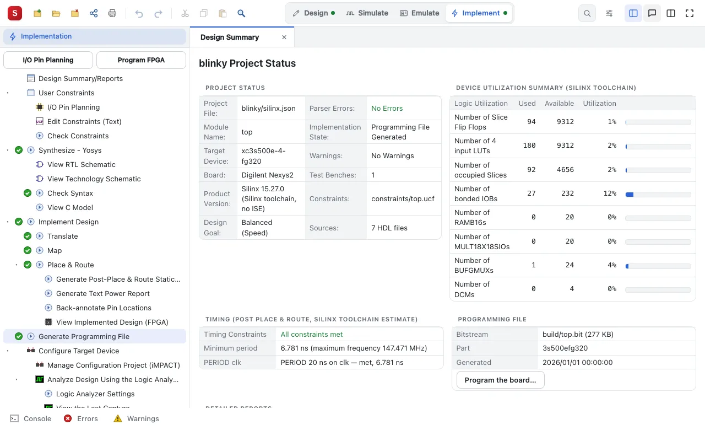
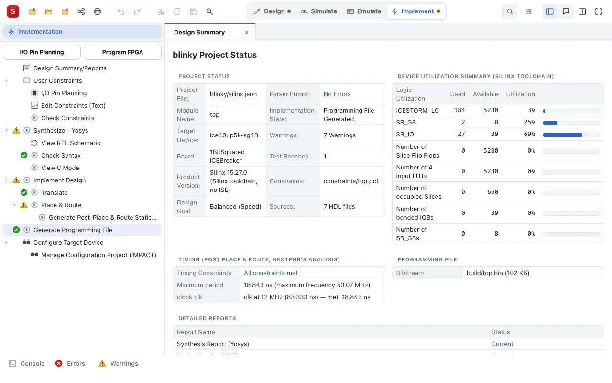
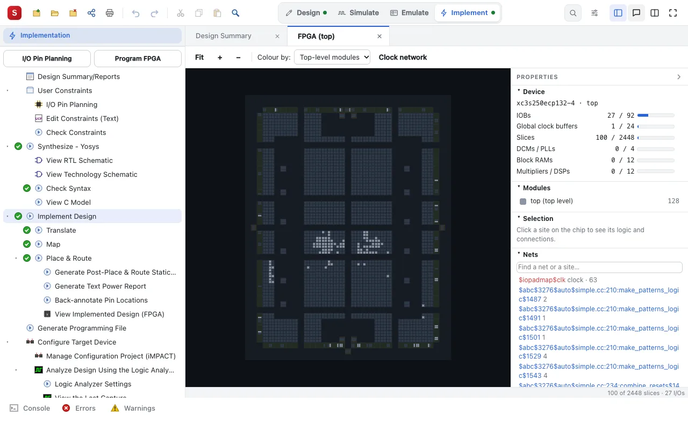

# Boards and toolchains

[User's guide](README.md) · English · [Português](../pt/boards.md)

From the design to the board: synthesis, place and route, the bitstream, and the board programmed. Silinx does it
with its own open toolchain (Yosys for the synthesis, nextpnr for place and route, Silinx's bitstream writer), in the
browser, with nothing installed.

| Blinky on a Nexys2 (Spartan-3E) | Blinky on an iCEBreaker (iCE40) |
|---|---|
|  |  |

## The boards

| Family | Boards | Built by |
|---|---|---|
| Spartan-3E | Basys2-100 / 250, Nexys2-500 / 1200 | the Silinx toolchain, or Xilinx ISE |
| Spartan-6 | Nexys3, Atlys | the Silinx toolchain, or Xilinx ISE |
| iCE40 | iCEBreaker | the Silinx toolchain |
| ECP5 | ULX3S | the Silinx toolchain |
| Gowin | Tang Nano 9K | the Silinx toolchain |
| GateMate | Cologne Chip GateMate FPGA Evaluation Board (not programmed from Silinx) | the Silinx toolchain |
| 7-series (an experimental family) | Basys 3, Nexys A7 (Artix-7); Zybo Z7-20 / 10, Arty Z7-20 / 10 (Zynq-7000: their programmable logic, the Cortex-A9 not yet) | the Silinx toolchain, or AMD Vivado |
| 7-series | Arty S7 (Spartan-7) | AMD Vivado |
| MAX 10, Cyclone IV E, Cyclone V (each an experimental family) | Terasic DE10-Lite; DE0-Nano, DE2-115; DE0-CV, DE1-SoC, DE10-Nano | Intel Quartus Prime Lite, which you install yourself (the local server); programmed with openFPGALoader through the on-board USB-Blaster |
| every family ISE 14.7 implements | the other Digilent, Xilinx and Numato boards, or a device alone | Xilinx ISE |

*Design Properties* chooses the board. A **design and simulation project** has no board: it designs and simulates
only.

## Building

*Implement* (the Silinx interface) or the Processes panel (the ISE style one), as in ISE: *Synthesize*, *Implement
Design* (Translate, Map, Place & Route), *Generate Programming File*. Then:

- the **Design Summary**: the resources used, the timing, the warnings;
- **View RTL Schematic** and **View Technology Schematic**: the design as Yosys read it, and as it maps it;
- **View Implemented Design (FPGA)**: the placed and routed design inside the chip;
- the slowest paths, stage by stage, back to the lines of the source.

For the Spartan-3E and the Spartan-6, the bitstreams the Silinx toolchain writes for the tested designs are byte for
byte the ones ISE writes for the same routing.

## Programming the board

From the browser, over USB (Chrome or Edge on a computer, Chrome on an Android tablet): *Configure Target Device ▸
Program FPGA*. The board's flash (its PROM) too, so that the design starts at power-up. With Silinx running on your
computer, the installed tools also work: Digilent Adept, openFPGALoader, xc3sprog, adepttool, ISE's iMPACT.

A **logic analyzer**, as ChipScope's, watches the signals inside the FPGA as the design runs on the board.

## Xilinx ISE 14.7 and AMD Vivado

For the boards the Silinx toolchain does not build for, Silinx runs ISE 14.7 (the free WebPACK edition) or Vivado,
which you install yourself, usually in a Docker image. How: [the toolchains](toolchains.md).

Next: [Teaching with Silinx](teaching.md).
