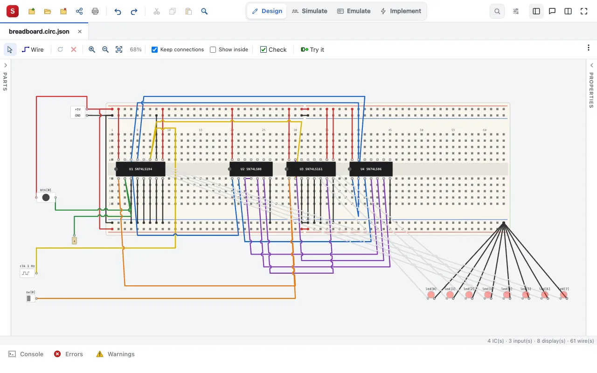

# Digital circuits on a breadboard

[User's guide](README.md) · English



A circuit is a drawing of real integrated circuits (74xx TTL, 4000 CMOS), switches, buttons, LEDs and displays, wired
on breadboards or without one, as a student builds it on the bench, and simulated live: a click on a switch, and the
LEDs show what the chips do. It is **digital only**: a wire carries a logic level, never a voltage or a current; there are no
resistors and no capacitors, and the power supply is a pair of logic levels (VCC is 1, GND is 0). Wokwi, Tinkercad
Circuits and Java Breadboard inspired it; its look, its parts' drawings and its format are Silinx's own.

The umbrella issue is #3897; each phase has an issue of its own (#3898 to #3902).

## The document

- A circuit is one file, `<name>.circ.json`, a design source of any project: an FPGA project or a design and
  simulation project (no new project kind). New Source ▸ **Digital Electronic Circuit** (second in its list, #4061) makes one: a half breadboard and its
  power supply, on its top rails, the top rails joined to the bottom ones (+ to +, − to −, #4929), or, by its **Wizard >** (the Digital Electronic Circuit Wizard, `core/circuit-templates.js`), a typical
  assembly: N breadboards (half or full) and a supply, their rails joined; a breadboard with N switches (`sw[k]`) and M
  LEDs (`led[k]`) (no empty one, #4161: New Source itself makes a breadboard and its supply); or, on a full
  breadboard, chips already placed, powered and wired, ready to try (#4164, `core/circuit-assemblies.js`): a 7-segment
  display (a 7447 or a 7448), a counter with display (a 7490 or a 74161, a clock of 1 to 50 Hz, a button `rst`), a
  4-bit adder (a 7483 or a 74283), a gate test bench (7400, 7402, 7404, 7408, 7432, 7486), a comparator (7485), a
  decoder or multiplexer (74138, 74151), a shift register (74164, 74194: buttons `clk` and `clr`, a switch `din`) and
  flip-flops (7474); a circuit is also a **Top-Level Source Type** (#4105): New Project starts an empty project with one as its
  top (`src/top.circ.json`), and Design Properties can choose it.
- **It is a module**, as every Silinx drawing: its **logic switches** and **buttons** are its inputs, its **LEDs**,
  each **7-segment display**'s segment and each **LED bar**'s light its outputs, named by their labels; its HDL file is generated from it (below). The Design pane shows
  its row as every drawing's: `[Circuit]` first (it opens the drawing), then `[Schematic]` (#4069, as a Boolean
  algebra's: a read-only schematic generated from the circuit, its HDL in its logic form, the gate ICs' gates as gates,
  the other ICs as blocks, following the circuit; `core/circuit-sch.js`, the MCP's `related_view` schematic),
  `[VHDL]` / `[Verilog]` last (hidden in a design project).
- **The canvas** is a grid of 0.1 inch steps (the breadboard's pitch): every pin, hole and wire end is on a grid point.
  A part is placed on a breadboard or anywhere beside it; nothing needs a breadboard.
- **Connectivity is geometric**, as on the bench: a pin that lands on a breadboard's hole is in that hole; a wire's end
  joins the hole, the pin or the other wires' ends on its point. Two wires that cross without an end in common are not
  joined.
- **Moving and turning** (#4059, #4065): a breadboard moved or turned carries the parts plugged into it (a pin in one of
  its holes) and the wires between them; with **Keep connections** (the toolbar's, as the schematic's: remembered, on by
  default) the ends of the other wires on the moved pins and holes follow them, not ticked they stay where they are. Every
  part turns a quarter clockwise (R), a breadboard too, drawn turned whole with its labels upright (#4114); there is no mirror. **Cut, Copy and Paste** (#4066) copy the
  selected part (a breadboard with the parts on it and the wires between them), pasted 2 steps right and down, new ids
  given, a label another part has left out.
- **Show inside** (#4060, the toolbar's, remembered): each breadboard's strips drawn under its holes (each column's a–e
  and f–j, each power rail), each gate IC's gates in its body (IEC boxes, &, ≥1, =1, 1, a bubble on an inverting one)
  joined to its pins, so that a circuit is easier to wire. An IC with no gates (#4508, `core/circuit-inside-blocks.js`)
  as its datasheet's connection diagram too: a dual or quad flip-flop, latch or decoder a box a unit beside its pins (the
  7474's two D flip-flops), another IC one box over its body; each pin's line into its box, its name inside (IEC: 1D, C1,
  S, R, and the box's qualifier CTR, SRG, RG, X/Y, MUX, Σ, COMP), a clock's ▷, a bubble on an active-low input. The
  latches whose units share an enable (#4934, `core/circuit-inside-drawn.js`: the 7475, 7477, 74375) as their datasheets
  draw them: a box a latch (D, G, Q, Q̅), each pair's enable a line between the two boxes, a dot, into both. A
  KiCad part that behaves as a library IC is drawn as it. A 4023, 4025, 4073 or 4075
  (#4505), whose first gate takes 1C from the upper row past its output 1Y, has that gate in the body's middle and 1C's
  line over it, crossing 1Y's once as the circuit's wires cross (Wire crossings: a hop-over or plain, never a dot); the
  ICs with a crossing inside are listed by name (`CROSSING_ICS`, `core/circuit-inside-cross.js`). A three-state IC
  (#4505, `core/circuit-inside-tri.js`): a buffer whose input and output are on one row flat beside them (the 74125's,
  74367's), one across the body standing between its rows (the 74244's, a transceiver's two directions side by side);
  each enable's bus into its buffers' sides, a bubble where it is active low, a dot where a line branches (one pin's T),
  its crossings of the data lines as the wires cross, never a dot; enables combined by a gate as the datasheet draws
  it (the 74365's and 74540's G1̅ and G2̅ by a NOR, the 74245's DIR and OE̅ by an AND and a NOR), its output the bus. An
  AND-OR-INVERT (7451, 74LS54, 7455, #4498) as its datasheet draws it: each term's AND beside its pins, turned toward
  the body's middle, feeding the NOR that faces its output pin.
- **How the wires are drawn** (#4064, #4080, the ⋮ menu, as the schematic's, `core/wire-style.js`): **Wires**, Direct (a
  straight line from point to point, the circuit's default), Orthogonal (horizontal and vertical segments) or Curved (a
  smooth curve through its bends, as a jumper wire), the circuit's `wireStyle` (`orthogonal`, `curved`; Direct not
  written) saved with it, an edit; and **Wire crossings** (#4101, a
  choice as the schematic's, remembered): **Hop-overs** (the default: a small arc where a wire crosses one drawn before
  it without joining it) or **Plain crossings** (the wires straight across each other); `core/circuit-wires.js`. The look
  only: the connections are the same.
- **Drawing a wire** (#4083, as the schematic's): a click on A (a pin or a hole), then on B, and the wire is made in the
  circuit's style; the clicks between them the points it goes through. Direct: straight; Curved: a curve through them, a
  sag between two points, as a jumper wire; Orthogonal: routed in horizontal and vertical segments by the schematic's
  router (`core/schpath.js`, `core/circuit-route.js`), never over another part's pin nor into an IC, along no other wire,
  over the breadboards' holes only where it must (around the board where it can), the clicks its waypoints; shown so
  while it is drawn; a pin boxed in by its neighbours and the other wires gets a straight leg, said in the console.
- **The editor** (`web/js/circuit-editor.js` and its `circuit-*.js` modules) follows docs/UI-GUIDELINES.md, as the Petri
  net's: the toolbar (select, wire, rotate, delete, then the zoom, Keep connections and Show inside, then Check and Try it, and at its right ☰ Parts, ☰ Properties (a narrow
  screen's) and the ⋮ menu; while trying it, the Try it bar above the canvas, as the schematic's, its Reset and Stop, #4067; printed
  by the main toolbar's Print), the **Parts** panel on the left (#4062, as the schematic's Symbols: a search, the parts by
  category, each folded or open, each part with its drawing, an IC's the schematic's symbol of its gate or its block; a
  click on a part, then on the drawing; foldable, over the canvas behind ☰ Parts on a narrow screen), the Properties side
  panel on the right, foldable, over the canvas behind ☰ Properties on a narrow screen: the selected part's label,
  colour, pinout and Part info, a switch's position as saved (a DIP switch's levers), a clock's frequency; the circuit's name (its HDL
  language in its Source Properties, as every drawing's, #4240: Project Preferred Language, VHDL or Verilog); the status line (its counts: "2 IC(s) · 2 switch(es) · 2 LED(s)
  · 15 wire(s)"; while simulating, "t = 24 ns"); every message in the console.

## The parts library

Each part is a description in `core/circuit-parts.js` (the ICs' tables: `core/circuit-ics.js`): its pins (number, name,
direction: in, out, open collector, power, passive, weak, not connected), its inputs (a level, a momentary button, a
clock), its contacts (two pins joined while an input is on or off), its pulls, its lamps (an anode and a cathode), its
logic and its timing. One description serves the editor, the simulation, the checks, the
generated HDL and the MCP server.

| Category | Parts | Phase |
|---|---|---|
| Breadboards | half (30 columns, 400 holes), full (63 columns, 830 holes); two power rails on each side | 1 (half), 2 (full) |
| Power | supply (+5 V and GND terminals: logic 1 and 0) | 1 |
| Boards (#5215, Systems) | Arduino Uno, Arduino Nano (a DIP-30 across the channel), Digilent Basys2, Digilent Nexys2 (their Pmod connectors, each pin with its package pin): their real pins, their 5V, 3V3 and GND powering the breadboard (logic 1 and 0); their other pins a System's ([systems.md](systems.md)) | — |
| Inputs | logic switch (a slide switch giving 0 or 1, as a trainer kit's), push button (SPST, momentary) | 1 |
| | SPDT slide switch (break before make), DIP switch (4 / 8), pull-up and pull-down (weak 1 / weak 0), clock source (its frequency, 0.1 to 50 Hz, ticking in real time) | 2 |
| Outputs | LED (anode, cathode; its colour) | 1 |
| | 7-segment display (common cathode and common anode, with its point), LED bar (10) | 2 |
| | character LCD 16×2 (HD44780, #5330): its 16 pins in a row (VSS, VDD, V0, RS, RW, E, D0..D7, A, K), its controller simulated (a write on E's falling edge, RS a command or a character, 8-bit or 4-bit mode as LiquidCrystal drives it, the cursor and display shifts), its two lines drawn on its glass; off until its program turns it on; its RW tied to GND (reads are not simulated). In the HDL an instance of its own entity, simulation only, that reports its lines after each write (`LCD1 \|Hello …\|`), in VHDL and in Verilog | 5 |
| | graphic OLED 128×64 (SSD1306 on I²C, #5336): its 4 pins as the common module's (GND, VCC, SCL, SDA), its I²C peripheral at 0x3C (each byte acknowledged, SDA pulled low; a read not simulated) and its controller simulated (the control byte, the addressing modes, the column and page addresses, the charge pump, remap, COM scan, inverse), its 128×64 pixels drawn as they light; SCL and SDA each need a pull-up (the check says so). In the HDL an instance of its own entity, simulation only, that reports what it shows after each STOP (`OLED1 on 14 0 0 0 0 0 0 0`), in VHDL and in Verilog | 5 |
| | servo SG90 (PWM, #5347), in the Outputs: its 3 wires (GND, VCC, its signal), each pulse measured (0.5 ms 0°, 2.5 ms 180°, every 20 ms), its arm drawn moving to the angle at its speed (60° in 0.1 s); a pulse or a period that is no servo's said. Driven by an Arduino's PWM or an FPGA's through a circuit node. In the HDL an instance of its own entity, simulation only, saying each angle its pulses ask for (`M1 to 135`) | 5 |
| | temperature sensor LM75 (I²C, #5342), in the Inputs: a DIP-8 (SDA, SCL, OS, GND, A2, A1, A0, VCC), its I²C peripheral at 0x48 + A2..A0 read and written (the pointer; the temperature, 9 bits, 0.5 °C; the configuration; THYST and TOS), its OS output (open drain) in comparator or interrupt mode; its temperature set while trying it (its − and +, its Properties' Temperature, the System Emulator, the MCP's controls). In the HDL an instance of its own entity, simulation only, answering with its saved temperature and saying each byte it sends (`U1 sends 25`) | 5 |
| | 4×4 matrix keypad (#5364), in the Inputs: a membrane keypad (1 2 3 A / 4 5 6 B / 7 8 9 C / * 0 # D), its ribbon's 8 pins (R1..R4, C1..C4); each key joins its row to its column while pressed (held while the mouse is down in Try it; two keys at once, and a real keypad's ghosting); each key an input of the HDL (KP1_1 … KP1_star, KP1_hash, KP1_D); scanned by a program through a System's circuit node (its rows driven low one at a time, its columns pulled up and read) | Systems |
| | Rotary encoder (#5451), in the Inputs: a KY-040 module, its pins CLK (A), DT (B), SW, + and GND; turning it joins CLK and DT to GND in quadrature (A first clockwise), 20 detents a turn, its pull-ups holding them high; its knob pushes SW to GND (no pull-up: the program's). In Try it, ↺ and ↻ turn it a detent and the knob is pushed; simulate_drawing turns it by its id (+n, −n). Its turns and its switch are inputs of the HDL |
| | Ultrasonic range sensor HC-SR04 (#5456), in the Inputs: its pins VCC, Trig, Echo and GND; a pulse of 10 µs or more on Trig and, about 0.46 ms after it ends, Echo is at 1 for 58 µs a centimetre of the object's distance (2 to 400 cm; 38 ms out of its range); a shorter trigger is said. The distance is its Properties' Distance (cm), and while trying it the − and + between its cans (5 cm a click); in Try it the simulated time follows the real one, so a trigger made by hand lasts what it lasted. simulate_drawing sets it by its id (`US1: 120`) and lets time pass with a step's `after_us`; a System's simulate takes it as a control (`value`, cm); the System Emulator draws its − and +. Not a port of the HDL |
| | Motion sensor PIR HC-SR501 (#5463), in the Inputs: its pins VCC, OUT and GND; someone moving in front of it (its input, an input of the HDL named after the part: press and hold its dome while trying it) sets OUT to 1 for its hold time (its Properties' Hold time, 3 to 300 s). Retriggering (its jumper at H, by default), OUT stays at 1 while they move and for its hold time after; single (L), it falls after its hold time from the rise. Then it is blind for 2.5 s. In Try it its times are real ones. simulate_drawing sets it by its id (`PIR1: 1`) and lets time pass with a step's `after_us`; edit_circuit sets `hold` and `retrigger`; a System's simulate takes it as a control (`on`). Its minute of warming up at power-on is not simulated |
| | Temperature and humidity sensors DHT11 and DHT22 (#5470), in the Inputs: their pins VCC, DATA, NC and GND, DATA open drain (put a pull-up on it); the one-wire protocol: the host holds DATA low (18 ms or more for a DHT11, 1 ms or more for a DHT22) and releases it, and 30 µs later the sensor answers 80 µs low, 80 µs high, then 40 bits (50 µs low, then high 26 µs for a 0, 70 µs for a 1): the humidity, the temperature (a DHT22 in tenths, a negative one its top bit) and their checksum. At most once a second (DHT11) or every 2 s (DHT22), also after power-on; a start too short or a read too soon is said in the console and not answered. Their temperature and humidity are set while trying them (the − and + on the case) and saved in their Properties; a button from DATA to GND makes a start by hand. simulate_drawing sets them as `DHT1.temp` and `DHT1.hum`, a System's simulate takes them as controls; edit_circuit sets `temp` and `hum`. Not ports of the HDL |
| | Buzzer (#5454), in the Outputs: an active buzzer, its + and −; its + at 1 (its − at 0) it sounds at its own tone (about 2.3 kHz), a square wave on its + (an Arduino's tone(), a PWM, an FPGA's divider) at that wave's frequency; at 0 silent. In Try it its waves and its tone are drawn; simulate_drawing says its tone. Not a port of the HDL |
| | Stepper motor 28BYJ-48 on its ULN2003 board (#5476), in the Outputs: its pins IN1 to IN4 (a coil each, A to D, its LED lit while it is on) and the board's GND and VCC; in the order A, AB, B, BC, C, CD, D, DA (half steps) or A, B, C, D (full steps) the shaft turns clockwise, the other way anticlockwise, 4096 half steps a turn (its gearbox), at most one every 1 ms; a jump it cannot follow (the opposite coil) or a step too soon is said in the console and not followed. Try it draws its LEDs, its shaft's arm and its angle (the simulated time follows the real one); simulate_drawing and a System's simulate say its steps and angle; its HDL says where it stops (`M1 at 512 half steps`). Not a port of the HDL |
| | SD card module (#5477), in the Outputs: its pins GND, VCC, MISO, MOSI, SCK and CS, a 32 MB SDHC card in it, on SPI mode 0 (MISO released while CS is high). After 74 clocks or more with CS high it answers the SD protocol's commands a library sends: CMD0, CMD8, CMD55 + ACMD41 (idle, then ready), CMD58, CMD16, CMD13, CMD17 (a 512-byte block read, its CRC16) and CMD24 (a block written), by block number; CMD0's and CMD8's CRC7 are checked; anything else is an illegal command. Its blocks are empty at first and keep what is written while trying it; the module shows its state, the blocks written and its last access. simulate_drawing and a System's simulate say its state and each block written with its first bytes; its HDL says what it does (`SD1 ready`, `SD1 wrote block 5`, `SD1 read block 5`) and keeps 4 blocks. Not a port of the HDL |
| Gates (74xx, as the 74LS) | 7400 NAND, 7404 NOT, 7408 AND, 7432 OR, 7486 XOR | 1 |
| | 7402 NOR, 7410 / 7411 / 7420 / 7427 / 7430 (3, 4, 8 inputs), 7414 (Schmitt NOT), 7401 / 7403 / 7405 / 7406 (open collector) | 2 |
| Gates (4000) | 4001, 4011, 4030 / 4070, 4069, 4071, 4081 | 2 |
| Gates (more, #4397) | 7407 (buffer), 7409 / 7412 / 7415 / 7422 / 7426 / 7433 / 7438 / 74136 (open collector), 7413 / 74132 (Schmitt NAND), 7421 (AND4), 7428 / 7437 / 7440 (buffers), 74133 (13-input NAND, DIP-16), 74386 (XOR), 7451 / 7454 (as the 74LS54) / 7455 (AND-OR-INVERT); 4002, 4012, 4023, 4025, 4072, 4073, 4075 (3 and 4 inputs), 4049 / 4050 (inverting and non-inverting buffers, DIP-16), 4077 (XNOR) | 2 |
| Three-state buffers (#4397) | 74125 / 74126 (quad, an enable each, active low / high), 74240 / 74241 / 74244 (octal, two groups), 74365 / 74366 (hex, common enables), 74367 / 74368 (hex, 4 and 2), 74540 / 74541 (octal, flow-through): off, an output is Z, a net's other drivers or its pull then; the transceivers 74242 (inverting) / 74243 (GAB̅ A to B, GBA B to A) and 74245 (DIR, OE̅), their A and B pins inputs and outputs at once. Three-state outputs on one net are a bus; with a plain output, Check warns of a short while one is enabled (#4409) | 2 |
| Flip-flops, latches and registers (#4397, written once in VHDL) | 7473, 74107 (J-K, clear), 74113 (J-K, preset), 7478, 74114 (J-K, preset, common clock and clear), 74109 (J-K̅, rising edge), 4013 (D) and 4027 (J-K) (set and reset active high); 7475, 7477, 74375 (D latches), 74279 (S̅-R̅ latches); 74174, 74175, 74273 (D registers, clear), 74377, 74378, 74379 (D registers, enable); 74173 (4-bit D register), 74373, 74573 (D latches), 74374, 74574 (D registers), their outputs three-state. Each is a VHDL model of the chip, run live in Try it; the circuit's HDL instantiates it, its Verilog translated by Silinx (`core/circuit-model-ics.js`, `core/circuit-hdl-core.js`) | 3 |
| Counters (#4397, written once in VHDL) | 74160, 74162 (synchronous decade; clear asynchronous, synchronous), 74168, 74169 (synchronous up/down, decade and binary), 74190 (the 74191's decade), 74192 (the 74193's decade); 74196, 74197 (presettable ripple, decade and binary), 74290 (the 7490 on another pinout), 74390, 74393 (dual ripple, decade and binary), 7492 (divide by 12); 74590 (8-bit counter and output register, three-state outputs); 4020, 4040 (14- and 12-stage binary ripple), 4022 (octal counter, 8 decoded outputs), 4029 (presettable up/down, binary or decade), 4510 (presettable up/down decade), 4518, 4520 (dual up, decade and binary). Each a VHDL model of the chip, its count numeric_std's, run live in Try it, its Verilog translated by Silinx (`core/circuit-model-counters.js`); an asynchronous load takes its data when it starts (the 74191's), a ripple counter's stages count together | 3 |
| Shift registers (#4397, written once in VHDL) | 7491 (8-bit serial in, serial out), 7495 (4-bit, shift right or load, its two clocks gated by MODE), 74166 (8-bit parallel in, serial out, clock inhibit), 74195 (4-bit parallel access, J-K̅ serial input), 74295 (4-bit, shift right or load, three-state outputs), 74594 (8-bit, output register with clear), 74596 (the 74595 with open-collector outputs), 4021 (8-stage, asynchronous parallel load). Each a VHDL model of the chip, run live in Try it, its Verilog translated by Silinx (`core/circuit-model-shift.js`). The 74299 and 74323, their I/O pins bidirectional, are drawn only (#4485) | 3 |
| Decoders, display drivers and encoders (#4397, written once in VHDL) | 7442, 74145 (BCD to decimal, active low; open collector), 4028 (active high); 74137, 74237 (3-to-8, address latches; outputs low, high), 74238 (the 74138, outputs high), 74154 (4-to-16, DIP-24 0.6 inch wide), 74155, 74156 (dual 2-to-4; open collector); 7446, 7449 (BCD to 7 segments, open collector; the 7449 active high), 74246, 74247, 74248 (with tails on 6 and 9; their BI̅/RBO̅ its RBO̅ output only), 4543 (latched, phase input for an LCD); 74147, 74148 (priority encoders), 74348 (its A̅ three-state, enabled while its GS̅ is low). Each a VHDL model of the chip, its logic sums of products, its Verilog translated by Silinx (`core/circuit-model-decoders.js`); in the Parts panel's MSI group. KiCad's 74LS48 is the 7448 (its segments pulled up inside, open collectors for KiCad); the 4056 (a third supply, VEE) is drawn only, and the 74249 until its datasheet is read | 3 |
| Multiplexers, arithmetic, parity, comparators (#4397, written once in VHDL) | 74158 (quad 2-to-1, inverting), 74257, 74258 (quad 2-to-1, three-state; inverting), 74251 (8-to-1, Y and W three-state), 74253, 74352, 74353 (dual 4-to-1: three-state, an enable each section; inverting; both), 74298 (quad 2-to-1 with storage, falling edge); 74181 (4-bit ALU, its 32 functions; Cn and Cn+4 active low, P̅ and G̅ for the 74182), 74182 (look-ahead carry generator), 74280 (9-bit parity), 74688 (8-bit identity comparator). Each a VHDL model of the chip, its Verilog translated by Silinx (`core/circuit-model-mux.js`); in the Parts panel's MSI group. The 74398 and 74399 are drawn only until their clock's edge is checked in their datasheet | 3 |
| Memories and storage (#4397, written once in VHDL) | 74670, 74170 (4 × 4 register files: words written as latches while GW̅ is low, read while GR̅ is; three-state, open-collector outputs), 74259 (8-bit addressable latch), 74256 (dual 4-bit), 74395 (4-bit shift register, three-state outputs, falling edge). Each a VHDL model of the chip, its Verilog translated by Silinx (`core/circuit-model-memory.js`). Drawn only: the 74322 (its I/O pins bidirectional, #4485), the 74385 (KiCad's symbol gives its outputs as inputs), the 74CBT3861 bus switches (contacts, as group G's analog switches) and the 74469 (until its datasheet's U/D̅ is checked) | 3 |
| MSI | 7447 / 7448, 4511 (BCD to 7 segments), 74138 / 74139 (decoders), 74151 / 74153 / 74157 (multiplexers), 7483 / 74283 (adders), 7485 (comparator) | 3 |
| Sequential | 7474, 7476, 74112 (flip-flops), 7490 / 7493 / 74161 / 74163 / 74191 / 74193 (counters), 74164 / 74165 / 74194 / 74595 (shift registers), 4017 | 3 |

**Real pinouts:** a 14-pin DIP's pin 1 is at its lower left with its notch on the left, pins 1 to 7 left to right
along its lower row, 8 to 14 right to left along its upper row, VCC on 14 and GND on 7 (the 7400 family's; each part
says its own). The 7400, 7408, 7432 and 7486 share one pinout (1A 1, 1B 2, 1Y 3, 2A 4, 2B 5, 2Y 6, 3Y 8, 3A 9, 3B 10,
4Y 11, 4A 12, 4B 13); the 7404's six inverters are 1A 1, 1Y 2, …, 4Y 8, 4A 9, 5Y 10, 5A 11, 6Y 12, 6A 13. The 7402's
outputs come first (1Y 1, 1A 2, 1B 3, …). Each part's pinout is shown in its Properties and on hover over a pin; under it,
its **Part info** (#4126): what the part does, an IC's chip, family, package, supply pins, logic (1Y = NAND(1A, 1B)…),
typical delay, open-collector outputs and how an input left open reads (a TTL input 1, a CMOS one X); each pin's role.

Every 4000 quad 2-input gate shares the 4001's pinout (1A 1, 1B 2, 1Y 3, 2Y 4, 2A 5, 2B 6, VSS 7, 3A 8, 3B 9, 3Y 10, 4Y 11,
4A 12, 4B 13, VDD 14), not the 7400's. The 7410, 7411 and 7427: 1A 1, 1B 2, 2A 3, 2B 4, 2C 5, 2Y 6, 3Y 8, 3A 9, 3B 10,
3C 11, 1Y 12, 1C 13; the 7420's pins 3 and 11 and the 7430's 9, 10 and 13 are not connected. A 7-segment display's pins
are e 1, d 2, COM 3, c 4, DP 5, b 6, a 7, COM 8, f 9, g 10 (its two commons joined inside), its rows 0.6 inch apart; an
LED bar's anodes are 1 to 10 and its cathodes 20 to 11.

**The MSI ICs** (`core/circuit-msi.js`) are described by their pins (an active low pin's name barred, as its datasheet's,
its port `<name>_n`), a model (its outputs from its inputs) and their HDL bodies, written into one wrapper (the inputs read
as a 74LS reads them, an unknown input making every output X, the outputs after the IC's delay, open collector ones a 0
or nothing). The 7447 drives a common anode display (open collector, active low), the 7448 a common cathode one (its
outputs modelled as totem pole, its pull-ups inside); their BI̅/RBO̅ pin is an input (BI̅), RBO̅ not modelled. The 7483's
VCC is pin 5 and its GND pin 12.

**The sequential ICs** (`core/circuit-seq.js`: the 7474, 7476, 74112, 7490, 7493, 74161, 74163, 74191, 74193, 74164,
74165, 74194, 74595, 4511 and 4017) are written three times the same way, in the clocked style a synthesis tool reads: the
engine's processes, each run when an input of its sensitivity changes (an asynchronous control first, else its clock's
edge, from 0 to 1 or 1 to 0), and their VHDL processes and Verilog always blocks; their registers are unknown (X) at
power-on, until a clear, a load or a clock makes them known. Two choices of that style, said here: an asynchronous load
(the 74165's SH/LD̅, the 74191's and the 74193's LOAD̅) takes the inputs when it starts, not while it is held (the chips
follow them); releasing one of two asynchronous controls both active (a 7474's PRE̅ and CLR̅, the 7490's R0 and R9, the
74193's CLR and LOAD̅: not stable on the chips) is seen by VHDL and the engine, not by Verilog's edges. The 74193 counts
on the rising edge of UP and DOWN ANDed, up when UP was the last to fall; the 4017 on CLK's rising edge only (not on CLK
INH's falling edge). Their generated HDL is clean of Check Syntax's warnings, the few the chips' own structure raises (a
clock read through the IC's input, a latch, a clock used as data) silenced with their reason (`silinx: ignore`).

**Timing:** a part has its typical propagation delay (the 74LS datasheets': 7400, 7402, 7404, 7408, 7410, 7411, 7420,
7427: 10 ns; 7430, 7486: 12 ns; 7432: 14 ns; 7414, 7406: 15 ns; the open collector 7401, 7403, 7405: 17 ns; the 4000s
at 5 V: 4069 45 ns, 4001, 4011, 4071, 4081 60 ns, 4030 100 ns, 4070 140 ns), one value for both edges. The delays are inertial (a pulse shorter than the delay does not get through),
as VHDL's `after` and Verilog's `#` on a continuous assignment, so the live simulation and the generated HDL agree.

## KiCad parts

A project's own parts are KiCad's (#4278, #4280): the symbol libraries of its `parts/` folder (a `.kicad_sym`, or a
`.kicad_symdir` folder of one symbol per file, KiCad 6 to 10) and their footprints (`parts/<library>.pretty/*.kicad_mod`).
They stay as KiCad wrote them, with their licence and authors: Silinx stores nothing converted and reads them again
(`core/kicad-sym.js`, `core/kicad-mod.js`, `core/circuit-kicad.js`) whenever it reads a circuit. A part is named by its
library and its symbol: `parts/ttl.kicad_sym#74HC00`. KiCad's parts have no logic, so a symbol gets its behaviour this way:

- **as an IC of the library**, when its part number is one (SN74LS00N, 74HC00, DM7400N, CD4011BE, HEF4071BP: the 7400,
  the 4011; the 74 and 4000 series' prefixes, families' letters and packages' suffixes) or its property `Silinx.Model`
  names one, and its pins are that IC's, pin by pin (numbers and directions; a passive or unspecified pin fits any). It
  is then that IC (its logic, its delay, its pins' places, its HDL entity), under its own number and datasheet.
  `Silinx.Family` (`ttl`, `cmos`) makes its inputs read as that family's (an entity of its own in the HDL). A part
  number whose pins are not the IC's is drawn only, with a warning;
- **as the library's LED, slide switch or push button** (#4349), when `Silinx.Model` says `led`, `spdt` or `button`, or
  its symbol says so: an LED (LED in its name, keywords or description) with two pins named A and K (or anode and
  cathode), a slide switch SPDT (not a relay) with three pins in a line, a push button (push button, tactile, momentary)
  with two pins. Its pins are matched by their names (SparkFun's LED has its cathode as pin 1, Silinx's its anode), a
  button's by their numbers, a switch's by their places (the middle one its common). It keeps its footprint's places
  and drawing. In Try it the LED lights in its own colour (Red, Green in its value), and the switch and the button are
  clicked. Check and the HDL treat them as the library's. A symbol like an LED whose pins are not one's is drawn only,
  with a note;
- **drawn only**, any other symbol: its pins on its footprint's places (a `.kicad_mod` of the project, else its
  footprint's name: `DIP-14_W7.62mm`, `PinHeader_1x04_P2.54mm`; else a DIP filter, `DIP*W7.62mm*` or KiCad's `DIP?16*`, its rows 7.62 mm apart up to 20 pins, #4397), turned as a DIP lies on
  the breadboard. It is not simulated and its pins drive nothing: Check Circuit warns *U2 (TEST-SENSOR) is drawn only: it is
  not simulated and its pins drive nothing*, and its HDL leaves it out.

- **modelled by a module of the project** (#4283, `core/circuit-kicad-hdl.js`), when its property `Silinx.HDL` names a
  VHDL entity or a Verilog module of the project (it comes before a part number). The module's ports are the part's
  pins: by their names (`A` → `a`, `~{EN}` → `en_n`), or as `Silinx.Ports` maps them (`1=a, 2=y`). Its supply pins are
  no ports, and a bidirectional or passive pin is refused. The circuit's generated HDL instantiates the module for the
  part, in its simulation's model and in its digital one, so that the circuit's HDL simulates and synthesizes with it.
  Check Circuit, given the project's modules, refuses a module missing, a port without a pin, a pin without a port, a
  direction or a width that differ. **Try it runs it** (#4284, `core/circuit-live-model.js`): each such part has a copy
  of its module of its own in Silinx's HDL simulator (as the schematic's Try it runs its modules). The levels of its
  input pins are forced on the module's input ports, the module runs a step (50 ns of its own time), and its output
  ports' levels drive the part's output pins after its delay (10 ns). Its registers keep their state from one step to the
  next. A module that cannot run (its elaboration's errors, a `$finish` or a failure as it starts) is said by Check
  Circuit and `simulate_drawing`, for example *U1 (TEST-INV): its module test_inv cannot run in Try it: its simulation
  stopped (finish)*, and its pins then drive nothing. The live run and the generated HDL's simulation agree vector by
  vector (the tests), and a flip costs about what a 7404's does.

A symbol with no through-hole footprint (an SMD package, none at all) is no part, its reason said; `Silinx.Footprint`
gives it one its file has not (its breakout's pin header). `Silinx.Source`, `Silinx.Author` and `Silinx.Licence` say
where it comes from. These properties are written in the symbols themselves (`core/kicad-edit.js`, only their text
changes), which KiCad keeps: the file stays valid in both programs. A power symbol (VCC, GND) is no part: a circuit has
its supply. Silinx's own library stays as it is, in JavaScript: its behaviour is code (#4290).

**In the editor** (#4281): the Parts panel lists the project's KiCad parts last, under *KiCad parts (project)*, by their
part number and description (searched by them too; an IC's drawing its gate's or block's, a part drawn only its own). On
the canvas a part that behaves as an IC is drawn as one, named by its part number (`U1  74HC00`). A part drawn only is
drawn as its footprint's drawing shows it from above, to scale (#4315): its F.Fab layer (F.SilkS when it has none), its
body's outline and the marks on it, an LED's body in its colour (a SparkFun red LED is a round red body). A part whose
footprint is known by its name only (a DIP, a pin header) has a dashed body round its pins. Its name goes over the body
when it fits, else above it. Its Part info adds its KiCad symbol and file, its part number, its datasheet (a link), its footprint, its
source, author and licence. **Import KiCad Part…** (the Parts panel's KiCad catalogue section, not in a read-only editor) takes a `.kicad_sym` or a
`.kicad_mod`. A library's symbols are listed with what each one is (*As the 7400 (by its part number)*, *Drawn only (not
simulated)*, *Not a part* and why, in its tip), which follows as each one's Model, Family and Footprint are set; its
source, author and licence are given once. The import is the MCP's `import_part` (`core/kicad-import.js`): a file there
already is replaced only when confirmed, and each symbol is said in the console. On a server, each call (an MCP tool, an HTTP
request) has its own project's parts (`server/parts-scope.js`, #4294).

**KiCad's libraries** (#4285): **Browse KiCad Libraries…** (the Parts panel's KiCad catalogue section, on the local server) lists KiCad's own symbol
libraries (74xx and 4xxx of KiCad 9.0.0: 61 and 7 of their parts behave as Silinx's ICs) and the library packages of the
KiCad Plugin and Content Manager's official index, each one's version, licence and size before it is fetched. A library
picked is fetched, and what its symbol libraries hold is said (their parts as ICs of the library, drawn only, the symbols
that are no part). Those ticked are imported into `parts/` with the footprints their symbols name, their source, author
and licence written in them. A browser alone cannot fetch them (repository.kicad.org and GitHub's release files send no
CORS header), so the local server does (`server/kicad-libraries.js`):
- from an allowed list of hosts only, over HTTPS, each redirect checked the same way, at most 96 MB;
- a package is read only once its SHA-256 is the index's, KiCad's own libraries by a SHA-256 pinned in `core/kicad-pcm.js`;
- of a package's zip only its `symbols/` and `footprints/` are inflated, with no path out of it;
- the index and the libraries fetched are kept in Silinx's configuration folder (`kicad/`). The index is fetched again
  after a day, and the one kept is used offline.

**The KiCad catalogue** (#4305): the Parts panel's last group, *KiCad catalogue*, folded at first and opened by a
search, lists KiCad parts by their part number, not by their library. It covers KiCad 9.0.0's 74xx and 4xxx (297 on their DIPs: their 249
parts that behave as Silinx's ICs, and those drawn only, #4397), KiCad's own basic parts (#4385: an LED, a resistor,
capacitors, a diode, a potentiometer, the 2N3904, 2N3906, BC547 and BC557, the 7805, a DIP switch, a 7-segment display,
each with a through-hole footprint Silinx picks for it, written as its `Silinx.Footprint` when it is imported) and
SparkFun's v10.0.0 parts on the 0.1 inch grid, and the Arduino boards that plug into a breadboard (#4394: the
Nano, Micro, Mini, MKR and Nicla sockets of the KiCad Library for Arduino Modules v4.2.0, CC-BY-SA-4.0, drawn only, as
Silinx does not simulate a microcontroller). A board's footprint whose pads are named by its pins (A0, 5V, D13) places
its pins from its first named pad. A pad within 0.1 mm of the grid is on it, as a lead bends that much
(KiCad's capacitors are 2.50 and 5.00 mm apart).
Silinx hosts none of their files: the catalogue (`core/kicad-catalogue-data.js`, written by `scripts/kicad-catalogue.mjs`,
run again to follow a new version) holds where each part is (its library file's URL and SHA-256, its footprint's), what
it is in Silinx and the symbols it extends. It also holds each SparkFun footprint's drawing, rounded to the grid, so a
row's preview is the part as it will be drawn (#4346): an LED round and in its colour, a relay's box, a header's strip,
a part drawn only on a DIP a DIP's body (CC-BY-4.0, SparkFun's; THIRD-PARTY-NOTICES.md). KiCad's own footprints are
CC-BY-SA-4.0, as are the Arduino modules', and a collection of their parts would be ShareAlike, so no drawing of them is kept: their previews are a
box round their pads until they are imported. A click imports the part: only its symbol (and those it extends), each
into a file of its own as KiCad 10's folders hold them (`parts/74xx.kicad_symdir/74HC00.kicad_sym`), with its footprint
beside it and its origin written in it. Every file is checked against its SHA-256, and a file there already with the
same text is kept. The local server fetches the catalogue's files only (kept for offline use; `SILINX_KICAD_OFFLINE`
fetches nothing). The browser's edition alone fetches from a host that sends CORS headers (SparkFun's on GitHub, KiCad's
through GitLab's API, which serves the same files), and the others say that they need the server.

Each row says what the part is (#4495): its part number in bold, then its function, on a second line when the panel is
narrow. A part that behaves as an IC of Silinx's library shows that IC's title. Any other shows its KiCad symbol's
Description, shortened by one rule (`shortFunction`, `core/part-function.js`): the packages, ratings, families and notes
left out ("DIP-16/SOIC-16", "0.2A Ic", "CMOS", "obsolete"), a sentence's case, at most 64 characters. Only that function
is kept (`core/kicad-catalogue-functions.js`, written by the same script), none of the libraries' text. The search
finds a part by its function too ("inverter", "flip-flop", "multiplexer"), its case and accents aside; a project's own
KiCad parts are shown and found the same way. In Portuguese, a KiCad function is translated by a small vocabulary of
the logic ICs' words, applied by rule (`functionPt`: "Quad 2-input NAND gate" → "Quatro portas NAND de 2 entradas",
"Dual retriggerable monostable" → "Dois monoestáveis redisparáveis"); one with a word outside it stays in English.
The MCP's `part_libraries` (with `catalogue`) and `circuit_parts` return the function and search by it (`query`).

Import KiCad Part… also takes a PCM package's `.zip` downloaded by hand and a `.kicad_symdir` folder.

**Exports** (#4282, `core/kicad-export.js`), in the editor's ⋮ menu, under KiCad:
- **Export ICs as KiCad Symbols…** writes the library's ICs (all 48, or this circuit's) as a `.kicad_sym` at KiCad 9's file
  version, generator `silinx`. A gate IC has a unit per gate and a unit of its supply pins; an MSI or sequential IC has
  one unit. The pins sit on the 2.54 mm grid (inputs on the left, outputs on the right, the supply above and below), an
  active low one named `~{CLR}`. The footprint is KiCad's `Package_DIP:DIP-n_W7.62mm`, with `Silinx.Model` and
  `Silinx.Family` in the properties. Silinx reads every one of them back as that IC, by its `Silinx.Model` and by its
  part number alone.
- **Export Parts as KiCad Package…** writes the project's KiCad parts (its `parts/` folder), and, when chosen, the
  library's ICs or all its parts, as a KiCad PCM package: a `.zip` with `metadata.json` (the PCM schema's required fields:
  identifier, name, description, author, licence, version), `symbols/` and `footprints/`. It installs in KiCad, or
  imports into another Silinx project.

**Silinx's library in KiCad's format** (#4290): every part of the library with pins (all but the breadboards, which are
the board itself) as a symbol of `symbols/Silinx.kicad_sym`. The ICs are written as above. Each other part is named
`Silinx_<type>` (`Silinx_led`, `Silinx_seg7-cc`), has one unit and carries `Silinx.Model` (its type). A display, an LED
bar or a DIP switch has KiCad's DIP footprint; every other part has a footprint of Silinx's
(`footprints/Silinx.pretty/Silinx_<type>.kicad_mod`, KiCad 9's file version), its pads where its pins sit on the 0.1 inch
grid. Read back, every part keeps its pins in the same places. The ICs, the LED, the push button and the slide switch
behave as the library's. The supply, the logic switch, the clock, the pulls, the DIP switches, the displays, the LED bar
and the probe are drawn only, and the import says so (a KiCad part does not behave as them yet, #4452). The library is
generated from the parts' descriptions at each export and is not kept as a file in the repository, so it is always the
running version's library.

The MCP's
`part_libraries` lists the libraries and what one holds, and `import_part` takes `library` (an identifier), a `.zip` or a
folder, with `libraries` to choose among them.

## The wiring

- **A wire** goes from a grid point to a grid point, with bends; its colour is the student's (red, black, and others).
  A new wire is red when it joins VCC (an IC's VCC or VDD pin, the supply's +, a + rail, or what they are joined to), black
  when it joins GND (GND, VSS, −), blue otherwise (#4932, #4933); its Properties' Colour changes it.
  The Wire tool draws it point by point (a click on each bend, a double click or a click on a pin or hole to end it).
  A selected wire shows its handles (#4930, #4931): drag an end to another hole, pin or grid point and the wire
  reconnects there; drag a bend to move it, a segment's middle to add a bend there, or double-click a bend to remove it.
  The MCP's edit_circuit does the same with its `reconnect` and `reshape` operations.
- **A breadboard's strips:** each column's five holes a–e are one strip, its five holes f–j another; the channel
  between e and f separates them, and a DIP IC straddles it. Each power rail (top +, top −, bottom +, bottom −) is one
  strip along its length (a full breadboard's rails split in the middle, as many real ones: phase 2).
- **The nets:** the strips, the wires and the pins on the same point are joined into nets (`core/circuit-net.js`). A
  closed switch or a pressed button joins its two nets while closed.

## The simulation

- **The engine** (`core/circuit-sim.js`) is an event-driven simulation of the nets with the parts' delays, in
  nanoseconds. Each net's level is resolved from its drivers by strength: a strong 0 or 1 (an output, the supply, a
  logic switch), a weak 0 or 1 (a pull-up or pull-down, phase 2), or nothing (Z). Two strong drivers of opposite levels
  are a short circuit: the net is X.
- **An IC reads its inputs as the real one:** a floating 74LS input reads high, a floating 4000 input reads X.
- **Open collector outputs** drive a 0 or nothing: several on one net are a wired AND, which a pull-up makes 1 while
  they are all off (with none, the check warns: the net floats).
- **Contacts:** a button, a slide switch (its common to A while off, to B while on) and a DIP switch's levers join two
  nets while closed.
- **The clock source** is an input like a switch, which Try it flips in real time at its frequency (0.1 to 50 Hz): the
  gates' nanoseconds settle between its ticks.
- **At power-on** every IC's output is unknown (X) until its inputs make it known, as in the generated HDL: a latch is X
  until it is set or reset, and a ring of inverters with no gate stays X (a gated one, a NAND enabled by a switch,
  starts from a known level and oscillates once enabled).
- **An IC is powered** when its VCC pin's net is 1 and its GND pin's net is 0; an unpowered IC drives nothing (its
  outputs float).
- **Live:** Try it starts it (its bar's Reset starts it again from time 0, its Stop or Esc ends it); a click on a logic switch flips it, a press on a button holds it while pressed (a long
  press on a touch screen); the simulation runs until the circuit is quiet. The LEDs light, each pin and wire is
  coloured by its level (0, 1, Z, X), the status line says the simulated time. A circuit still changing after 1 µs of
  simulated time (a ring oscillator, a latch's race) is said to oscillate, in the console, its oscillating nets marked.
- **The logic probe** shows its tip's level while trying it (H, L, open, X); it is no port of the HDL, but the net it
  watches is a signal of it (one only a probe watches declared with its reason, no warning).
- **The waveforms** (#4068) are those of the circuit's simulation, as every module's: Simulate of a test bench of the
  circuit (the Test Bench Wizard's, or one written by hand) in SSim; the editor has no waveforms of its own.
- **SSim:** the generated HDL is simulated as any module's (its test bench, the waveforms); the unit tests check that
  the live engine and the HDL simulated by Silinx agree.

## Analog parts and the analog/digital boundary

The **Analog** group of the Parts panel (#5382): a resistor, a capacitor, a potentiometer (a trimmer, its ends 1 and 3,
its wiper W), a light-dependent resistor (GL5528), an NTC thermistor (10 kΩ, B 3950), a diode (1N4148) and a voltmeter.
A resistor's resistance and a capacitor's capacitance are set in their Properties, written as `4.7k`, `4k7`, `100n` or
`2.2u`; a potentiometer's position, an LDR's light and a thermistor's temperature are set while trying the circuit (their
− and +) and saved in their Properties.

- **A circuit with an analog part is solved as a circuit too** (`core/analog-mna.js`, a modified-nodal-analysis solver,
  DC and in time): its nets that an analog part or an LED touches are analog nodes; the others stay logic as before. A
  circuit with no analog part is the logic it always was (its LEDs lit by their levels).
- **The boundary at the pins:** an output drives its levels through its output resistance (a 74LS output's 1 is 3.4 V
  through about 70 Ω, its 0 through 30 Ω; a 4000's 5 V and 0 V through 400 Ω; a switch, a clock, a board's pin 25 Ω; a
  pull-up 10 kΩ; the supply 0.05 Ω); an input reads its node's voltage against its thresholds: a 74LS input 0 under
  0.8 V, 1 over 2.0 V and X between them, a 4000's 1.5 V and 3.5 V. A Schmitt-trigger input (the 7414, the 74132)
  switches at 1.6 V rising and 0.8 V falling, its hysteresis between them. A 74LS input sources its own current (1.5 V
  through 4 kΩ): open it reads high, and a 10 kΩ pull-down is too large to make it 0 (it reads X), 1 kΩ is not. A node
  that nothing drives through the parts floats (Z).
- **An LED is a diode of its colour** (red 1.9 V, yellow 2.0 V, green 2.1 V, blue and white 3.1 V at 20 mA): lit by its
  current, as bright as it (its current in its tip). More than 30 mA is said once in the console: a current-limiting
  resistor is missing, with its value from 5 V.
- **In time:** the capacitors charge between the logic's events, the solver stepping them while they move (a step aims
  at 50 mV, smaller near an input's threshold: a crossing is found within a millivolt). A 7414 with a resistor from its
  output to its input and a capacitor to GND oscillates at the period its exponentials give; a button with an RC and a
  Schmitt trigger is debounced. Try it runs an analog circuit in real time.
- **The voltmeter** shows its + lead's voltage against its COM lead's, to the millivolt; on a circuit with no analog part,
  a net's level as the volts of what drives it.
- **In the HDL:** a resistor from a supply's rail is a pull-up or a pull-down of its other net, one between two other
  nets joins them (its driven side copied to the other); capacitors, diodes and the voltmeter are not in it.
- **The MCP server:** edit_circuit's set takes `ohms`, `farads`, `pos`, `lux` and a thermistor's `temp`;
  simulate_drawing sets a potentiometer's position, an LDR's light and a thermistor's temperature by its id, says each
  voltmeter's reading and each LED's current (mA), and `after_us` lets the capacitors charge (a step's change is read
  at once, the capacitors holding their voltage); circuit_parts lists each part's values and what it senses.

## The oscilloscope

The **Oscilloscope** of the Analog group (#5383): two probes, CH1 and CH2, each the voltage of the net its lead touches
against GND (a logic net's at its levels' volts, an analog net's solved), drawn against time while trying the circuit,
on a screen of 10 × 8 divisions (0 V two divisions above its bottom).

- **Its time base and scale:** 1 µs to 1 s a division, 10 mV to 5 V a division, each between its − and +.
- **Its trigger:** its source (CH1 or CH2), its edge (↑ rising, ↓ falling) and its level (− and +, 0.1 V), marked on the
  screen; its mode: AUTO shows the last screen even with no trigger, NORMAL waits for one ("Waiting for the trigger"),
  SINGLE keeps the first screen it triggered on (a knob's click arms it again).
- **Its cursors:** a click on its screen sets cursor A, a second B: their Δt and 1/Δt, each channel's volts at them.
- **Its measurements,** each channel's over the screen: its frequency f, its period T, its duty cycle D, its Vpp, its
  mean Vavg (core/scope.js: the period between rising crossings of the middle, the rise and fall times 10 % to 90 %).
- Its settings are saved in its Properties (Try it starts from them); the knobs while trying change them for the run.
  A circuit with an oscilloscope runs in real time (a tenth of a second at a time: slower than real time rather than
  falling behind).
- **The MCP server:** simulate_drawing says each step each scope's measurements over its screen (`; OSC1 CH1 f 790 Hz,
  T 1.27 ms, D 30.2 %, Vpp 3.16 V, Vavg 1.05 V`), with `after_us` to let the time pass; edit_circuit's set takes `tdiv`,
  `vdiv`, `source`, `level`, `edge` and `mode`.

## A function generator, a comparator, the Pmod DA2 and AD1

From the Analog group too (#5384):

- **A function generator:** a square wave (a PWM: its duty cycle turned while trying it, its − and +), a sine or a
  triangle between its low and high levels at its frequency (0.1 Hz to 1 MHz), on OUT through 50 Ω; its COM is earthed,
  the circuit's GND. Through a resistor into a capacitor, a PWM's mean is its duty cycle times its high level: a simple
  DAC (its ripple the RC's). An LED on a PWM is drawn as bright as its mean current, as the eye sees it.
- **An LM393:** two comparators, each output open collector (a pull-up on it): off while IN+ is above IN−, else low.
- **The Pmod DA2** (two DAC121S101) and **the Pmod AD1** (two AD7476A), their J1 a Pmod's pins on SPI and their J2 the
  analog pins, as the chips work: the DA2 takes 16 bits while SYNC is low, on SCLK's falling edges, MSB first (2 ignored,
  2 of power-down, the 12 of the code) and sets VOUT = VCC × code / 4096; the AD1 samples A0 and A1 as CS falls and puts
  out 4 zeros and the 12 bits of code = VIN × 4096 / VCC on D0 and D1, one on each of SCK's falling edges. Their VCC is
  their reference: 3.3 V on a board's Pmod connector. While trying, each DAC's code and each ADC's last code are drawn.
- **An R-2R ladder** is built of resistors: its output is the reference times the code over 2ⁿ.
- **The MCP server:** edit_circuit's set takes a generator's `hz`, `vhigh`, `vlow`, `duty` and `wave`; simulate_drawing
  sets its duty cycle by its id; circuit_parts lists each part's values, what it senses, its choices and a scope's
  settings.

## ngspice (optional)

Silinx's own solver is the default; ngspice is a second opinion on a circuit's analog side (#5386). While trying an
analog circuit, the Try it bar's **ngspice** simulates the run so far again with ngspice, from time 0, and says in the
console each voltmeter's reading (with Silinx's beside it) and each oscilloscope channel's range.

- **One way.** The digital outputs (an IC's, a board's pin, a DAC's) go into ngspice's netlist as they were in Silinx's
  run: each a source of its volts through its resistance, piecewise linear in time. ngspice computes the analog
  waveforms that follow; nothing it computes changes the digital side. The console says so at each run.
- The netlist starts from the capacitors' voltages as the run had them (UIC), not from a DC operating point. A switch or
  a wire that changed while running: ngspice runs on the connections as they are at the end, and says so.
- **Where it runs:** on the local server (`silinx serve`, the app), not in the browser-only editions. ngspice is
  eecircuit-engine 1.9.0 (ngspice in WebAssembly), downloaded from npm the first time (about 11 MB, its SHA-256 checked)
  and kept in `~/.silinx/ngspice/`; Silinx does not ship it. Its licences are in THIRD-PARTY-NOTICES.md (its wrapper
  MIT; ngspice Modified BSD, with its KLU solver and numparam under the LGPL).
- **The MCP server:** simulate_drawing's `ngspice: true` runs the circuit's steps, then ngspice on them, and answers
  the same lines and, in its data, each voltmeter (ngspice's and Silinx's) and each scope channel (its minimum,
  maximum and last value).

## The checks

A circuit's Check (and every change, as the other drawings') says in the console, a click on a message selecting the
part or wire:

- **errors:** a short circuit (two outputs, or the supply's two terminals, driving opposite levels on one net: the parts
  named; an open collector output with a totem pole one, or on the + rail; a contact joining the supply's + and − while
  closed); an IC not powered or powered the wrong way (its VCC and GND pins' nets); an output driving a supply rail; two
  parts on the same holes; a label used twice or not a valid HDL name;
- **warnings:** an IC input floating (and what it reads: "U1 pin 1 (1A) is floating: a 74LS input reads high", "… a
  CMOS input reads X"; or while a contact is open: "floats while S1 is off"); an open collector output with no pull-up;
  an LED that can never light (its anode and cathode on the same net, or reversed between the rails), a display's
  common on the wrong rail; a part or a wire end
  that joins nothing; an IC whose gates are partly unused is not warned (their inputs unwired are the bench's habit),
  but their outputs are left out of the HDL.

## The generated HDL

The circuit's HDL file (VHDL or Verilog, the circuit's language) is one module named after the circuit:

- its ports: an input per logic switch, slide switch, button and clock (`'1'` while on, pressed or high), per DIP switch's
  lever (`<label>_1` …); an output per LED, per display's segment (`<label>_a` … `<label>_g`, `<label>_dp`) and per LED
  bar's light (`<label>_1` …), `'1'` while lit;
- its nets: one signal each (`std_logic`, resolved, in VHDL; a `wire` in Verilog), the supply's as constants;
- each IC an instance of its own entity, written in the same file and named after the circuit (`<circuit>_sn74ls00`,
  so that two circuits of a project never define the same entity), its gates with their delays and its inputs read as
  the real chip reads them (`'Z'` as `'1'` for a 74LS);
- a contact (a button, a slide switch, a DIP lever): an assignment copying its strongly driven side's net to its other
  side while closed, `'Z'` while open; one between two strongly driven nets is an error of the check;
- a pulled net (a pull-up or -down): its strong drivers on `<net>_d`, the net `<net>_d`'s level, or the pull's while
  `<net>_d` is `'Z'`: written so, not as `'H'` / `'L'`, the same in both languages (Silinx's VHDL resolution of the
  weak values is wrong, #3926; its Verilog has no `pullup`);
- an open collector output: a `'0'` or `'Z'`; a 4000's input reads `'Z'` as `'X'` (`to_x01`);
- a lamp (an LED, a segment, a light): its output is `to_x01(anode) = '1' and to_x01(cathode) = '0'`.

It is regenerated as every drawing's (on save, after an edit through the MCP server), with its header "generated from
…, do not edit". The HDL does not flow back into the circuit.

## A circuit on the FPGA

A circuit can be an FPGA project's top (#3901): its switches, buttons and clock the board's, its LEDs the board's LEDs.
Its HDL file holds two models of it, one for the simulation and one for synthesis, and nothing else changes for the user:

- **the simulation's model**, as above (the chips' delays, `'Z'`, `'X'`, the power), behind
  `-- synthesis translate_off` … `-- synthesis translate_on`: XST skips it, and so does the Silinx toolchain's front end
  (`core/translate-off.js`, `flowFrontEnd` of `core/synth-front.js`: those lines blanked, the others where they were, so
  that the messages keep the file's line numbers);
- **the digital model** (`core/circuit-digital.js`), which synthesis builds: each net one expression, no `'Z'`, no
  delay, no power. A gate is inlined (only those whose output is read); an MSI or sequential IC is an instance of its
  entity's `digital` architecture (`core/circuit-hdl-ics.js`), its registers flip-flops of the FPGA; open collector
  outputs on one net are ANDed; a contact gives its strong side's level while closed, else the net's default; the
  default is the pull's level, else `'1'` where an IC's input reads the net (a floating 74LS input reads high), else
  `'0'` (an LED on an open line is dark); a three-state output (a 74595's) gives its level while enabled, else the net's
  default; a lamp is its anode and not its cathode. The switches' and the clock's nets are their ports themselves, so
  that synthesis names the clock's net after its port, as the constraints do.

In VHDL each entity has its `digital` architecture first and the simulation's (an IC's `model`, the top's `circuit`)
last, inside the fence: the simulator binds the last one analysed, synthesis sees only the first. In Verilog a module
has one body, chosen by `` `ifdef SILINX_SIM_<NAME> `` (the simulation's) `` `else `` (the digital one): the
`` `define `` is the fenced line, so the simulator defines it and synthesis does not. A gate IC is only in the simulation's model (its gates are inlined).

**Buses.** A single port's label `name[k]` is bit `k` of the vector port `name`: `led[0]` … `led[5]` make
`led : out std_logic_vector(5 downto 0)` (`output [5:0] led`), so the board's pin assignment (*I/O Pin Planning*, New
Project, the UCF) matches them by name as every example's `led`, `sw`, `btn`, `clk`. The check refuses a bus with a bit
missing (its bits 0 to its last), one with inputs and outputs, one named as a scalar port, and a bus's bit on a part of
several ports (a DIP switch, a display: their ports are `<label>_<k>`).

**The example** `breadboard` (`examples/breadboard`): 74LS chips on a full breadboard, a button's presses counted by a
74161 on LD3..LD0, up to 15 (the button synchronised by a 74194 shift register, its four stages on LD4..LD7, its
rising edge `QB and (QB xor QC)` by a 7486 and a 7408, whose other gates stop the count at the 74161's RCO), SW0 clearing
them; its test bench runs the simulation's model; the Silinx toolchain and ISE build it on every board with no warning.
Every output of its MSI and sequential chips is read. A circuit that leaves one open builds with ISE too: XST warns on
the chip instance's unconnected output and on the flip-flops behind it (Xst:753, Xst:2677), and the ISE run leaves those
two messages out when they are on a circuit's chips (found by their names in the circuit's generated HDL), and says in
the console how many it left out (`INFO:Silinx - … warning(s) of XST left out`); the synthesis report's count of
warnings is without them. Any other instance's still warn (#4020).

What differs on the FPGA:

- the clock is the board's (50 MHz on the Basys2), not the circuit's clock source's rate; a button is not debounced
  by the board (synchronise it with a clocked chip, as the example does);
- a flip-flop with both an asynchronous preset and an asynchronous clear (7474, 7476, 74112) is built with the controls
  the circuit uses (#3975): one tied high (to the supply's +, or left open) is left out of its digital model (the
  chip's generics `USE_PRE1`, `USE_CLR1`… false on its instance, the generated HDL's), so that a preset tied high gives a
  flip-flop with a clear only; one whose preset and clear are both driven makes the open synthesis warn ("Complex async
  reset", Yosys); the 74161, 74163, 74164 and 74194 have a clear only; in Verilog the digital model of those flip-flops keeps its level when both are low and one is released
  (an `always` block sees no release), as XST builds it, where the chip takes the one still low;
- a board whose buttons or switches are active low (the Mimas V2) reads them inverted: a circuit has no generics
  (`core/board-generics.js`) to turn them;
- the power and the shorts are the simulation's only: a circuit with errors has no HDL.

## The MCP server

What the interface does, the MCP server does (CLAUDE.md, #2674):

- `new_source` type `circuit` (a half breadboard and its supply, or the wizard's assembly: `template` boards, io,
  seg7, counter, adder, gates, comparator, decoder, shift or flipflop (an unknown one, `empty` too, refused naming the
  valid ones, #4161), `template_params`: a chip, a display, a clock's frequency);
- `circuit_parts`: the library, a part's pins, its logic and delay; one part's Part info too; with a project, its KiCad
  parts (as which IC, or drawn only; their file, source and licence) and the symbols that are no part, with why;
- `part_libraries`: KiCad's own and the KiCad PCM's libraries (searched), and what one holds; with `catalogue`, the
  KiCad catalogue's parts;
- `export_part`: the library's ICs as a `.kicad_sym`, or a PCM package's `.zip` of a project's KiCad parts and/or the
  library's ICs or parts (`parts`, `all_parts`: Silinx's library in KiCad's format, #4290), in the exchange folder;
- `import_part`: a `.kicad_sym` or `.kicad_mod` of the exchange folder (or a PCM package's `.zip`, a `.kicad_symdir`
  folder, a library of `part_libraries`, a catalogue's `part`: its one symbol) copied into the project's `parts/`, the Silinx
  properties given written in its symbols (a symbol's model, family and footprint; its source, author and licence),
  each symbol said;
- `edit_circuit`: operations on a circuit: add a part (on a breadboard's hole, `bb1.f10`, or at a grid point), move,
  rotate (a breadboard with its parts; `keep: false`, the editor's Keep connections off), copy (the editor's Copy and
  Paste), wires (direct, orthogonal or curved, the editor's ⋮ Wires), delete, wire two points (holes, pins `U1.3`, `S1.out`, grid points; in the circuit's style, routed when orthogonal, #4083), set a part's label (a bus's bit,
  `led[0]`) or colour, a wire's colour;
- `run_process`: a circuit as a project's top synthesized, implemented and its bitstream made, as any top;
- `check_drawing`: the circuit's check (its errors and warnings, as the console's);
- `simulate_drawing`: a sequence of steps, each setting switches and buttons and running until quiet (or a given time),
  answering the LEDs, the nets asked for, the time and the warnings (a short, an oscillation); with `ngspice: true`, an
  analog circuit's run again by ngspice (#5386);
- `read_file` / `write_file` for the JSON itself, the HDL regenerated after a write.

## The file format

```json
{
  "format": "silinx-circuit", "version": 1,
  "name": "half_adder", "lang": "vhdl",
  "parts": [
    { "id": "bb1", "type": "breadboard-half", "x": 0, "y": 0 },
    { "id": "P1", "type": "supply", "x": -6, "y": 2 },
    { "id": "U1", "type": "7486", "x": 10, "y": 13, "rot": 0 },
    { "id": "S1", "type": "logic-switch", "x": -4, "y": 20, "label": "a", "on": false },
    { "id": "D1", "type": "led", "x": 30, "y": 4, "rot": 90, "label": "s", "color": "red" }
  ],
  "wires": [
    { "id": "w1", "points": [[-4, 18], [-4, 16], [10, 16]], "color": "yellow" }
  ],
  "generatedFile": "src/half_adder.vhd"
}
```

Coordinates are grid steps (0.1 inch). A part's `x`, `y` is its pin 1's point (a breadboard's: its hole a1's), `rot` its
quarter turns; the part's other pins follow from its description. `on` is a switch's position as saved (the simulation
starts there). The file is plain JSON. Silinx's drawing merge does not take it yet (phase 4): git merges it as any text file, line by
line.

## The phases

1. **The first slice** (#3898): first the model, the simulation, the checks, the HDL and the MCP tools (`core/circuit*.js`,
   `server/mcp-circuit.js`), then the document and its editor (a followed shared project shows it read-only; its live
   editing in a shared project is phase 4), the half breadboard, the supply, the logic switch and the push
   button, the LED, the 7400, 7404, 7408, 7432 and 7486; the nets, the checks, the live simulation with delays, the
   generated HDL (VHDL and Verilog), the Design pane's row, New Source, the MCP tools; Portuguese.
2. **More parts:** the full breadboard, the SPDT and DIP switches, pull-up and pull-down, the clock source (a
   simulation in real time, slowed), 7-segment displays and the LED bar, the other 74xx gates, open collector outputs,
   the 4000 gates.
3. **MSI and sequential ICs:** decoders, multiplexers, adders, comparators, flip-flops, counters, shift registers; a
   logic probe.
4. **The circuit in the rest of Silinx:** a circuit as an FPGA project's top (its switches and LEDs on the board's),
   with an example (4a, #3901: the two models, the buses, `breadboard`); Convert to Schematic (the ICs as symbols); edited live in a shared project, its git merge; labs and
   grading; print and export as SVG.
5. **Sensors, actuators and displays** (digital interfaces, each with its protocol simulated): a rotary encoder, a
   keypad matrix, a buzzer, a servo (PWM), a stepper and its driver, an ultrasonic range sensor, a PIR sensor, a
   temperature and humidity sensor, a character LCD (HD44780, parallel), a graphic OLED (I²C / SPI), an SD card (SPI).
