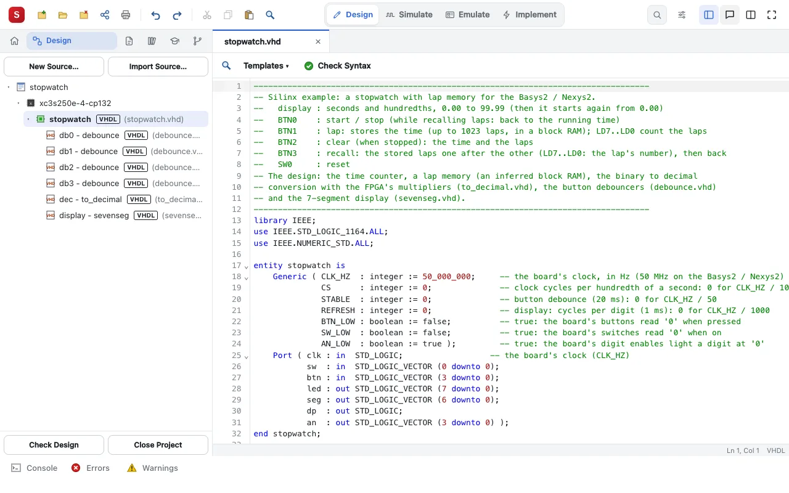
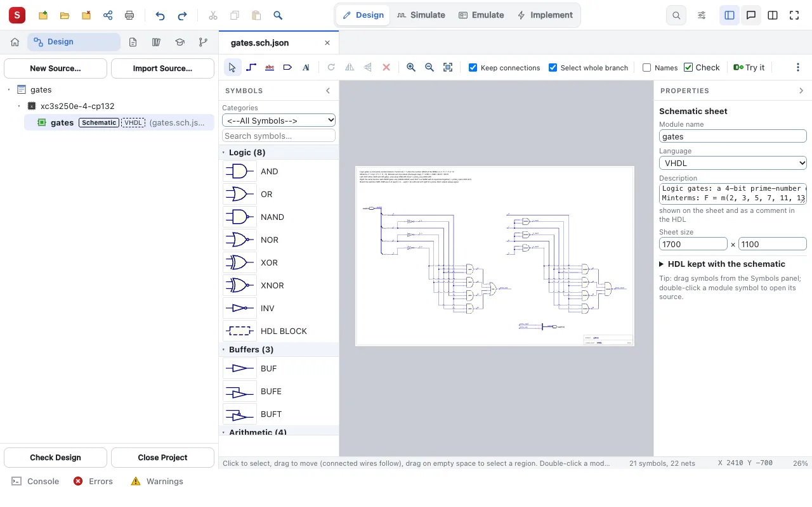
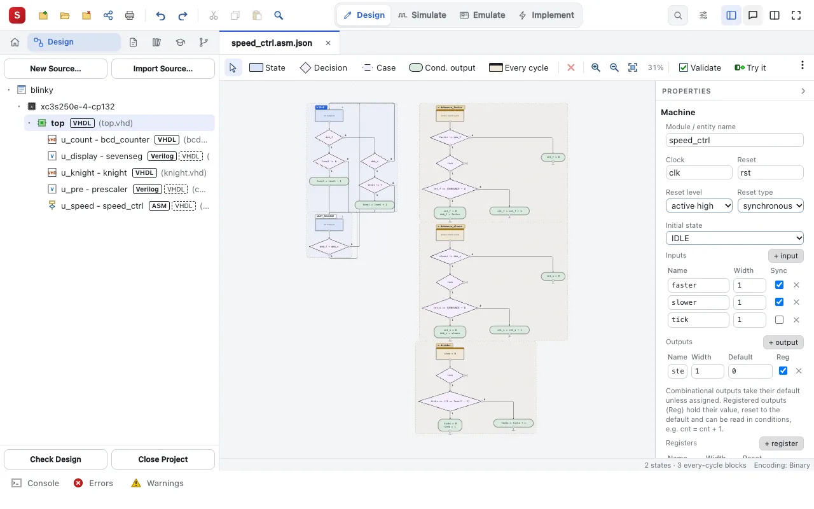
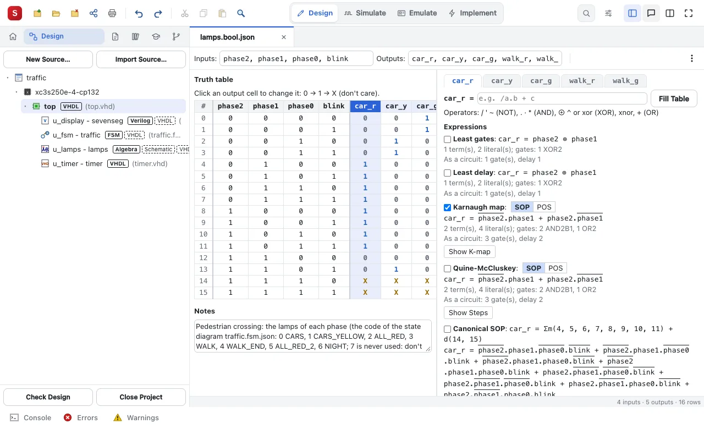

# Designing

[User's guide](README.md) · English

A Silinx project is made of modules, and each module is written or drawn the way that suits it best. A drawing is
the module's source: Silinx generates its VHDL or Verilog from it, always up to date. *New Source…* (the Design
pane) adds a module of any kind, most of them with a wizard.

## VHDL and Verilog

- Both languages, mixed in one project.
- Live errors and warnings, with an **explanation and how to fix it** for the common ones, and quick fixes.
- Auto-complete, language templates, go to definition, rename a signal everywhere it is used.
- Design checks as you type: a latch inferred, an incomplete sensitivity list, a signal never used…

## Schematics

Gates, multiplexers, adders, counters, registers and your own modules as symbols, wired as in ISE's Schematic Editor.
*Simulate* in the editor runs it live: click an input, see the wires change. Every symbol has its datasheet
(*Symbol Info*).

## State machines and ASM charts

- **State diagrams (FSM)**: states and transitions, Moore or Mealy, drawn or made by the FSM Wizard.
- **ASM charts**: state, decision and conditional output boxes, as the textbooks draw them.
- A state diagram becomes an ASM chart and back; *Try it* runs either, step by step.

## Boolean algebra and Karnaugh maps

A truth table, or expressions, become a circuit: the Karnaugh map, Quine-McCluskey with its steps, the canonical
forms, and the circuit each gives (its gates and delay). An expression can even be written by hand, with a pen.

## Circuits, Petri nets and C

- **Digital circuits on a breadboard**: real 74xx and 4000 chips, see [Circuits on a breadboard](circuits.md).
- **Petri nets**: places, transitions and tokens, simulated, and their hardware generated.
- **C and C++**: a function made into a VHDL or Verilog module, as AMD's Vitis HLS does: see
  [Silinx HLS](c-to-hdl.md).

## The Design pane

One row per module: its drawing first, then the HDL generated from it. A design and simulation project (no FPGA, no
board) shows only the drawings, for a course that does not reach the board.

Next: [Simulating](simulating.md). Every editor in detail: [the features](features.md).
