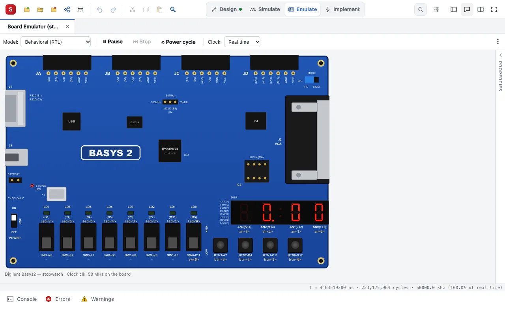
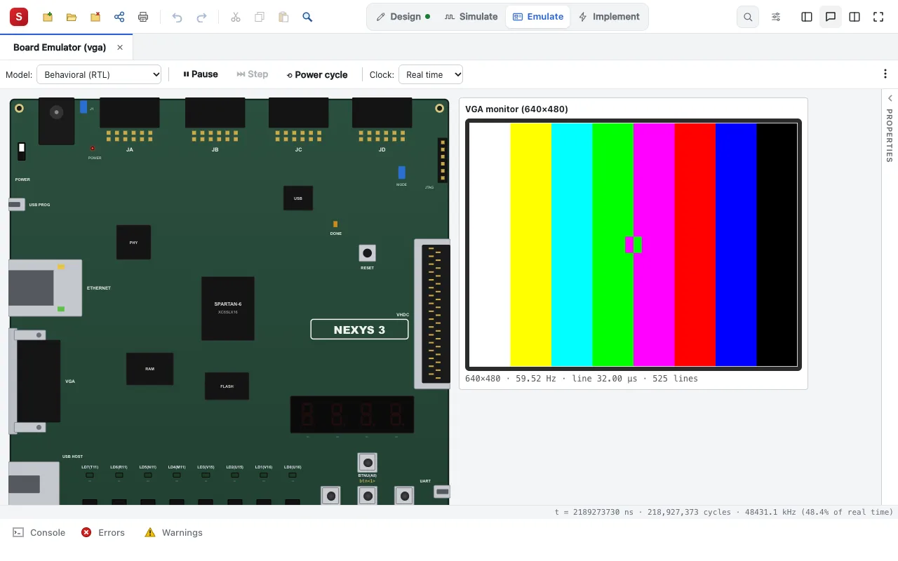
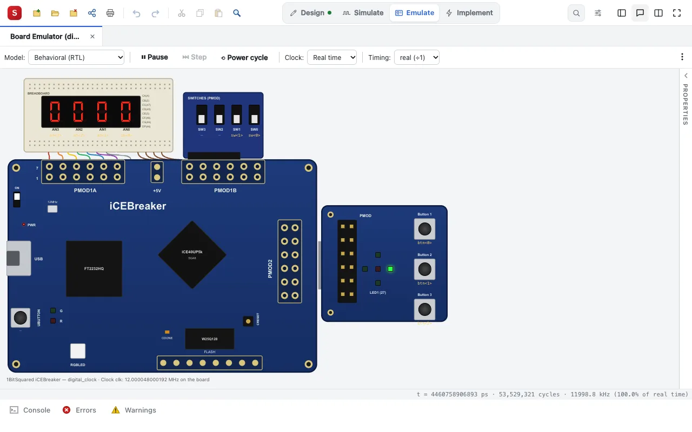

# The Board Emulator

[User's guide](README.md) · English · [Português](../pt/emulator.md)

The Board Emulator runs the design on a drawing of the real board, wired by its constraints: flip the switches,
press the buttons, and watch the LEDs, the 7-segment displays and the VGA monitor, at the board's real speed. No
board needed, and nothing to install: it works in the browser, on a tablet too. On a phone the board is fitted to the
screen's width, and its switches and buttons are repeated under it, large enough for a finger.

*Emulate* (the Silinx interface's Emulate task) or *Emulate on Board ▸ Emulate Behavioral Model (RTL)* (the ISE style
interface) opens it on the project's top module.

## Boards

The Basys2, Nexys2, Nexys3, Atlys, Basys 3, Nexys A7, Spartan-3E Starter Kit, iCEBreaker, ULX3S, Tang Nano 9K, Zybo Z7
and Arty Z7 (among others) are drawn as they are, their PCB's colour included; the other boards (the GateMate evaluation
board, the Arty S7…) get a generic panel. On the Zybo Z7 and the Arty Z7 the processing system's parts (the MIO LED and
buttons, PS-SRST) are drawn but not emulated. What an example needs and such a board lacks (the Zybo Z7's, the Arty Z7's
and the Arty S7's 4-digit display, LEDs and switches past their own), which the constraints put on its Pmods, is drawn
on a breadboard under the board, each module named with its Pmods, and emulated as the board's own parts; the toolbar's
menu hides it (*Modules on the headers*).

| A Nexys3 and its VGA monitor (the vga example) | An iCEBreaker and its Pmods (the clock example) |
|---|---|
|  |  |

## What it shows

- The LEDs, the multiplexed 7-segment display (its persistence of vision), the switches and buttons.
- A **VGA monitor**: the 640×480 picture the design scans out, its sync timing measured and what is wrong with it
  said.
- A **watch list** of internal signals, and the clock rate, real time or slower.
- Two engines: the design **compiled** (tens of millions of cycles per second), or the **event-driven** simulation of
  the HDL, to debug.

## Pressing the buttons

A button clicked (or tapped) stays down, lit, until the design has run with it as long as a real press, a tenth of a
second of the board's time, so that a design's debouncer takes it however slow the emulator runs. A click made while
the emulator is paused is kept in the same way: the button stays down, and the design takes the press once it runs
again (*Run*). **Shift+click** holds a button down until it is Shift+clicked again; *Power cycle* lets
every button go.

It can also run what the tools built (the post-synthesis to post-place & route models), to see that the synthesized
design still does what the HDL said.

Next: [Boards and toolchains](boards.md). In detail: [the features](features.md).
