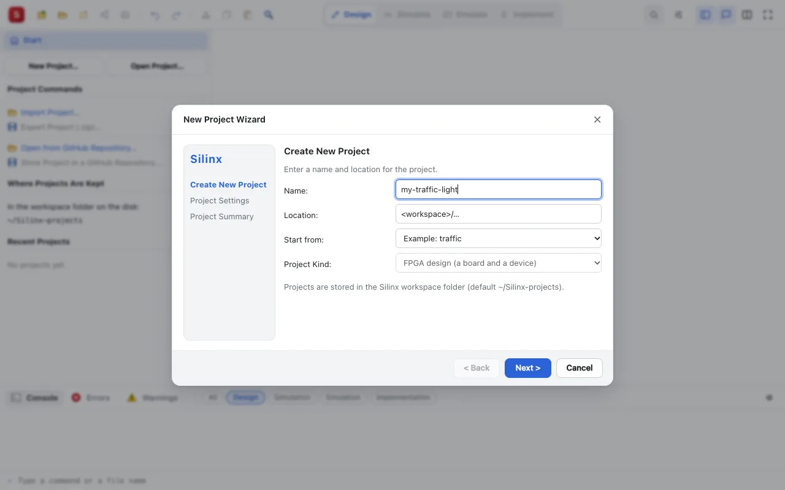

# Getting started with Silinx (step by step)

[User's guide](README.md) · English · [Português](../pt/getting-started.md)



No programming tools or git needed. **Way 1, in the browser, does it all**: Way 2 is another way of
running the same Silinx, on your own computer.

| I want to… | Use |
|---|---|
| write VHDL/Verilog, draw schematics and state machines, wire digital circuits on a breadboard (74xx and 4000 ICs, tried live), simulate, **synthesize** and **program a Basys2 / Nexys2 board** | **Way 1**: in the browser, nothing to install |
| work offline, keep the projects as folders with any browser, program with the installed tools (Adept, openFPGALoader…), or use **Xilinx ISE 14.7** or **AMD Vivado** for other boards | **Way 2**: run Silinx locally (installs Node.js once) |

---

## Way 1: in the browser (simplest)

The quickest: open **https://pmnmalo.github.io/Silinx/** in your browser (the latest release; your
projects are kept in that browser. The development version, with the changes not released yet, is at
https://pmnmalo.github.io/Silinx/dev/, its projects kept apart) and go to step 4. Or download it, to work offline:

1. Open the **[latest release](https://github.com/pmnmalo/Silinx/releases/latest)**.
2. Under **Assets**, click **`Silinx.html`** to download it.
3. Double-click the downloaded file. It opens in your browser (Chrome, Edge, Firefox or Safari).
4. On the Start page click **New Project…**: its first page asks the project's kind, **Digital Logic** (schematics, truth tables, state machines and circuits on a breadboard, drawn and simulated: nothing of HDL, board or FPGA flow shown), **FPGA** (the default, a board and a device: what follows), **Embedded / SoC** (FPGA boards and microcontrollers in one System) or **System** (and terminals; these two not available yet in a release). Then choose in *Start from* **Example: gates** (logic gates drawn as a schematic: a good first example), **Example: breadboard** (74LS chips wired on a breadboard, counting a button's presses: a digital circuit, see [circuits.md](circuits.md)), **Example: traffic** (a pedestrian crossing: a state diagram and a Boolean algebra), **Example: blinky** (or *pong*, a game for two, *stopwatch*, *clock*, *vga*, a picture on a VGA monitor, *isqrt*, a C function made into hardware, *uart*, an echo over the serial port to a terminal, or *micro80*, an 8080-compatible microprocessor running a program) or **Empty project**. After the examples come the **Test design: …** entries: designs Silinx itself is tested with (schematics, state diagrams, C programs for Silinx HLS), each with its test (a test bench, or the C program's `main()`), to see what Silinx does with each kind of source. An empty project asks one thing more, on the next page: its **Top-Level Source Type** (HDL, Schematic, a state machine (FSM or ASM), Boolean Algebra, Petri Net, Circuit, or a C or C++ function for Silinx HLS): the project starts with that top. The kind and the top can be changed later in **Design Properties** (its *Project Kind*, the project's profile: a wider one allows more kinds of nodes and converts nothing; a narrower one is refused while a node would not be allowed, the console naming it).

That's all. Things to know:

- The menus named below (**File ▸ …**, **Tools ▸ …**) are the ISE style interface's; in the Silinx interface (the
  default) the same commands are on the Start page, under the header's **Settings** (⚙), and in the command palette
  (**Ctrl+K**: type the command's name).

- Your projects are saved **inside this browser** on this computer. To keep a copy or move it to
  another computer use **File ▸ Export Project (.zip)…** (and **File ▸ Import Project
  (.zip)…** to load it back, from the zip or from the project's folder, the one with its silinx.json; it also opens a `.silinx.json` project bundle of an earlier version). Clearing the browser's data deletes them.
- **Or keep them in a folder on your disk** (Chrome or Edge): **File ▸ Open Workspace Folder…**
  (also on the Start page) and choose a folder, for instance a new `Silinx-projects` folder in your
  Documents. Each project is then an ordinary folder in it (`silinx.json`, `src/`, `sim/`,
  `constraints/`, and `build/` with the bitstream), the same as Silinx running locally (Way 2): the
  folder opens there too, and a project's folder can be zipped and handed in. The browser remembers
  the folder; when it asks for permission again, click **Reopen Silinx-projects** on the Start page.
  **File ▸ Copy Browser Projects to the Folder** copies the projects you already had in the browser,
  and **File ▸ Use Browser Storage** goes back to the browser. The status bar shows where the projects
  are kept. The first time Silinx opens in Chrome or Edge, the console offers **Choose a Workspace
  Folder…** or **Keep in This Browser**; with a folder chosen, the projects already in the browser can
  be copied or moved into it (a move asks before deleting them from the browser). Firefox and Safari
  cannot open a folder: there the projects stay in the browser. A project kept only in the browser and not
  backed up for 7 days (exported as a Silinx project, or committed to GitHub) is said once in the console when
  it opens, with **Export Project (.zip)** and **Store Project in a GitHub Repository…** buttons.
- **Implement Design** and **Generate Programming File** run the Silinx toolchain in the browser
  (Basys2, Nexys2, Nexys3, Atlys and iCEBreaker boards; the first run downloads its tools from the site, about 100 MB, then the
  browser keeps them; the downloaded `Silinx.html` too): the bitstream (`<top module>.bit`, e.g. `blinky.bit`) is downloaded.
- **Program the board from the browser** (Chrome or Edge, or Chrome on an Android tablet; Firefox
  and Safari cannot reach USB devices; the page opened from the site's address, not from the
  downloaded file): connect the board's USB cable, switch it on, then **Configure Target Device ▸ Program
  FPGA** and choose the board in the list the browser shows (only the first time). On Windows, if
  Digilent Adept is installed, its driver holds the board: give it the WinUSB driver with
  [Zadig](https://zadig.akeo.ie) to use it from the browser. On Linux, allow access to the board with a
  udev rule (`SUBSYSTEM=="usb", ATTR{idVendor}=="1443", MODE="0666"`). To store the design in the
  board's flash (PROM), so that it starts at power-up, select the PROM (XCF02S / XCF04S) in the chain
  and click **Program PROM**, with the mode jumper on ROM (Basys2: JP3).
- **On an iPad or a tablet** (Safari, or the tablet's browser): editing, drawing, simulation and
  **Generate Programming File** work. **Chrome on an Android tablet also programs the board**, as
  on a computer (checked on a Samsung tablet; the board on the tablet's USB port); Safari on an iPad cannot reach USB devices (program
  the downloaded `.bit` from a computer or an Android tablet). The projects stay in the browser, which iPadOS may clear after some weeks
  without use: keep a copy with **File ▸ Export Project (.zip)…**. A tablet has less
  memory, so a large design may fail in synthesis. The right-click menus open with a **long press**
  (hold a finger still for half a second); two fingers move a drawing and a pinch zooms it. In portrait the side panel (Design) is shown or hidden
  with the header's side panel button (in the ISE style interface it is a drawer, the button at the left of the header), and the editors' properties open over the drawing (**Properties**).
- **On a phone**: open a project, an example or a link, read the documents (read only there), simulate and run the
  Board Emulator; one pane at a time, switched by the bar at the bottom (*Panels*, *Document*, *Console*). Editing,
  implementing and programming the board need a tablet or a computer (see [Features](features.md#on-a-phone)).
- **A link for your slides**: right-click the project in the Design pane, **Share Project…** (a copy), then **Generate** (the link made, then
  **Copy**, **Show** or **Show QR Code**): the link opens Silinx on the design, in Try it, the simulation or the board emulator, the whole project inside it (see the README,
  *A design in a link*).
- The interface opens in Portuguese when the browser is in Portuguese; **Settings (⚙) ▸ Language** changes it (in the
  ISE style interface, **View ▸ Language**).

### Programming the board from the browser on Windows

Chrome and Edge reach a USB board only through Windows' **WinUSB** driver. Digilent Adept (installed with
Adept, Xilinx ISE or Vivado, as on most lab computers) gives the Basys2 / Nexys2 its own driver, and FTDI's
driver takes the FTDI boards (Basys 3, Nexys A7, iCEBreaker, ULX3S, Tang Nano 9K). Then either:

- the board is **missing from the browser's list** of USB devices, in Chrome and in Edge alike, and the
  console says *no board chosen* once the list is closed; or
- the browser lists the board but cannot open it: the console says *the board cannot be opened (Access
  denied.)…*.

Both lines have a **Help: The Board on Windows** button that opens this section. To see which driver has
the board: Windows' Device Manager, with the board connected and switched on. Under *Digilent* or *Jungo*
(*Digilent USB Device*), or *USB Serial Converter* for an FTDI board, it has Adept's or FTDI's driver; under
*Universal Serial Bus devices*, with WinUSB as its driver, the browser can use it. A board shown nowhere, or
as an *Unknown USB Device*: check the cable (one that carries data, not only power), the power switch,
another USB port.

1. Close Digilent Adept, iMPACT, Vivado's Hardware Manager and the Silinx application: one program at a
   time can use the board.
2. Download [Zadig](https://zadig.akeo.ie) and run it, with the board connected and switched on.
3. **Options ▸ List All Devices**, choose the board (*Digilent USB Device*, *Basys2*, *Nexys2*, or
   *Dual RS232-HS (Interface 0)* for an FTDI board), choose **WinUSB** as the driver and click
   **Replace Driver** (or **Install Driver**).
4. Unplug the board and plug it in again, then click **Program FPGA**: the browser shows its list of
   USB devices; choose the board (only the first time).

Adept, iMPACT and Vivado no longer see the board while it has WinUSB: to use them again, put Digilent's
(or FTDI's) driver back in Windows' Device Manager (the board ▸ *Update driver* ▸ *Let me pick*).

**In a lab** (for teachers and the computers' administrators): Zadig needs an administrator's rights, so
students usually cannot run it themselves, and the driver it installs stays for every user of the computer
(once per computer and board model). Choose one setup per room: WinUSB, for Silinx in the browser; or
Digilent's driver, for Adept, iMPACT and the Silinx application run locally. A board that moves between
rooms of both kinds is given its driver again in each.

The browser shows its list only right after a click: if the console says *the browser did not show its
list of USB devices*, click the button again. If it says *no board chosen*, the list was closed with no
board: check the cable and that the board is switched on (a board missing from the list on Windows: its
driver, as above).

---

## Way 2: run Silinx locally (Node.js)

The same Silinx, running on your computer instead of the site: projects as folders in
`Silinx-projects` with any browser, synthesis offline, the board programmed with the installed tools
too (Digilent Adept, openFPGALoader, xc3sprog, adepttool) or from Firefox and Safari, and Xilinx ISE
14.7 or AMD Vivado for the boards the Silinx toolchain does not support yet.

### Step 1: install Node.js (once)

Silinx runs on **Node.js**, a free program.

1. Go to **https://nodejs.org** and download the version marked **LTS**.
2. Run the installer and accept the defaults (Next, Next, Install).
   - **Windows:** keep the option *Add to PATH* ticked (it is by default). You do **not** need the
     extra "Tools for native modules".
   - **macOS:** open the downloaded `.pkg` and follow the steps.
   - **Linux:** use your package manager (Ubuntu/Debian: `sudo apt install nodejs npm`) or the
     installer from nodejs.org. Version 18 or newer is needed.

### Step 2: download Silinx

1. Open the **[latest release](https://github.com/pmnmalo/Silinx/releases/latest)**.
2. Under **Assets**, download **`silinx-<version>.zip`** (for example `silinx-15.22.1.zip`).
   - Don't use the green **Code ▸ Download ZIP** button or "Source code": that version does not
     include everything Silinx needs (it still works, but the first start needs Internet to
     download the missing parts).
3. **Unzip it** (extract it) to a folder you will find again, e.g. *Documents*:
   - **Windows:** right-click the zip ▸ **Extract All…** ▸ Extract. Don't run it from inside the zip.
   - **macOS:** double-click the zip.
   - You get a folder called **`silinx`**.

*Optional, to make sure the file is the release's (for example one you got from a course page):* the
release lists each file's SHA-256 checksum in its notes and in the file **`SHA256SUMS`**. Download
`SHA256SUMS` into the same folder and, in a terminal there, run `sha256sum -c SHA256SUMS --ignore-missing`
(Linux) or `shasum -a 256 -c SHA256SUMS --ignore-missing` (macOS): the file must say `OK`. On Windows,
`Get-FileHash silinx-<version>.zip` in PowerShell prints the checksum to compare with the notes'.
Each file also has GitHub's build provenance attestation (it was built by the repository's Release
workflow from the version's tag): with the [GitHub CLI](https://cli.github.com),
`gh attestation verify silinx-<version>.zip --repo pmnmalo/Silinx`.

### Step 3: start Silinx

Open the `silinx` folder and double-click the launcher for your system:

| System | Double-click |
|---|---|
| Windows | **`Start Silinx.bat`** |
| macOS | **`Start Silinx.command`** |
| Linux | **`start-silinx.sh`** (or run `./start-silinx.sh` in a terminal) |

A black window (the Silinx server) opens and then your browser shows Silinx at
**http://127.0.0.1:8642**.

- **Keep the black window open** while you work. Closing it stops Silinx.
- Closed the browser tab by mistake? Go to http://127.0.0.1:8642 again, in the same browser, while the window is open
  (or double-click the launcher again).
- Double-clicking the launcher when Silinx is already running just opens the browser again.

**First time only, you may see:**

- **Windows: "Windows protected your PC"**: click **More info ▸ Run anyway**.
- **Windows Firewall** asks about Node.js: click **Allow** (Silinx only listens on your own computer).
- **macOS: "cannot be opened because it is from an unidentified developer"**: right-click
  (or Ctrl-click) `Start Silinx.command` ▸ **Open** ▸ **Open**. Next time a double-click is enough.

### Step 4: use it

- Start page ▸ **New Project…**, *Start from* **Example: gates** for a first look (AND, OR, NOT and NAND gates in
  a schematic: a 4-bit prime-number detector on the switches and two LEDs), **Example: traffic** next (a
  pedestrian crossing: its controller a state diagram, its lamps a Boolean algebra), **Example: blinky** to explore a
  complete design, or **Empty project**.
- Your projects are saved as normal folders in **`Silinx-projects`** in your user folder
  (Windows: `C:\Users\<you>\Silinx-projects`, macOS: `/Users/<you>/Silinx-projects`).
  You can copy them, back them up, or zip them to hand in.
- **Rename Project…** (File menu, the project's right-click menu in the Design pane, a recent project's on the Start
  page) changes a project's name: its folder is renamed (a git repository's with its `.git`, its GitHub repository
  kept), and the project stays open with its tabs. Not while an implementation runs or while the project is shared live.
- **Open in VS Code** (the editor Silinx finds on this computer: VS Code, VSCodium or Cursor): right-click a text file
  (HDL, C, constraints) in the Design pane or its tab for the file, the project for its folder (**Open Folder in VS
  Code**); each save there is shown in Silinx.
- **The Collaboration tab** (the side panel's last; with no project open, beside Start: the sign-in, Open from GitHub Repository…): a project in a GitHub repository (a GitHub Classroom assignment's
  too), Commit…, Push, Pull, Changes… (its changed files, in a window), History… and GitHub's checks; Store Project in a GitHub Repository… or Open from GitHub Repository…
  for one with none (README, "A project on GitHub"); and its Sharing box: Share a Copy…, and live sharing: Share Live…,
  who is in, Stop Sharing.
- **File ▸ Export Project (.zip)…** starts with the software it goes to: **Xilinx ISE** produces a zip that opens in Xilinx ISE 14.7; **Silinx** saves the whole Silinx project (ASM charts and schematics included), reopened with **File ▸ Import Project…** (which recognises the zip's software); a Silinx project's folder (the one with its silinx.json) imports there too, as an ISE project's does. AMD Vivado and Intel Quartus are shown disabled: Silinx does not read or write their projects yet. An imported project came from outside: it runs Xilinx ISE and programs a board only once you press **Trust Project** in the console, where it says so when the project opens. A design and simulation project (no FPGA) has no software to choose: it is exported as a Silinx project.
- The interface opens in Portuguese when the browser is in Portuguese; **Settings (⚙) ▸ Language** changes it (in the
  ISE style interface, **View ▸ Language**).

### Updating Silinx

Download the new `silinx-<version>.zip`, unzip it and use the new folder (you can delete the old
one). **Your projects are not inside that folder**, so they are kept.

---

## Synthesis and programming a board with Silinx running locally (optional)

In the browser (Way 1) nothing more is needed for the Basys2 and Nexys2. Running Silinx locally
(Way 2), these need up to two more things. Your teacher may provide them already set up.

1. **For the Basys2 and Nexys2 boards, nothing:** the *Silinx toolchain*, the default mode,
   synthesizes and generates the bitstream with no Xilinx tool. **The Spartan-6 boards, the Nexys3 and the
   Atlys, too**, in the browser and with Silinx running locally; the Atlys has no seven-segment
   display or VGA of its own, so Silinx puts them on its VHDCI connector (as a Digilent VmodBB wires
   them). For the other boards (or the
   processes that need ISE), **Xilinx ISE 14.7** (free WebPACK licence); on any computer it runs
   inside **Docker**, then choose an ISE mode in *Settings (⚙) ▸ Toolchain Settings (ISE / Programmers)…* (ISE style:
   *Tools ▸ …*):
   - install [Docker Desktop](https://www.docker.com/products/docker-desktop/) (on Apple Silicon
     Macs, OrbStack is a faster alternative);
   - download `silinx-docker-kit-<version>.zip` from the release and follow its `ise/README.md`:
     you download the ISE installer and licence with your own free AMD account and run one script
     (it takes 20–60 minutes, once). ISE cannot be shared, so everyone builds their own copy.

   The 7-series boards, the Basys 3 and the Nexys A7 (Artix-7), the Arty S7 (Spartan-7) and the Zybo Z7 (Zynq-7000),
   are built by **AMD Vivado** ML Standard (free for these parts) with Silinx running locally, its Synthesis Tool
   Vivado; the Basys 3 and the Nexys A7 by the Silinx toolchain too, in the browser as well (the README, *The Artix-7
   boards with AMD Vivado*).
2. **The board's USB driver** to program it:
   - **Windows:** install Digilent **Adept 2** (Runtime + Utilities) from digilent.com.
   - **macOS (Basys2):** in a Terminal, inside the `silinx` folder, run
     `brew install libusb python` and `./scripts/install-adepttool.sh` (needs [Homebrew](https://brew.sh)).
   - **Linux:** Digilent Adept, or openFPGALoader from your package manager.

In Silinx, **Settings (⚙) ▸ Toolchain Settings (ISE / Programmers)…** (ISE style: **Tools ▸ …**) shows what was found.

---

## Problems?

| What you see | What to do |
|---|---|
| The launcher says **Node.js is not installed** | Install it (Step 1). Then close the window and double-click the launcher again. |
| Browser: **"This site can't be reached"** | The Silinx window was closed: double-click the launcher again. |
| **"Port 8642 is used by another program"** | Another program uses that port. Open a terminal in the `silinx` folder and run `node bin/silinx.js serve --port 8643 --open`. |
| Console: **"the Silinx server is not running"** | Same as above: start Silinx again. Your unsaved changes are saved as soon as it is back. |
| macOS: the `.command` file **opens in a text editor** | Right-click it ▸ Open With ▸ Terminal. |
| The window flashes and closes | Open a terminal in the `silinx` folder and run `node bin/silinx.js serve --open` to read the message. |

**Opening a terminal in a folder:** Windows: open the folder, click the address bar, type `cmd`
and press Enter. macOS: right-click the folder ▸ *New Terminal at Folder* (or open Terminal, type
`cd `, drag the folder into the window and press Enter).

---

## For those who use git

```bash
git clone https://github.com/pmnmalo/Silinx.git
cd Silinx
npm install
npm start            # prints the address to open: http://127.0.0.1:8642/#token=…
```
