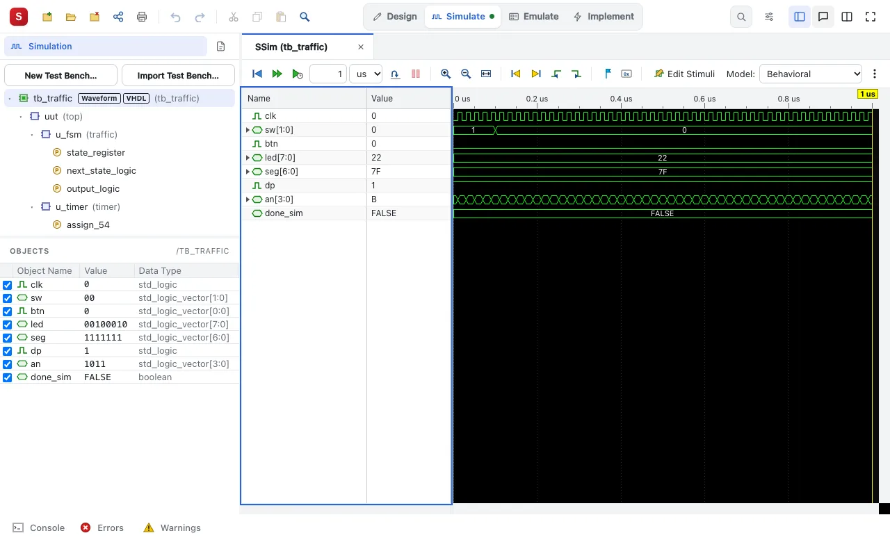

# Simulating

[User's guide](README.md) · English · [Português](../pt/simulating.md)

Silinx has its own simulator, **SSim**, for VHDL and Verilog, in the browser. Nothing else to install.

## Three ways to see a design work

- **Try it**, in a drawing's editor (a schematic, a state diagram, an ASM chart, a circuit): click the inputs, step
  the clock, watch the drawing change. The quickest check, with no test bench.
- **A test bench**: *Simulate* (the Silinx interface's Simulate task, or *Simulate Behavioral Model* in the ISE style
  one) runs it and shows the waveforms: zoom, cursors and markers, values in binary, hexadecimal or decimal, the
  internal signals of any instance added to the window.
- **The Board Emulator**: the design on a picture of the board, see [The Board Emulator](emulator.md).

A Try it that runs on its own (Run, a clock), the Board Emulator and the System Emulator pause while you do not see
them (another browser tab, a minimised window, another document tab) and go on where they were when you come back.
The Board Emulator's menu, **When hidden ▸ Keep running**, keeps them all running instead.

## Making a test bench

- **The Test Bench Wizard** (*New Test Bench…*, or a module's right-click menu) writes a self-checking test bench:
  the input vectors, and the expected outputs, given or taken from the design.
- **Stimuli drawn on the waveforms** (*Edit Stimuli*), as ISE's old HDL Bencher did: draw the inputs, and Silinx
  writes the test bench.
- Or write it by hand, in VHDL or Verilog.

## After the synthesis

The same test bench can run on what the tools built: the post-synthesis, post-translate, post-map and
post-place & route models, the last one with its timing.

Next: [The Board Emulator](emulator.md). In detail: [the features](features.md).
