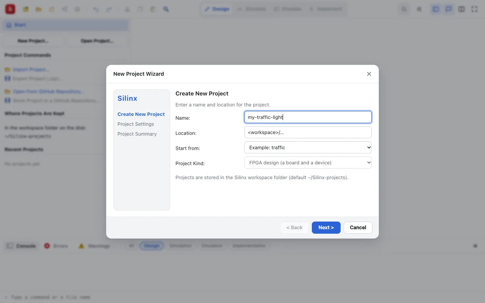

# Teaching with Silinx

[User's guide](README.md) · English · [Português](../pt/teaching.md)

Silinx was made for a digital systems course: the examples, the labs, the grading and the sharing are a teacher's
tools.

## The examples

Each example is a complete project, with its test bench, that builds and runs on every supported board. They go from
the first gates to a microprocessor:

| Example | What it shows |
|---|---|
| **gates** | logic gates drawn as a schematic: a first project |
| **breadboard** | 74LS chips wired on a breadboard: a digital circuit |
| **traffic** | a pedestrian crossing: a state diagram, Boolean algebra, VHDL and Verilog |
| **blinky** | VHDL and Verilog, an ASM chart, the board's display |
| **pong** | a game for two, in Verilog |
| **stopwatch** | VHDL, a block RAM and the multipliers |
| **clock** | a clock set with the buttons, in Verilog |
| **vga** | a picture on a VGA monitor |
| **isqrt** | a C function made into hardware |
| **uart** | serial communication with a terminal |
| **micro80** | a microprocessor running a program from a block RAM |

*New Project…* starts from any of them.

## Guided labs

*Project ▸ Guided Labs…* opens a step-by-step tutorial beside the project: each step says what to do, and
*Check Step* checks it on the project (a file, a module's ports, the warnings, the simulation's values, a pin…).
Silinx ships labs on gates, traffic, blinky and stopwatch, in English and Portuguese, and a teacher writes new ones
(*New Source ▸ Guided Lab*).

## Exercises graded automatically

An exercise's tests simulate the student's design and give each test its verdict and points, as Mooshak does for
programs: in the interface, on the command line for a whole class, or as a GitHub Classroom assignment. See
[automatic grading](grading.md) and [GitHub Classroom](classroom.md).

## Sharing

- **A design in a link**, for the slides: *Share Project…* makes a link that opens Silinx on the design, straight in
  Try it, the simulation or the board emulator, the whole project inside the link. Or a QR code.
- **Live**: share the project as you work; the class follows read only, or edits with you. From the site, your
  followers connect to you directly; [a relay of your own](live-relay.md), free on Cloudflare, finds them and carries
  the messages of those whose network blocks a direct path. Reloading the page, yours or a follower's, resumes it:
  the same links, the followers back by themselves.
- **Merge Contribution…** brings a student's or a group's copy back into the project, a drawing merged by its
  objects.
- **GitHub**: a project in a repository (commit, push, pull, branches), a GitHub Classroom assignment too.

In detail: [the features](features.md#guided-labs).
