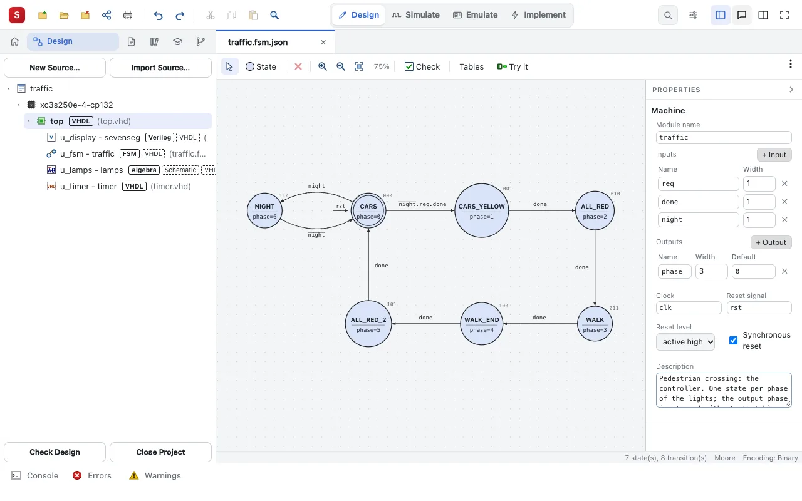
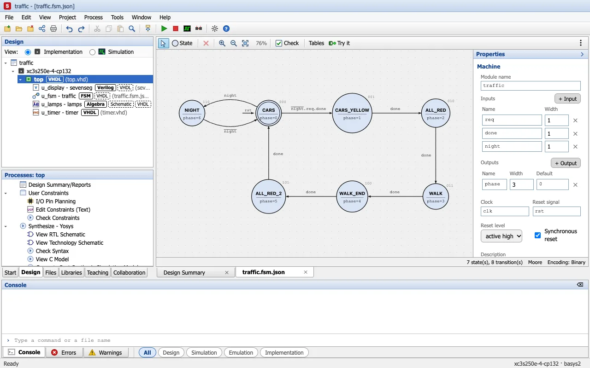

# What Silinx is

[User's guide](README.md) · English · [Português](../pt/what-is-silinx.md)

Silinx is an FPGA design environment made for teaching digital systems. A student writes VHDL or Verilog, or draws
the design (a schematic, a state diagram, an ASM chart, a truth table, a circuit of real chips on a breadboard),
simulates it, tries it on an emulated board, and builds it for a real board, all in one place, in the browser.

It was made because the tool many courses were built on, Xilinx ISE, was discontinued long ago. Silinx works like
ISE's Project Navigator, so the course materials still fit, and it brings its own open toolchain, so the students
need nothing else installed. Who started it and why: [the history of Silinx](../../HISTORY.md).

## For whom

- **Students**: open the site, start from an example, and get to a working board without installing anything.
  Errors come with an explanation and how to fix them, in English and Portuguese.
- **Teachers**: guided labs, exercises graded automatically, a design in a link for the slides, a project shared live
  with the class. See [Teaching with Silinx](teaching.md).
- **Anyone** who wants to learn digital design on an FPGA board.

## Two interfaces

*Settings ▸ Interface* switches between them, and the projects are the same in both.

| The Silinx interface (the default) | The ISE style interface |
|---|---|
|  |  |
| Its tasks (Design, Simulate, Emulate, Implement) in the header, one at a time. | The menus, toolbars and Processes panel of ISE's Project Navigator. |

Both are in English and in Portuguese: the browser's language is chosen, and *Settings ▸ Language* changes it.

## Where it runs

- **In the browser**, at https://pmnmalo.github.io/Silinx/: nothing to install, the projects kept in the browser
  (or, in Chrome and Edge, in a folder of your disk). On a tablet too.
- **As one file**, `Silinx.html`, to keep and open offline.
- **On your computer**, with Node.js: the projects as folders, Xilinx ISE 14.7 and AMD Vivado for the boards the
  Silinx toolchain does not build for, and the board programmed with the installed tools.

[Getting started](getting-started.md) shows each way.

## What it is not

Silinx is not affiliated with, endorsed by or supported by AMD/Xilinx. Xilinx, ISE, ISim, iMPACT, Spartan and Virtex
are trademarks of AMD. ISE and Vivado, where you use them, are installed by you.

*About the name:* Silinx = **SI** + **linx**. SI stands for *Super Intelligence*: the tool was generated by an AI.
*linx* stands for the programmable links of an FPGA, the interconnect that wires its logic blocks together.
