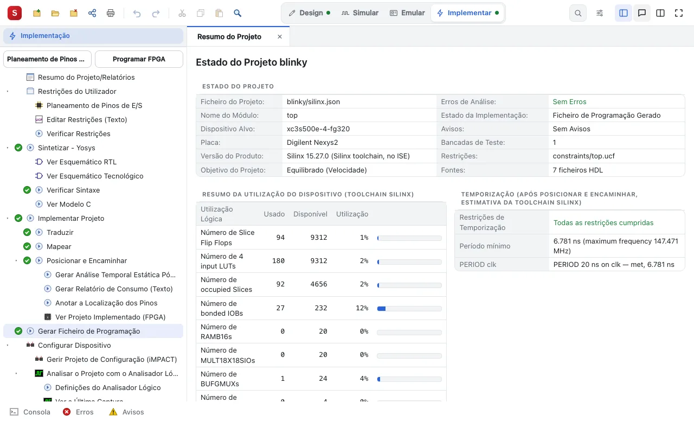
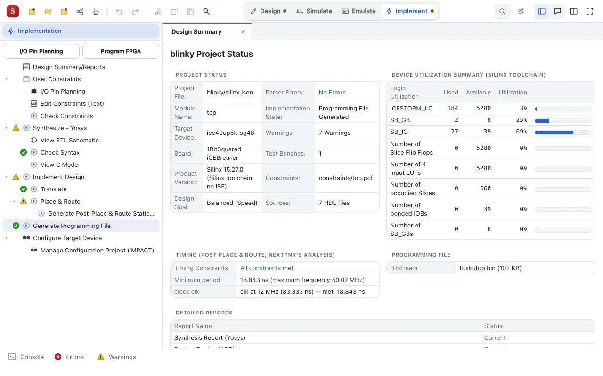
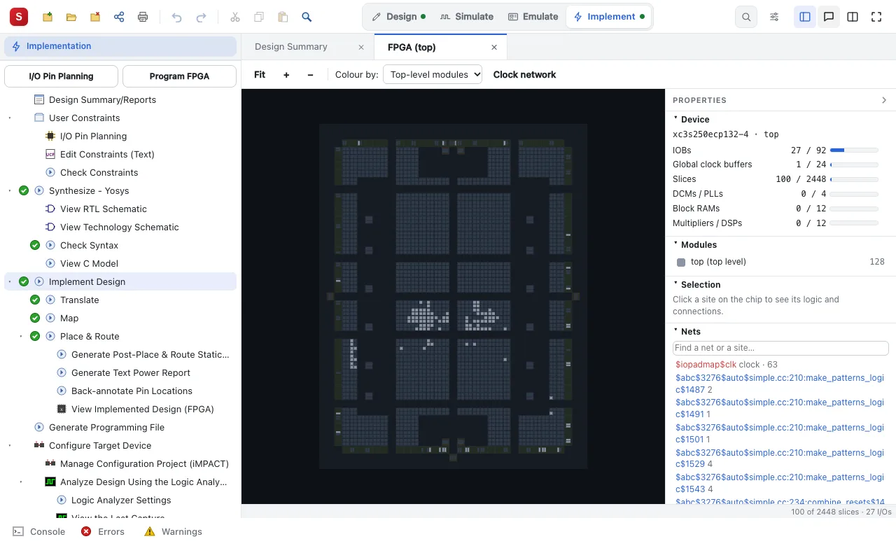

# Placas e ferramentas

[Guia do utilizador](README.md) · [English](../en/boards.md) · Português

Do projeto à placa: a síntese, o posicionamento e encaminhamento, o bitstream, e a placa programada. O Silinx faz tudo
com as suas próprias ferramentas abertas (o Yosys para a síntese, o nextpnr para o posicionamento e encaminhamento, o
gerador de bitstreams do Silinx), no browser, sem nada instalado.

| O blinky numa Nexys2 (Spartan-3E) | O blinky numa iCEBreaker (iCE40) |
|---|---|
|  |  |

## As placas

| Família | Placas | Implementadas por |
|---|---|---|
| Spartan-3E | Basys2-100 / 250, Nexys2-500 / 1200 | as ferramentas do Silinx, ou o Xilinx ISE |
| Spartan-6 | Nexys3, Atlys | as ferramentas do Silinx, ou o Xilinx ISE |
| iCE40 | iCEBreaker | as ferramentas do Silinx |
| ECP5 | ULX3S | as ferramentas do Silinx |
| Gowin | Tang Nano 9K | as ferramentas do Silinx |
| GateMate | Cologne Chip GateMate FPGA Evaluation Board (não programada a partir do Silinx) | as ferramentas do Silinx |
| Série 7 (uma família experimental) | Basys 3, Nexys A7 (Artix-7); Zybo Z7-20 / 10, Arty Z7-20 / 10 (Zynq-7000: a sua lógica programável, o Cortex-A9 ainda não) | as ferramentas do Silinx, ou o AMD Vivado |
| Série 7 | Arty S7 (Spartan-7) | o AMD Vivado |
| MAX 10, Cyclone IV E, Cyclone V (cada qual uma família experimental) | Terasic DE10-Lite; DE0-Nano, DE2-115; DE0-CV, DE1-SoC, DE10-Nano | Intel Quartus Prime Lite, que instala à parte (o servidor local); programadas com o openFPGALoader pelo USB-Blaster da placa |
| todas as famílias que o ISE 14.7 implementa | as outras placas da Digilent, da Xilinx e da Numato, ou só um dispositivo | o Xilinx ISE |

*Propriedades do Projeto…* escolhe a placa. Um **projeto de desenho e simulação** não tem placa: só projeta e simula.

## Implementar

*Implementar* (a interface Silinx) ou o painel de Processos (a interface ao estilo do ISE), como no ISE: a síntese,
*Implementar Projeto* (tradução, mapeamento, posicionamento e encaminhamento), *Gerar Ficheiro de Programação*. Depois:

- o **Resumo do Projeto**: os recursos usados, os tempos, os avisos;
- **Ver Esquemático RTL** e **Ver Esquemático Tecnológico**: o projeto tal como o Yosys o leu, e tal como o mapeia;
- **Ver Projeto Implementado (FPGA)**: o projeto posicionado e encaminhado dentro do chip;
- os caminhos mais lentos, etapa a etapa, até às linhas da fonte.

Para o Spartan-3E e o Spartan-6, os bitstreams que as ferramentas do Silinx escrevem para os projetos testados são,
byte a byte, os que o ISE escreve para o mesmo encaminhamento.

## Programar a placa

A partir do browser, por USB (o Chrome ou o Edge num computador, o Chrome num tablet Android): *Configurar Dispositivo ▸
Programar FPGA*. Também a memória flash da placa (a PROM), para o projeto arrancar ao ligar. Com o Silinx a correr no
seu computador, também servem as ferramentas instaladas: o Digilent Adept, o openFPGALoader, o xc3sprog, o adepttool,
o iMPACT do ISE.

Um **analisador lógico**, como o ChipScope, observa os sinais dentro da FPGA enquanto o projeto corre na placa.

## O Xilinx ISE 14.7 e o AMD Vivado

Para as placas que as ferramentas do Silinx não implementam, o Silinx corre o ISE 14.7 (a edição gratuita WebPACK) ou o
Vivado, que instala por si, normalmente numa imagem Docker. Como: [as ferramentas](../en/toolchains.md) (em inglês).

A seguir: [Ensinar com o Silinx](teaching.md).
