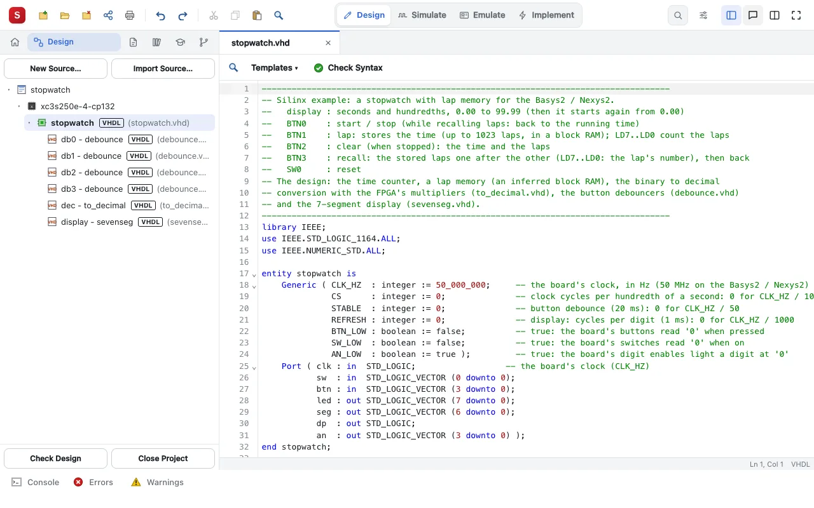
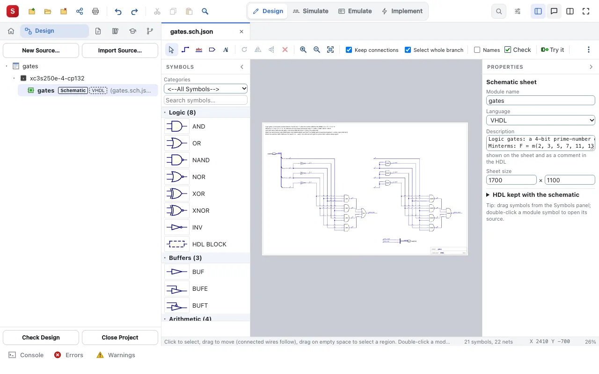
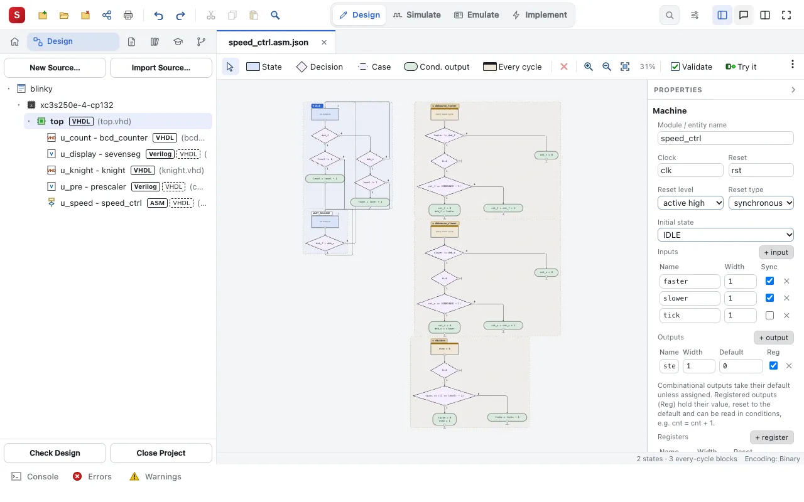
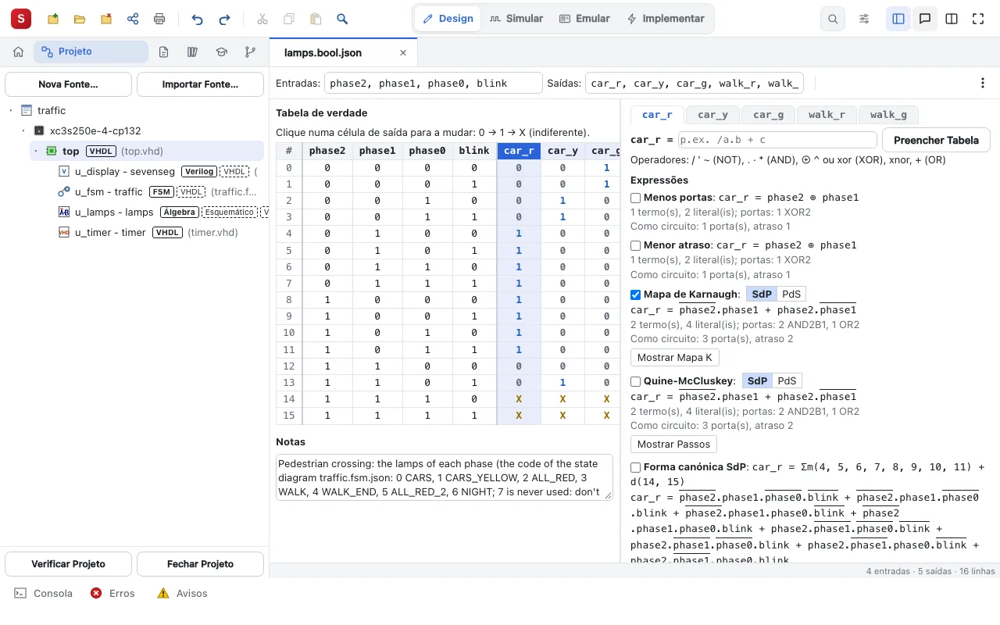
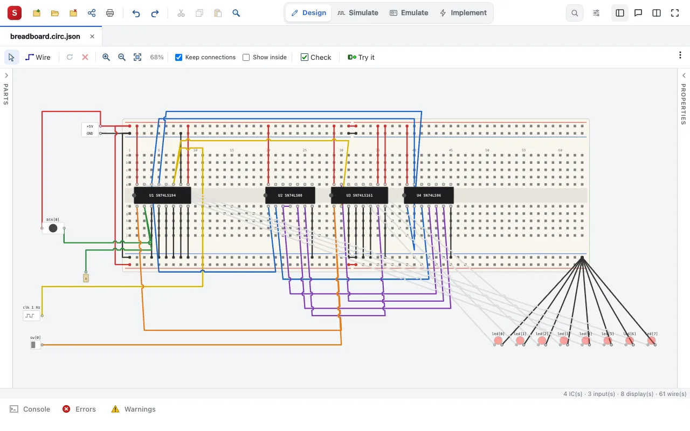

# Projetar

[Guia do utilizador](README.md) · [English](../en/designing.md) · Português

Um projeto do Silinx é feito de módulos, e cada módulo é escrito ou desenhado da forma que melhor lhe convém. Um
desenho é a fonte do módulo: o Silinx gera dele o VHDL ou o Verilog, sempre atualizado. *[Novo]* na linha do
dispositivo do painel Projeto (ou *Projeto ▸ Nova Fonte…*) acrescenta um módulo de qualquer tipo que o dispositivo
aceite, quase todos com um assistente, e *[Importar]* copia ficheiros para lá; num Sistema, cada nó tem os seus, as
suas fontes na sua pasta: numa FPGA HDL, desenhos, assistentes e C / C++ para o Silinx HLS; num Arduino um sketch, C,
C++ e assembly; num Pico ou num ESP32 Python; num PIC24 o seu .hex, importado. Um ficheiro de restrições não é uma
fonte nova: faz-se com o I/O Pin Planning.

## VHDL e Verilog

- As duas linguagens, misturadas no mesmo projeto.
- Erros e avisos enquanto escreve, com uma **explicação e a forma de o corrigir** para os mais comuns, e correções
  rápidas.
- Completar automático, modelos da linguagem, ir para a definição, mudar o nome de um sinal em todo o lado onde é usado.
- Verificações do projeto enquanto escreve: um latch inferido, uma lista de sensibilidade incompleta, um sinal nunca
  usado…

## Esquemáticos

Portas, multiplexadores, somadores, contadores, registos e os seus próprios módulos como símbolos, ligados como no
Schematic Editor do ISE. *Simular* no editor põe-no a funcionar: clique numa entrada e veja os fios mudarem. Cada
símbolo tem a sua folha de características (*Informação do Símbolo*). Nos somadores, subtratores, comparadores, contadores, multiplexadores,
descodificadores, desmultiplexadores e codificadores pode entrar-se (*Entrar*, ou um duplo clique numa simulação): como
são construídos, nível a nível até às portas lógicas (ADD8 de dois ADD4, ADD4 de quatro FA1; M8_1 de dois M4_1 e um
M2_1), cada nível simulado, com os valores do símbolo quando se entra a partir de uma simulação.

## Máquinas de estados e fluxogramas ASM

- **Diagramas de estados (FSM)**: estados e transições, Moore ou Mealy, desenhados ou feitos pelo assistente de FSM.
- **Fluxogramas ASM**: caixas de estado, de decisão e de saída condicional, como os livros os desenham.
- Um diagrama de estados passa a fluxograma ASM e volta; *Experimentar* corre qualquer um, passo a passo.

## Álgebra de Boole e mapas de Karnaugh

Uma tabela de verdade, ou expressões, passam a circuito: o mapa de Karnaugh, o Quine-McCluskey com os seus passos, as
formas canónicas, e o circuito que cada um dá (as portas e o atraso). Uma expressão pode até ser escrita à mão, com uma
caneta.

## Circuitos, redes de Petri e C

- **Circuitos digitais numa breadboard**: CIs 74xx e 4000 reais, ligados como na bancada e simulados ao vivo: veja
  [os circuitos](../en/circuits.md) (em inglês).

  
- **Redes de Petri**: lugares, transições e marcas, simuladas, e o seu hardware gerado.
- **C e C++**: uma função transformada num módulo VHDL ou Verilog, como faz o Vitis HLS da AMD: veja
  [o Silinx HLS](../en/c-to-hdl.md) (em inglês).

## O painel Projeto

Uma linha por módulo: primeiro o desenho, depois o HDL gerado dele. Um projeto de desenho e simulação (sem FPGA nem
placa) mostra só os desenhos, para uma cadeira que não chega à placa. No estilo ISE, a vista Implementação lista o
ficheiro de restrições e as imagens de memória debaixo do módulo de topo, como o ISE; na interface Silinx, Implementar
e Emular têm um separador Ficheiros ao lado do dos seus processos, com esses ficheiros debaixo do módulo de
topo (sozinhos quando o projeto não tem topo). Na interface Silinx, os painéis laterais de Implementar, Emular e Simular
começam pela mesma hierarquia: o projeto, o seu dispositivo (nenhum num projeto Circuito), e depois o módulo de topo de
Implementar e de Emular com os seus processos por baixo, ou os bancos de teste de Simular, cada um com os seus objetos
(a unidade em teste, os seus submódulos) por baixo.

A seguir: [Simular](simulating.md). Cada editor em pormenor: [as funcionalidades](../en/features.md) (em inglês).
