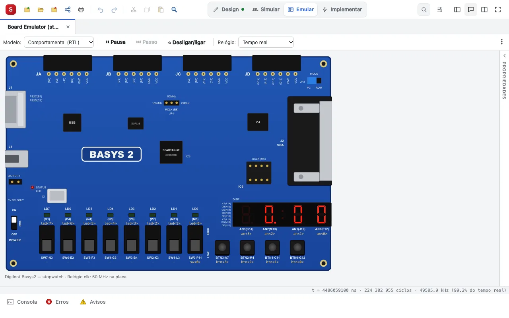
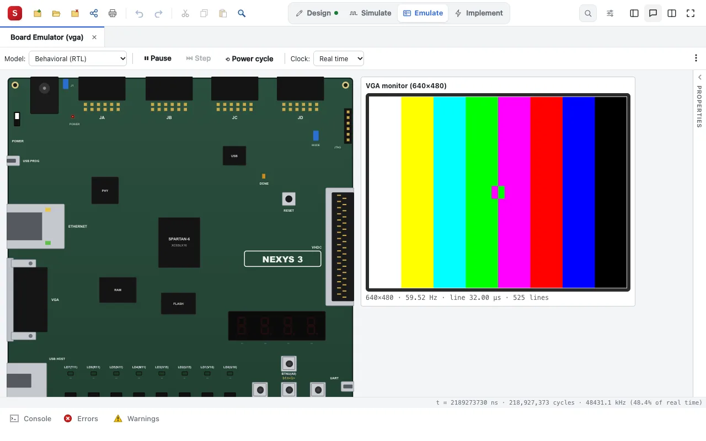
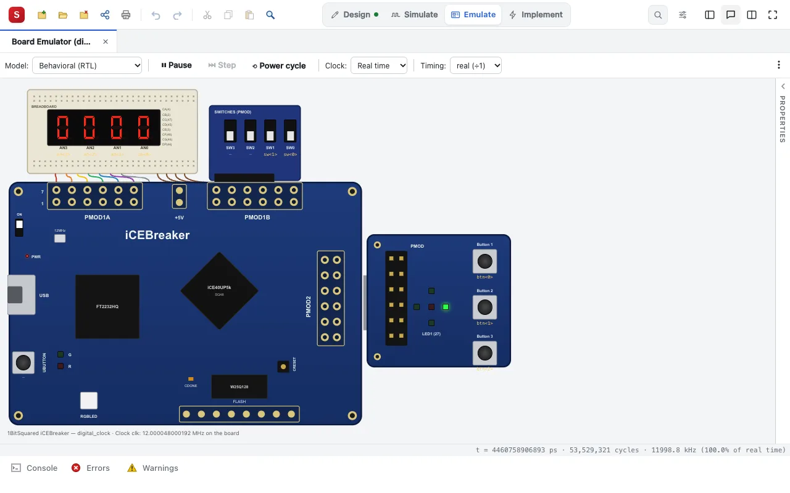

# O Emulador da Placa

[Guia do utilizador](README.md) · [English](../en/emulator.md) · Português

O Emulador da Placa corre o projeto num desenho da placa real, ligado pelas suas restrições: mude os interruptores,
carregue nos botões, e veja os LEDs, os mostradores de 7 segmentos e o monitor VGA, à velocidade real da placa. Sem
placa e sem nada a instalar: funciona no browser, também num tablet. Num telemóvel a placa ajusta-se à largura do
ecrã, e os seus interruptores e botões repetem-se por baixo dela, grandes o bastante para o dedo.

*Emular* (a tarefa Emular da interface Silinx) ou *Emular na Placa ▸ Emular Modelo Comportamental (RTL)* (a interface
ao estilo do ISE) abre-o com o módulo de topo do projeto.

## Placas

A Basys2, a Nexys2, a Nexys3, a Atlys, a Basys 3, a Nexys A7, o Spartan-3E Starter Kit e a iCEBreaker são desenhadas
tal como são; as outras placas (a ULX3S, a Tang Nano 9K, a placa de avaliação GateMate, a Arty S7, a Zybo Z7…) têm um painel genérico.

| Uma Nexys3 e o seu monitor VGA (o exemplo vga) | Uma iCEBreaker e os seus Pmods (o exemplo clock) |
|---|---|
|  |  |

## O que mostra

- Os LEDs, o mostrador de 7 segmentos multiplexado (com a persistência da visão), os interruptores e os botões.
- Um **monitor VGA**: a imagem de 640×480 que o projeto desenha, os tempos da sincronização medidos e o que estiver
  errado assinalado.
- Uma **lista de observação** de sinais internos, e a frequência do relógio, em tempo real ou mais devagar.
- Dois motores: o projeto **compilado** (dezenas de milhões de ciclos por segundo), ou a simulação do HDL **por
  eventos**, para depurar.

## Carregar nos botões

Um botão clicado (ou tocado) fica em baixo, aceso, até o projeto ter corrido com ele tanto quanto um toque real, uma
décima de segundo do tempo da placa, para que o debouncer do projeto o apanhe por mais devagar que o emulador corra.
Um clique feito com o emulador em pausa é guardado da mesma maneira: o botão fica em baixo, e o projeto apanha o toque
quando voltar a correr (*Executar*). **Shift+clique** mantém um botão em baixo até novo Shift+clique; o
*Desligar/ligar* solta todos os botões.

Também corre o que as ferramentas construíram (os modelos depois da síntese até depois do posicionamento e
encaminhamento), para confirmar que o projeto sintetizado ainda faz o que o HDL dizia.

A seguir: [Placas e ferramentas](boards.md). Em pormenor: [as funcionalidades](../en/features.md) (em inglês).
