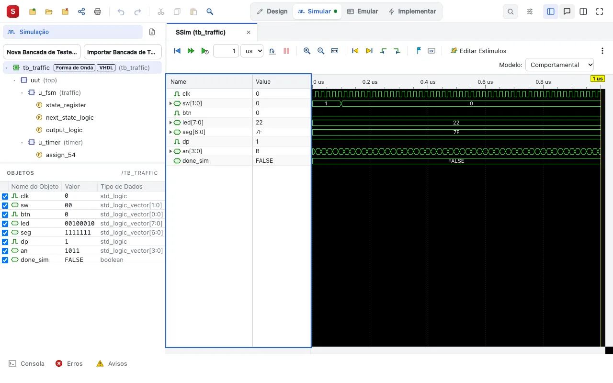

# Simular

[Guia do utilizador](README.md) · [English](../en/simulating.md) · Português

O Silinx tem o seu próprio simulador, o **SSim**, para VHDL e Verilog, no browser. Nada mais a instalar.

## Três formas de ver um projeto a funcionar

- **Experimentar**, no editor de um desenho (um esquemático, um diagrama de estados, um fluxograma ASM, um circuito):
  clique nas entradas, avance o relógio, veja o desenho mudar. A verificação mais rápida, sem bancada de teste.
- **Uma bancada de teste**: *Simular* (a tarefa Simular da interface Silinx, ou *Simular Modelo Comportamental* na
  interface ao estilo do ISE) corre-a e mostra as formas de onda: zoom, cursores e marcadores, valores em binário,
  hexadecimal ou decimal, os sinais internos de qualquer instância acrescentados à janela.
- **O Emulador da Placa**: o projeto numa imagem da placa, veja [O Emulador da Placa](emulator.md).

## Fazer uma bancada de teste

- **O assistente de bancadas de teste** (*Nova Bancada de Teste…*, ou o menu de um módulo) escreve uma bancada de
  teste que se verifica a si própria: os vetores de entrada e as saídas esperadas, dadas ou tiradas do projeto.
- **Estímulos desenhados nas formas de onda** (*Editar Estímulos*), como fazia o antigo HDL Bencher do ISE: desenhe as
  entradas, e o Silinx escreve a bancada de teste.
- Ou escreva-a à mão, em VHDL ou em Verilog.

## Depois da síntese

A mesma bancada de teste corre sobre o que as ferramentas construíram: os modelos depois da síntese, da tradução, do
mapeamento e do posicionamento e encaminhamento, este último com os seus tempos.

A seguir: [O Emulador da Placa](emulator.md). Em pormenor: [as funcionalidades](../en/features.md) (em inglês).
