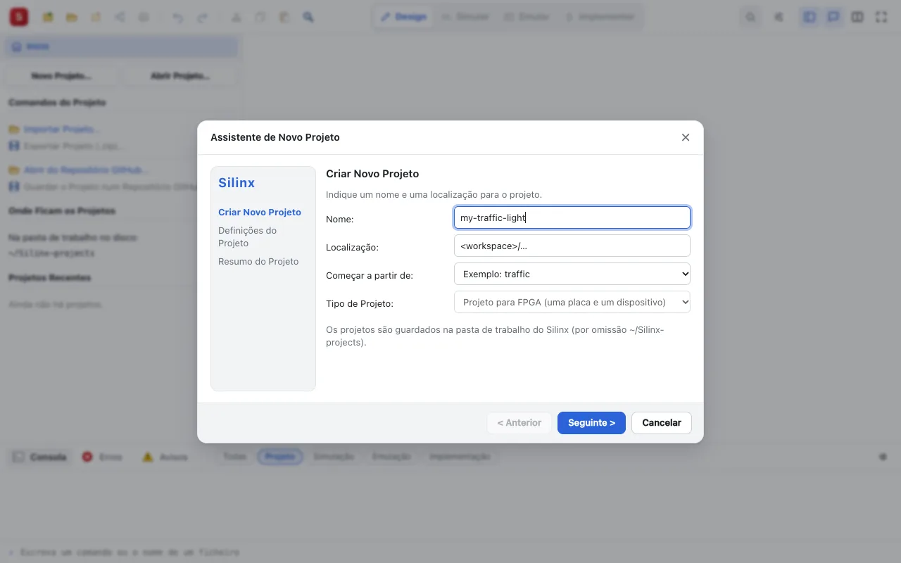

# Ensinar com o Silinx

[Guia do utilizador](README.md) · [English](../en/teaching.md) · Português

O Silinx foi feito para uma cadeira de sistemas digitais: os exemplos, os laboratórios, a avaliação e a partilha são
ferramentas do professor.

## Os exemplos

Cada exemplo é um projeto completo, com a sua bancada de teste, que se implementa e corre em todas as placas suportadas.
Vão das primeiras portas lógicas a um microprocessador:

| Exemplo | O que mostra |
|---|---|
| **gates** | portas lógicas desenhadas num esquemático: um primeiro projeto |
| **breadboard** | CIs 74LS ligados numa breadboard: um circuito digital |
| **traffic** | uma passadeira: um diagrama de estados, álgebra de Boole, VHDL e Verilog |
| **blinky** | VHDL e Verilog, um fluxograma ASM, o mostrador da placa |
| **pong** | um jogo para dois, em Verilog |
| **stopwatch** | VHDL, uma RAM de blocos e os multiplicadores |
| **clock** | um relógio acertado com os botões, em Verilog |
| **vga** | uma imagem num monitor VGA |
| **isqrt** | uma função em C transformada em hardware |
| **uart** | comunicação série com um terminal |
| **micro80** | um microprocessador a correr um programa de uma RAM de blocos |

*Novo Projeto…* começa a partir de qualquer um deles.

## Laboratórios guiados

*Projeto ▸ Laboratórios Guiados…* abre um tutorial passo a passo ao lado do projeto: cada passo diz o que fazer, e
*Verificar Passo* verifica-o no projeto (um ficheiro, os portos de um módulo, os avisos, os valores da simulação, um
pino…). O Silinx traz laboratórios sobre o gates, o traffic, o blinky e o stopwatch, em português e em inglês, e um
professor escreve novos (*Nova Fonte ▸ Laboratório Guiado*).

## Exercícios avaliados automaticamente

Os testes de um exercício simulam o projeto do aluno e dão a cada teste o seu veredicto e a sua pontuação, como o
Mooshak faz com os programas: na interface, na linha de comandos para uma turma inteira, ou como um trabalho do GitHub
Classroom. Veja [a avaliação automática](../en/grading.md) e [o GitHub Classroom](../en/classroom.md) (em inglês).

## Partilhar

- **Um projeto num link**, para os slides: *Partilhar Projeto…* faz um link que abre o Silinx no projeto, logo no
  Experimentar, na simulação ou no emulador da placa, o projeto inteiro dentro do link. Ou um código QR.
- **Ao vivo**: partilhe o projeto enquanto trabalha; a turma acompanha só a ver, ou edita consigo. A partir do sítio,
  quem o segue liga-se diretamente a si; [um retransmissor seu](live-relay.md), gratuito no Cloudflare, encontra-os e leva
  as mensagens de quem está numa rede que bloqueia o caminho direto.
- **Juntar Contribuição…** traz de volta para o projeto a cópia de um aluno ou de um grupo, um desenho juntado pelos
  seus objetos.
- **GitHub**: um projeto num repositório (commit, push, pull, ramos), também um trabalho do GitHub Classroom.

Em pormenor: [as funcionalidades](../en/features.md#guided-labs) (em inglês).
