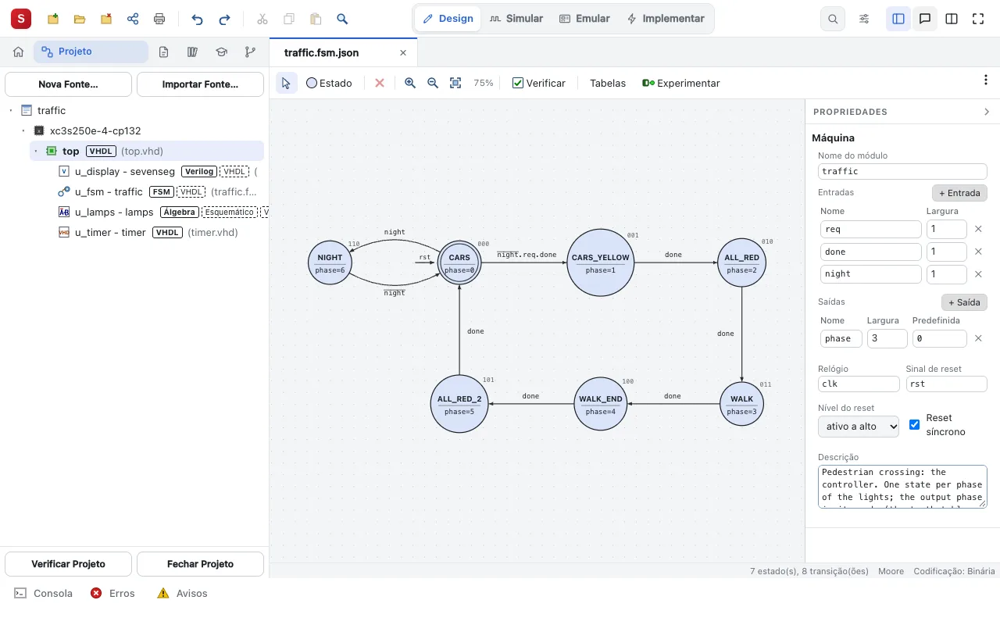
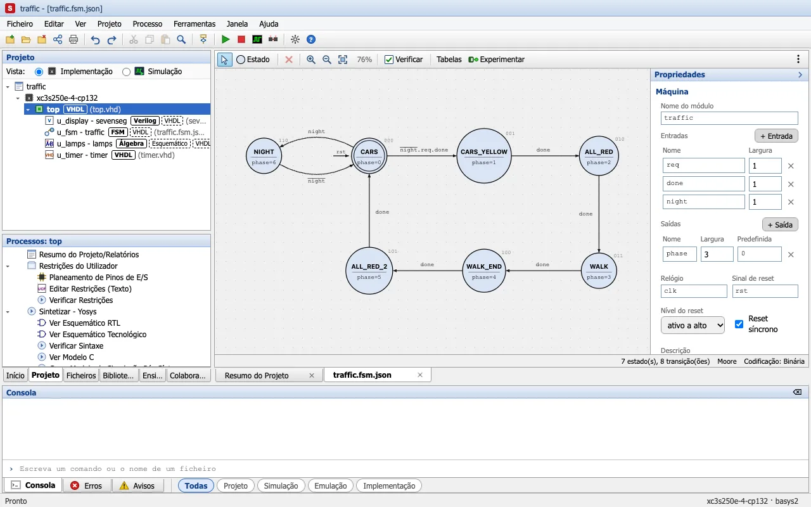

# O que é o Silinx

[Guia do utilizador](README.md) · [English](../en/what-is-silinx.md) · Português

O Silinx é um ambiente de projeto para FPGA feito para ensinar sistemas digitais. O aluno escreve VHDL ou Verilog, ou
desenha o projeto (um esquemático, um diagrama de estados, um fluxograma ASM, uma tabela de verdade, um circuito de
circuitos integrados reais numa breadboard), simula-o, experimenta-o numa placa emulada e implementa-o para uma placa
real, tudo no mesmo sítio, no browser.

Nasceu porque a ferramenta em que muitas cadeiras assentavam, o Xilinx ISE, foi descontinuada há muito. O Silinx
funciona como o Project Navigator do ISE, para que os materiais das aulas continuem a servir, e traz as suas próprias
ferramentas abertas, para que os alunos não precisem de instalar mais nada. Quem o começou e porquê:
[a história do Silinx](../../HISTORY.md) (em inglês).

## Para quem

- **Alunos**: abrem o site, começam a partir de um exemplo e chegam a uma placa a funcionar sem instalar nada. Os erros
  vêm com uma explicação e com a forma de os corrigir, em português e em inglês.
- **Professores**: laboratórios guiados, exercícios avaliados automaticamente, um projeto num link para os slides, um
  projeto partilhado ao vivo com a turma. Veja [Ensinar com o Silinx](teaching.md).
- **Quem quiser** aprender projeto digital numa placa FPGA.

## Duas interfaces

*Definições ▸ Interface* muda de uma para a outra, e os projetos são os mesmos nas duas.

| A interface Silinx (a predefinida) | A interface ao estilo do ISE |
|---|---|
|  |  |
| As tarefas (Projetar, Simular, Emular, Implementar) no cabeçalho, uma de cada vez. | Os menus, as barras de ferramentas e o painel de Processos do Project Navigator do ISE. |

As duas estão em português e em inglês: o Silinx escolhe a língua do browser, e *Definições ▸ Idioma* muda-a.

## Onde corre

- **No browser**, em https://pmnmalo.github.io/Silinx/: nada a instalar, os projetos guardados no browser (ou, no
  Chrome e no Edge, numa pasta do disco). Também num tablet.
- **Num só ficheiro**, o `Silinx.html`, para guardar e abrir sem Internet.
- **No seu computador**, com o Node.js: os projetos em pastas, o Xilinx ISE 14.7 e o AMD Vivado para as placas que as
  ferramentas do Silinx não suportam, e a placa programada com as ferramentas instaladas.

[Começar](getting-started.md) mostra cada uma das formas.

## O que não é

O Silinx não tem qualquer ligação à AMD/Xilinx, nem é aprovado ou suportado por ela. Xilinx, ISE, ISim, iMPACT,
Spartan e Virtex são marcas da AMD. O ISE e o Vivado, quando os usa, são instalados por si.

*Sobre o nome:* Silinx = **SI** + **linx**. SI de *Super Intelligence* (superinteligência): a ferramenta foi gerada
por uma IA. *linx* das ligações (links) programáveis de uma FPGA, a interligação que liga os seus blocos lógicos.
